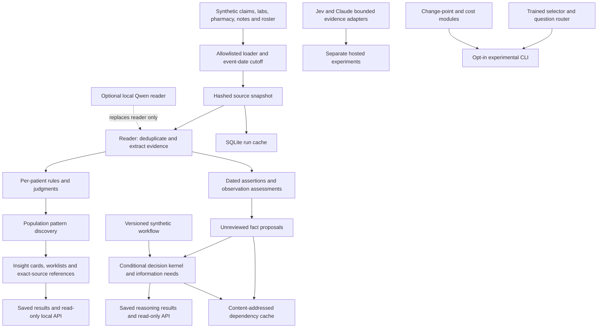

# Agere

**Healthcare intelligence that turns fragmented evidence into justified action.**

**Current implementation:** [the connected stack](AGERE_CONNECTED_STACK.md) now executes source versioning, evidence/observability, conditional reasoning, trained packet selection, offline provider-request preparation, population review cards and development-only learning preparation through one CLI. Open the [connected workspace](artifacts/agere-stack/index.html). Candidate models and research methods remain explicitly distinguished from active components.

**Research scope:** [the mathematical and cross-industry research program](research/agere/RESEARCH_PROGRAM.md) preserves the work on observation/state modeling, information theory, active sensing, process monitoring, causal/operations methods and tensor interactions. Pretrained-model selection is one enabling workstream, not the full Agere research agenda.

**Current model implementation priority:** [the comparative model review](research/agere/MODEL_SELECTION_REVIEW.md) selects BioClinical ModernBERT-base for the next evidence-training component and Perplexity Decider v1.1 for the next hosted comparison against Jev. Retrieval and document specialists have separate roles. These are build priorities, not newly installed models or clinical winners.

Working name and architecture review — October 8, 2026. This records the current personal-laptop project and its proposed direction. All local patient records and clinical experiments are synthetic. The working name is not a trademark-clearance claim.

**Latest build:** the [conditional reasoning implementation](research/agere/CONDITIONAL_REASONING_BUILD.md) adds bounded reasoning over unknown facts, minimum supporting fact sets, joint information needs, a dependency cache and an assumption-based information-value calculator. Open the [interactive reasoning lab](artifacts/agere-reasoning/lab.html). The new layer ran over 3,914 synthetic hardest-world assessments; all remain unresolved because inherited extraction labels are not promoted to reviewed clinical facts. A repeat run reused 7,828 operators without model calls. This is infrastructure progress, not demonstrated clinical improvement or newly trained weights.

The earlier [consolidated build record](AGERE_BUILD_PLAN.md) and [synthetic evidence product view](artifacts/agere/index.html) document the underlying evidence/observability layer. The [upstream evidence contract](research/agere/UPSTREAM_EVIDENCE_CONTRACT.md) describes how richer synthetic sources can connect without exposing hidden truth to inference.

**Foundation and learning update:** [Qwen is a comparison candidate, not Agere's mandatory foundation](research/agere/FOUNDATION_DECISION.md). The new model-independent review workflow prepares development-only cases, preserves reviewer corrections and exports reviewed labels. The first 60 cases await review; none are falsely labeled clinician-adjudicated. An [offline review screen](artifacts/agere-learning/review.html) is available.

## What we have accomplished

We now have a reproducible research environment, a working synthetic insight baseline, provider adapters and the first trained specialist components. We do not yet have a broadly capable, clinically validated healthcare foundation model or a production population-health platform.

| Work | What exists | Why it was added |
|---|---|---|
| Synthetic data foundation | 1,612 runnable source families, 13 worlds, 62,868 patient-world instances and 366,182 note-world instances | Learn and inspect failure modes without private patient data; repeated worlds are not independent people |
| Evidence-to-insight baseline | Existing chart reader, per-patient judge and population discovery, run across all worlds | Establish a functioning end-to-end reference before replacing parts |
| Auditable execution | Source hashes, dated snapshots, exact evidence references, local SQLite run reuse, question API | Make outputs reproducible and avoid repeating identical computation |
| Local reader experiment | Qwen3-4B through MLX with typed evidence output and rules | Explore an offline reader; its small holdout result did not justify replacing the baseline |
| Hosted readers | Jev and Claude adapters, bounded spending, response cache, experimental cascade | Compare specialized decisions with frontier interpretation behind one evidence contract |
| Question inventory | 140 runtime question specifications: 6 implemented, 6 partial, 128 unimplemented | Preserve real product requirements and return missing capabilities honestly |
| VBC research | 84 scoped source reviews, 105 CMS directory entries and 40 CMS overview pages | Identify useful questions, intervention evidence, policy/version pitfalls and measurement needs |
| Training work | Passage classifier fitted on 16,122 synthetic examples; lexical and semantic domain heads trained on 96 original research questions | Start teaching reusable evidence and planning skills |
| Mathematical/cost work | Experimental Gaussian change-point primitive, bounded evidence packets and token/cache accounting | Add useful computation without requiring generated prose |

Sources: [stack build record](STACK_BUILD_REPORT.md), [corpus manifest](artifacts/corpus/manifest.json), [VBC coverage](research/vbc-landscape/coverage_summary.json), [training record](TRAINING_BUILD_REPORT.md). The 96 research questions supplement the 140-question inventory; they are not 96 new executable handlers. Earlier reports saying “no training” describe their earlier runs; the later training record supersedes that statement for the project as a whole.

## How the stack actually runs today

The default full-world pipeline still uses the inherited lexicon/rules reader. The hosted providers and new experimental models are not an automatically deployed ensemble. The read-only API serves saved synthetic results and does not call paid providers. The change-point function is not yet connected to automatic renal-series extraction. The new assertion store preserves source and optional arrival dates, but lacks complete bitemporal correction semantics. There is no production patient identity service, complete healthcare ontology or CMS/commercial-contract rule compiler here. No Lumeris or TextQL assets are available on this laptop.

The optional Qwen experiment failed to improve a small frozen synthetic cohort: exact status matches were 26/47 versus 44/47 for the baseline, with 20 patient/subject pairs sent to review. This is why that reader did not become the default. [Local holdout record](artifacts/holdout/REPORT.md)

Our new evidence selector reached 71.41% weak-teacher relevance recall on reserved families in `hard16_llm`. In a 40-chart packet sample it reduced local token count by 69.25%, but retained 10/11 teacher spans. The semantic router achieved 37.50% top-1 and 65.63% top-3 accuracy in small developmental cross-validation. These results support further research, not automatic clinical acceptance. [Training record](TRAINING_BUILD_REPORT.md)

## What a model should learn

Agere should learn durable skills, while changing rules and patient facts remain versioned data.

| Skill | Example supervision | Intended output |
|---|---|---|
| Read evidence accurately | Patient versus relative, current versus historical, negated versus present | Typed assertion with exact source span |
| Reconcile medication state | Prescribed, filled, reportedly taken, discontinued, held, intolerant, outside supply | A dated state plus conflicts and unknowns |
| Recognize source limitations | Claims delay, missing pharmacy channel, outside lab, copied text | Evidence-completeness and source-quality assessment |
| Find decisive evidence | Supporting, excluding, contradictory and stale passages | Question-specific evidence view with recovery path |
| Interpret a healthcare question | Cohort, time horizon, denominator, measures, comparison and requested action | Typed executable-plan proposal |
| Read a new program | Authority, effective dates, eligibility clauses, exclusions and required inputs | Draft versioned rule, with unresolved ambiguities |
| Identify useful population findings | Site or subgroup pattern, artifact alternatives, magnitude and uncertainty | Supported finding or a labeled hypothesis |
| Recommend the next useful step | Additional data, clinical review, access support or operational change | Action rationale, owner and outcome to measure |
| Allocate compute | Quality/cost outcomes by task, model and evidence condition | Calibrated route or abstention |

Current training covers only weak passage relevance and research-domain routing. It does not yet train all these skills. The full plan-target curriculum is exported, but no generative planner was fine-tuned. The encoder is frozen MiniLM; the trainable part is its classification head. No MedGemma or Jev weights were trained.

Policy knowledge should be retrieved from authoritative, dated documents and translated into reviewed executable logic. Updating a CMS, Medicaid or commercial-plan measure should trigger affected-rule and cohort recomputation. It should not require teaching every model the new contract from scratch. Claims and payment arithmetic belong in code. Provider comparisons require case mix, selection and uncertainty; risk scores alone do not establish which intervention helps.

## Missing evidence is a first-class requirement

Design requirement added October 8, 2026. The first deterministic implementation now exists in `clinical_core/observation.py`: immutable assertions, separate source-coverage metadata, reconciliation states, information needs and per-patient assessment reuse. Known arrival dates are filtered in `inputs.py`; absent dates stay unknown. A trained observation model, full correction resolution and validated clinical gap identification remain proposed. Existing provider instructions also state that a missing claim is not proof of missing care and require an unknown option (`clinical_core/providers.py`). Prompt instructions alone do not implement an observation model.

Agere must distinguish what happened to the patient from what the available sources can establish. Missing data must not silently become a negative clinical fact. Represent two separate axes per question, concept and time window:

- **Care evidence:** documented completed care, documented noncompletion, documented exception or hold, conflicting evidence, or unresolved. Each assertion retains its source, event time and arrival time. A documented statement is evidence with a scope and date, not timeless ground truth.
- **Observability:** which sources were connected and searched, their expected scope, patient linkage, reporting delays, freshness, coverage window, inaccessible sources and known outages. Unknown coverage remains unknown. A populated chart is not necessarily complete for a particular question.

For example, an absent local test result could mean the test was not performed, was performed elsewhere, is pending, arrived as an unprocessed document, was linked incorrectly, or is outside the search window. An order proves an order, not completion. A note reporting outside completion supports reported completion; it does not supply an unseen result. Explicit noncompletion still needs eligibility, timing and exceptions checked before calling it a care gap.

Output a supported care opportunity, a data-reconciliation task, a documented exception, or an unresolved question as appropriate. Preserve the ability to recommend clinical review when available evidence warrants it even if records are incomplete. For each unresolved question identify the missing fact, why it matters, what sources were checked, and the next authorized source or clarification most likely to change the decision. Never invent an unseen result or imply access to an unconnected system.

Training must include matched synthetic examples of missing care, missing records, outside completion, delayed feeds, incomplete retrieval, appropriate holds and contradictory documentation. Source availability and time cutoffs are model inputs; hidden synthetic truth is supervision only. When identical observed inputs are compatible with different hidden realities, the correct target is uncertainty or information acquisition, not a forced hidden-state guess. Separate patient families across training and evaluation and test source outages and shifts in capture patterns. A source-completeness estimate is not a calibrated probability that care was missed.

At population level, surface missingness by source, site, concept and time alongside observed care gaps. A deteriorating data feed can create apparent deterioration in care. Keep formal measure denominators and unknown handling faithful to the applicable versioned specification; do not silently drop patients with incomplete records. Recompute affected judgments when new evidence or coverage information arrives.

Interoperability starting point: [FHIR data-absent-reason](https://fhir.hl7.org/fhir/valueset-data-absent-reason.html) distinguishes reasons for an absent value, including unknown, not asked and masked. It does not by itself establish chart completeness or explain a missing encounter; Agere needs the broader source-coverage representation described here.

## New model candidates from EdgeEvals

I opened the rendered [System One board](https://edgeevals.ai/system-one/?references=1), read its methodology, and checked primary model documentation. The board is a useful shortlist, not clinical validation: it uses authored cases with labels not yet reviewed by clinicians/coders. Its reported ranks, costs and thresholds do not establish performance on our longitudinal population tasks. The source cards, runtime caveats and selected board results are recorded in [the model review](research/agere/EDGE_MODELS.md).

My proposed first local comparison is **Kev 4B versus Mapika Decider 4B**, with **lev** as an additional candidate if its specialized readout is faithfully supported on our hardware. **Liquid d1-3B** adds a different architecture and multimodal capability. **JevK5** is a secondary candidate with useful version and out-of-scope caveats. For larger/hosted comparisons, consider **pplx-decider v1.1 27B**, **Cloudflare Clef/Clef-flash** and **OpenAI Decisions**, alongside existing Jev/Claude.

Do not install every contender or run every model on every patient. First pin the implementation, decision head, attention behavior, quantization and calibration. An ordinary chat loader can erase the very benefit being evaluated. A model advertised as serving long contexts may only have validated much shorter ones. The scored builds on EdgeEvals are not proven identical to today's model-card `main` versions.

Most of these systems reuse language-model representations. Their economy comes partly from scoring a bounded answer space without autoregressive prose. Input processing still costs compute. Multi-question APIs may duplicate the state internally, so shared-prefill savings must be measured rather than assumed. Agere must compete on correct useful results per total dollar, not just absence of output tokens.

## What could make Agere distinctive

The defensible research target is a joint system for **patient state, observation quality, decision relevance and the value of additional information**. Multi-model routing, LoRA and typed decisions already exist. Their presence alone is not an invention.

**Research hypothesis A: learn clinical state and how that state gets recorded together.** Distinguish patient deterioration from a new assay, a changed interface, more frequent testing or stale copied language. Preserve separate event and arrival time. Learn reliability by source/concept/context, with lineage so repeated copied statements are not independent votes. Such a model needs supervised anchors and identifiability checks; the “true patient state” cannot be recovered merely by naming a latent variable.

**Research hypothesis B: learn which evidence a decision cannot afford to lose.** Optimize retrieval against missed exceptions, incorrect subject/time, unsupported conclusions and compute cost. A note containing an appropriate hold can be more valuable than many positive disease mentions. Train hard counterfactual pairs with one answer-changing difference. Keep compressed evidence reversible and flag insufficient coverage.

**Research hypothesis C: learn the next most valuable computation or observation.** When uncertainty concerns an absent outside prescription, querying that source may outperform a stronger model on the same incomplete chart. Learn to select among retrieving more evidence, applying a deterministic rule, calling a specialist, escalating or requesting review. Compare expected improvement with cost and delay.

**Research hypothesis D: discover opportunities that survive alternative explanations.** Separate measurement changes from changes in care; use negative controls and replication; distinguish high risk from high expected intervention benefit. Rank findings using patient goals, feasible actions, uncertainty and the applicable contract. Provider financial opportunity must not be mistaken for patient benefit.

The [mathematical design](research/model-economics/MATHEMATICAL_DESIGN.md) defines candidate objectives. Established state-space methods, information bottlenecks, decision theory and tensor decompositions are building blocks. Their particular healthcare composition might support original work, but no novelty or superiority has yet been established. Quantum hardware has no demonstrated role in the current product.

## Economics by construction

The target is **lowest total cost per correct, supported, actionable result at a specified coverage and consequence level**. Count data processing, model inference, retries, hardware, storage, review and updates. A cheap answer that omits an appropriate hold has failed the objective.

1. Process changed source records, then recompute dependent assertions and judgments. The observation layer reuses per-patient assessments keyed to their evidence, coverage, cutoff and implementation. The new conditional reasoning layer has a content-addressed dependency graph that tracks source, policy and operator revisions. Recompute is explicit when called with updated inputs; baseline engine execution still uses whole-run caching and has not been migrated to this graph.
2. Extract reusable evidence once. Preserve dates and context; an assertion cache needs more than a sentence hash.
3. Use SQL/rules for joins, counts, dates, eligibility arithmetic and payment calculations. Use statistical models for time series and comparisons.
4. Use small trained readers for bounded interpretation. Escalate based on demonstrated error patterns and uncertainty, not an arbitrary confident-looking score.
5. Batch compatible tasks and reuse stable prefixes where the actual runtime permits it. Measure cold starts, concurrency and internal repeated-input work.
6. Use frontier reasoning for difficult synthesis, plan proposals and training assistance; validate consequential claims against evidence and executable results.
7. Keep corrections and failures as supervision. A repeated failure should improve the component, rather than cause perpetual expensive escalation.

For a simple cheap-then-frontier cascade, one accounting model is `C = C_data + C_cache + (1−h)(C_small + r C_frontier) + C_review + C_fixed`, where `h` is the valid cache-hit fraction and `r` the escalation fraction among misses. The terms must be measured consistently and must not double-count hardware. This is an accounting model, not a measured savings forecast. Confidence thresholds need task-specific calibration; the current cascade has no validated acceptance policy by default.

## The next coherent build

Build the evidence foundation and one healthcare skill end to end before adding broad model layers. Start with **HFrEF medication state and the reasons behind apparent gaps**, extending to kidney measurements and treatment tolerance. The output should separate supported opportunity, already-treated state, appropriate hold, access barrier, contradictory evidence and insufficient data, with exact references.

The first assertion/reconciliation record and patient-level cache are now implemented. Next add reviewed correction/supersession semantics and training targets; adapt one local decision model; compare it with the existing reader, Jev and a frontier-only approach using the same information cutoff. Preserve unknown states. Extend synthetic dose, renal trajectory and access fields where the existing generator lacks them. Then connect successful evidence skills to the program/rule compiler and population operators.

In parallel, keep a small, explicit research track for the joint observation-state model and decision-preserving selection objective. That is the path toward an Agere-specific model. Do not let an unvalidated exotic architecture replace a useful baseline simply because it is unusual.

An actionable insight should answer: **what is happening, which evidence supports it, what is uncertain, what could be done, why it could help, whether it is feasible, and how improvement would be measured.** Agere supplies that intelligence before care execution. Real-world effectiveness and commercial superiority remain future claims requiring appropriate evidence.

No additional models were installed, trained or called through paid APIs for this review or the subsequent observation-layer build. The new Agere HTML view is a local synthetic evidence-review artifact; it does not rebrand the existing CareSignal website or constitute a production release.
