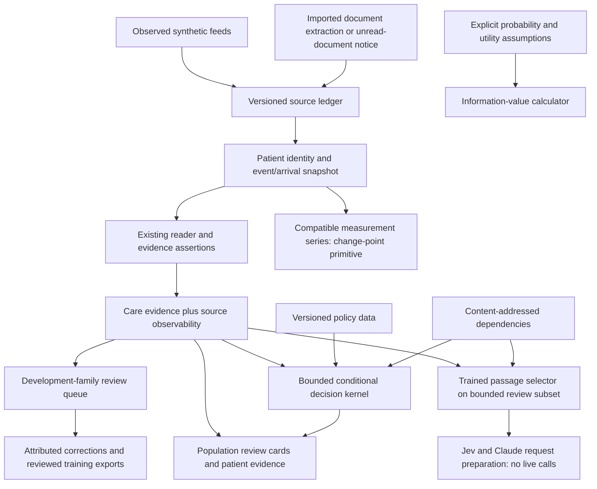

# Agere connected stack

Update: [local specialist execution](AGERE_LOCAL_MODELS.md) now adds installed
Granite retrieval, BGE reranking, frozen BioClinical representations and a trained
finite simulator patient/recording model. The original integration record below
remains a historical receipt; its model-installation status is superseded there.

October 8, 2026. This is the current integration record, superseding earlier descriptions of these modules as entirely separate experiments. All patient data and product examples are synthetic. No employer ontology or TextQL assets are present.

## What was built

One executable path now connects versioned source intake, the existing clinical reader, evidence/observability reconciliation, conditional reasoning, the trained passage selector, bounded provider-request preparation, population review cards and development-only learning tasks. The build does not install every candidate model or promote experimental mathematics to validated clinical algorithms.

Open the [connected evidence workspace](artifacts/agere-stack/index.html). It shows population cards alongside a filterable case list; each case exposes the original source identity, revision, exact quote offsets, dates, missing information, next operation and dependency identifiers. The read-only `/stack` endpoint serves the same saved JSON without inference.



## Execution and artifacts

Run from this repository:

```sh
.venv/bin/python -m clinical_core.stack \
  --world /Users/mikel/insight-engine/data/worlds/hard16_llm \
  --namespace hard16_llm \
  --database artifacts/agere-stack/verified-final.sqlite3 \
  --output artifacts/agere-stack/run.json \
  --report artifacts/agere-stack/index.html \
  --max-packets 24

.venv/bin/python -m clinical_core.service \
  --stack-run artifacts/agere-stack/run.json
```

`--max-packets 0` disables learned packet work. The command never sends provider requests, downloads models or invokes OCR. The existing trained selector runs locally; its tokenizer count is not a vendor billing estimate. The packet limit is an engineering work budget, not a learned optimal allocation policy. Selection currently follows a deterministic review order and can miss useful evidence.

`--question-id HF-01` invokes an existing registered handler. `--question '...'` invokes the existing trained research-domain proposal router, without executing arbitrary generated plans. Unsupported registered questions keep their explicit missing-capability response.

`--policy` accepts an effective-dated synthetic Boolean workflow using the existing fact contract. It is not a compiler for CMS/payer PDFs and must not be described as a validated guideline. `--information-assumptions` connects the existing information-value calculator using caller-declared assumptions; it does not automatically learn priors or issue acquisitions.

Execution receipts are [cold](artifacts/agere-stack/hard16-cold.json), [warm/current](artifacts/agere-stack/run.json), and [development](artifacts/agere-stack/development.json). The [verification receipt](artifacts/agere-stack/verification.json) summarizes the measured checks and links to those inputs. Counts describe software outputs, not accuracy or clinical benefit.

## Source contract and correction semantics

`clinical_core/source_ledger.py` accepts synthetic envelopes with namespace, source system, source kind, record ID/version, exact patient ID, event date, available date and an allowlisted payload. Every revision is immutable. Changing a record requires a new revision. A source ID cannot silently move to another patient. Unlinked records and ambiguous versions are quarantined and reported.

For a cutoff, choose the latest unambiguous arrived revision, then apply event time. A correction that moves an event beyond the cutoff removes the previously visible event. Two conflicting revisions with the same availability date are unresolved. An undated correction is not arbitrarily ordered after a dated one. No fuzzy cross-system patient linkage is implemented.

The legacy world adapter still projects to its requested cutoff before handing records to this ledger. The ledger cannot retain records that upstream projection already removed. For future connectors, ingest full observed version envelopes directly and let the ledger create snapshots. Legacy records without stable source IDs use content identities; they cannot support inferred correction chains.

Snapshot mode includes records with unknown arrival dates and reports that limitation. `--strict-arrival` excludes clinical records whose arrival time is unknown. An undated roster remains cohort context. Neither mode invents coverage from empty arrays. Chronological ordering is preserved before the inherited copy-forward reader, so a later copy cannot refresh an old statement.

Document payloads distinguish `pending`, `failed` and `ready`. Ready imports require a document hash, extractor revision and numbered literal-text pages. The envelope availability date describes when this particular extraction revision became usable, not merely when the original document existed. Page IDs and exact text offsets survive into clinical assertions. Native OCR execution, word boxes and confidence calibration are not implemented by this importer.

The [document fixture](examples/agere-stack/README.md) demonstrates the interface. [Before extraction](artifacts/agere-stack/documents-pending.html), the next operation is to resolve document processing. [After importing text](artifacts/agere-stack/documents-ready.html), reported outside treatment and an earlier hold require timeline reconciliation. This is literal synthetic fixture text, not output from a tested OCR model.

## How the research fits together

| Workstream discussed | Current connection | Remaining learning or implementation |
|---|---|---|
| Dirty structured data and narrative evidence | Source projection, immutable versions, exact references, baseline reader | Broader terminology/unit normalization, identity resolution and real feed connectors |
| Missing care versus missing records | Separate observability, outside-care evidence, unread-document and source-conflict routes | Train joint patient-state/source-observation model with identifiable supervision |
| Small models and classifiers | Existing trained passage selector; optional research question router | BioClinical ModernBERT evidence relations and temporal/subject heads |
| Jev, Perplexity, Lev and frontier models | Existing Jev/Claude request contracts prepared from selected evidence | Add faithful Decider/Lev adapters and compare calibrated decisions on matched evidence |
| Chandra, Interfaze, MedGemma | Replaceable document-extraction envelope | Actual runtime/license selection and clinical document extraction validation |
| Retrieval, reranking and compression | Trained selector, protected spans, token bounds, recoverable source references | Granite/BGE/Qwen comparisons and decision-preserving selection training |
| Astronomy and signal inference | Lab-series adapter calls existing Gaussian change-point primitive only when metadata suffices | Joint state/observation dynamics; clinical prospective trajectory validation |
| Information theory and formal reasoning | Conditional fact certificates and explicit unknown states | Learned evidence representations preserving consequential exceptions |
| Active sensing/control theory | Information-needs queue; optional assumption-based EVSI | Learn observation reliability and acquisition value from outcomes |
| Database/SRE ideas and economics | Source revisions, namespace scope, operator dependencies, cold/warm receipts | Distributed ingestion, patient-scoped baseline recomputation, workload cost calibration |
| Industrial process monitoring | Source processing failures are explicit | Cohort/feed monitoring with validated denominators, CUSUM and drift controls |
| VBC/company/health-system research | Existing question registry and original research curriculum remain connected | Executable causal, contract, outcome and capacity operators for the remaining questions |
| Porter/patient value and intervention effects | Preserved as distinct question/learning domains | Patient goals, longitudinal outcomes, defensible effect estimation and constrained interventions |
| CMS/commercial/Medicaid rule changes | Versioned effective-dated rule data and dependent decision recomputation | Authoritative clause extraction, review and general rule compiler |
| Quantum-inspired tensors and algorithm search | Preserved in research plan; not a runtime dependency | Compare bounded-rank interactions and policy search with simpler methods |

This composition is an engineering/research hypothesis. It does not establish a new mathematical theorem, patentable novelty, superiority to competitors or improved patient outcomes. Combining specialists is established prior art. Agere's proposed contribution is learning how patient state, source visibility, decisive evidence and acquisition choices interact in healthcare.

The detailed prior-art record remains [the research program](research/agere/RESEARCH_PROGRAM.md), [mathematical design](research/model-economics/MATHEMATICAL_DESIGN.md), [VBC synthesis](research/vbc-landscape/RESEARCH_REPORT.md), [engineering review](ENGINEERING_RESEARCH.md) and [model comparison](research/agere/MODEL_SELECTION_REVIEW.md).

## Interfaze and document-model decision

Interfaze is useful architectural precedent. Its Lite release combines a reasoning core and specialists, including Chandra, while its paper describes fused specialist representations. The public Lite code implements tool orchestration; do not assume that downloading it reproduces the fused paper architecture. The bundle retains upstream component licenses. Adopt selective activation and preservation of source metadata, while keeping providers replaceable. Sources: [model card](https://huggingface.co/interfaze-ai/interfaze-1-lite), [code](https://huggingface.co/interfaze-ai/interfaze-1-lite/blob/main/agent.py), [license](https://huggingface.co/interfaze-ai/interfaze-1-lite/blob/main/LICENSE), [paper](https://arxiv.org/html/2602.04101v2).

No vendor model was newly installed by this build. BioClinical ModernBERT remains the next evidence-training candidate, Perplexity Decider a bounded-decision challenger, and Lev a local comparison candidate. Qwen is neither the mandatory foundation nor rejected as a family. The existing local Qwen reader remains a separate experiment.

## Training is connected, not falsely completed

`--prepare-learning <database>` bridges the actual integrated development snapshot into the existing model-independent review workflow. Only `dev`/`hard_dev` and non-test source families may seed the queue. It records machine suggestions with raw observed evidence and source mappings; it does not promote them to ground truth.

The current development run registers review tasks. Pending tasks are not reviewed training targets; no new clinical encoder or joint observation model was fitted in this build. Earlier weakly supervised selector training remains real and is now exercised by the integrated runner. Zero new reviewed labels must not be disguised by retraining on the baseline's own answers and reporting agreement as improved clinical correctness.

The [current training review](artifacts/agere-stack/training-review.html) contains 60 tasks from the latest development snapshot. The database also preserves an earlier task revision set; those are not additional independent patients or new question scenarios. The [export manifest](artifacts/agere-stack/reviewed-export/manifest.json) correctly reports no reviewed training rows. Reviews downloaded from the page can be imported into `artifacts/agere-stack/development-reviews.sqlite3` using the existing `clinical_core.learning import-reviews` command.

## Next development milestones

1. Connect richer source events and observation metadata from the separate synthetic-world work through these contracts. Preserve source-family splits and keep hidden simulator state outside inference.
2. Train a compact evidence specialist on source-supported targets for subject, time, negation, medication state and exceptions. Compare a simple head with encoder adaptation; preserve uncertainty and reviewed-label provenance.
3. Fit the patient/source observation prototype alongside simpler missingness-aware baselines. Explicitly represent observationally indistinguishable states.
4. Compare selected document and decision specialists, including actual billed usage and review burden. Promote only demonstrated task-specific improvements.
5. Build real policy/cohort/outcome operators and statistically disciplined discovery. Add causal and capacity-aware recommendations when their required data and assumptions are available.

## Practical limits

The current Boolean clinical workflow remains unresolved when eligibility/current treatment/appropriate exceptions are unreviewed. Evidence-review cards are nevertheless usable for inspecting and resolving those premises. Imported document text is unverified extraction. Existing claims are not proof of ingestion or optimized therapy. The baseline still reruns on a changed population snapshot, although evidence assessments and the new DAG reuse unaffected work.

This is a measured local batch stack, not a billion-record distributed system. SQLite scope strings are not authorization. Throughput beyond the supplied synthetic worlds, cost per correct clinical decision, clinical calibration and real-world outcomes remain unmeasured. The shared workspace and original world generators were preserved; no patient data was uploaded and no paid model calls were made.
