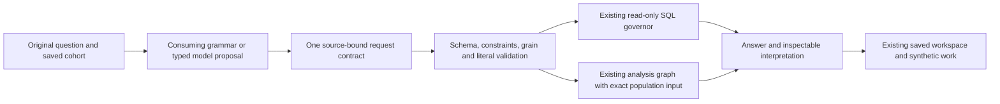

# Shared planner delivery and remaining language blocker

The shared request/compiler path is implemented and deployed. The general synthetic MVP is still incomplete: the installed Qwen interpreter fails some ordinary unfamiliar phrasing, and neither model/clinical qualification nor every promised analytical workflow is established. This delivery removes competing default answer authorities; it does not prove universal understanding or preservation of every natural-language intent.

## Delivered architecture

Stack.compose, economical_planner.plan and together.compose_together now enter the same planner. Historical implementations remain explicitly named legacy functions for inspection; they are not default dispatch paths. The therapy shortcut, exact-question recipes, narrow model rewrites, paraphrase cache and parallel SQL analysts cannot silently replace an active question.

The request is a typed relational program with original text bindings, source identity and a content hash. Boolean predicates, exclusions, existence tests, entity-key relationships, dates, projections, aggregates, ratios, grouping, aggregate thresholds, ordering and limits compile into read-only SQL. One-to-many filters use EXISTS so duplicate records do not inflate counts. Explicit dimension joins require unique target keys. Group limits and aggregate filters constrain the contributing patient set, not just the displayed rows. SQL null predicates retain separately reported unresolved membership.

The catalog is discovered from the received snapshot: currently 58 semantic tables, 872 columns and 237 source-stream field catalogs. Raw payload fields require an explicit received stream. These counts establish discoverability, not semantic qualification of every field. A new table/column can be queried without adding a complete-question handler. The grammar composes reusable vocabulary; unfamiliar language uses a typed model proposal under the same compiler. Literal coverage and comparator checks catch omissions and some meaning changes, but cannot prove arbitrary semantic equivalence.

Existing analytical engines can consume the same compiled cohort through the new query_population graph input. Their own parameter/availability validators remain authoritative. This is not qualification of every engine or support for arbitrary new causal/predictive methods. The actual aggregate-engine connection was exercised on the active warehouse, with identical input membership and patient count.

Follow-ups retain saved membership and evidence. New standalone questions in the same conversation are no longer rewritten through a prior frame. Existing exact list/count/group transforms remain bounded transformations over the saved set. More general supported cohort edits use the shared compiler with the saved IDs bound as JSON. Failed interpretations do not replace the last usable answer. The public UI shows the interpretation and executable computation and opens the exact saved cohort in the existing synthetic action workspace.

Only exact-question, exact-source, exact-code, exact-context request contracts can be reused. Cached requests are recompiled. An unqualified model proposal remains partial and cannot create program work. Medication mention predicates explicitly remain partial when the question asks about current treatment; current use/maximal tolerated dose is not inferred from a mention. Age_latest is explicitly labeled as latest snapshot age, not historical age at each event.

## Evidence and observed failures

78 focused tests pass, including 21 independent shared-planner tests. Cases include new cross-domain combinations, a newly introduced source table, raw source fields, duplicate evidence, nulls, polarity/boolean scope, thresholds and time changes, exact saved cohorts, group thresholds/limits, ratios, named claim relationships, request tampering, engine contracts and the real conversation handler. Existing VBC empty-slice warnings remain.

The actual API answered financial/denial, age-filtered utilization, immunization-source and aggregate questions with zero hosted calls. The saved diabetes observation cohort contained 230 patients, narrowed to 114 by the stated latest-age predicate, and grouping retained exactly those 114. A subsequent complete claim question was independent; contextless “Group them by PCP” was refused. These are execution and membership checks, not independent clinical adjudication of those active-warehouse counts. The old 671-patient diabetes result used different prior logic and is not a reference answer.

Live verification caught a missing conversation-resolution reason field; it was fixed and covered by an end-to-end conversation regression. Starter-question checking caught a field-label parsing defect where “length of stay” split at “of”; field/source resolution now uses the catalog together. The earlier failed live result is retained. Browser inspection showed the compiled constraints, zero-call answer and action workspace with the exact 50 contributing patients for the inspected grouped ED query.

Actual local Qwen diagnostics found invented fields/quotes, changed thresholds and incorrect grouping representations. The compiler refused those plans. A generic wire normalization repair only supplies optional empty fields, qualifies received field identifiers and restores exact quote casing; it never changes predicates. After that repair, a simple unfamiliar sex breakdown produced the independently expected fixture counts (3 female, 2 male), labeled partial. The more complex financial wording and PCP/diabetes wording still failed. These adaptive development checks are not a benchmark or model qualification.

Evidence: artifacts/agere-shared-planner-v1/tests.log, live-api.json, live-api-before-conversation-fix.json, final-live-check.json, actual-graph.json, local-model-attempts.json, local-language-smoke.json and implementation-receipt.json. No paid API calls, benchmark runs, rescoring, external contacts, real care or publication occurred.

## Runtime and next decision

Deployed source: c706f5fd0bb99f87bc7a72a2c675bbbb548c8be5 in /Users/mikel/agere-mvp-run on :8885, PID 32585, exec session 84932. Hosted calls remain disabled. The existing v2.8 configuration overlay, data/model links and all saved work remain preserved. Configuration portability remains open. The previous runtime b411b7d is a recovery reference with the same shared engine before the final starter-label correction; the pre-change 8eb7306 implementation has known correctness limitations and is not an accuracy-qualified rollback.

The configured frontier interpreter is wired to propose the same request contract, with bounded attempts, the existing provider ledger and per-request known API usage. It has not been called or validated. Mike's earlier no-additional-spending statement is being honored conservatively. An explicit question asking whether a bounded frontier validation is allowed is pending; silence is not authorization. Do not turn hosted calls on until that is resolved.

G3 remains active, G5 blocked, full acceptance false. Next: qualify a capable general language interpreter against independent unseen compositions and constraint mutations, including original clinical/temporal requirements and registered-engine selection. Then assess the remaining source reconciliation, complete prospective economics and broad workflow acceptance. No new disease-specific shortcut or one-question route should substitute for that work. Preserve the entire ten-area charter and the restriction on unvalidated benchmark runs.
