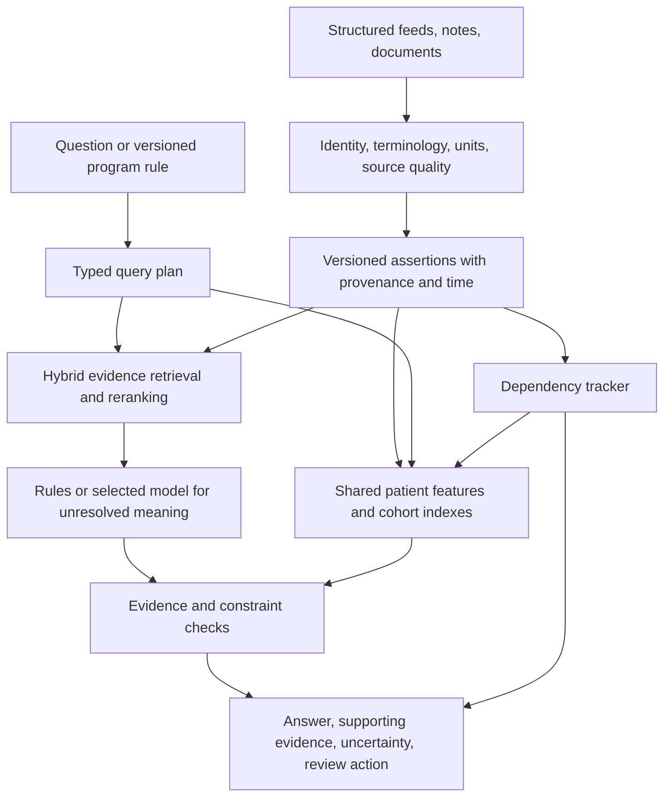

# Engineering beyond models for healthcare intelligence

Research and proposed architecture — October 8, 2026.

The recommendation is to build a reusable clinical evidence and query engine around the existing model adapters. Extract dated, source-linked assertions; compute shared features; compile questions into executable operations; and spend inference only where unresolved interpretation can change the answer. Proposed components below are not implemented or clinically validated by this document. All local patient examples and evaluations are synthetic. Employer ontology and TextQL infrastructure are unavailable here.

**What the current code establishes**

`clinical_core/runtime.py` persists source snapshots and whole-run results in SQLite. The run key includes the source snapshot, cutoff, reader, engine and a hash of all Python modules in `clinical_core`. This supports exact replay, but broad code or snapshot changes invalidate the whole run. `clinical_core/providers.py` additionally caches exact provider request bodies. It exposes bounded Jev and Claude evidence tasks, with output checks, explicit budgets and uncertain/review states. These adapters are separate from the default full-world baseline. None of these establishes a fine-grained, continuously updated evidence store.

`STACK_BUILD_REPORT.md` records 140 question specifications: six implemented, six partial and 128 not implemented. Adding retrieval does not automatically implement those questions. Longitudinal dose/tolerance, real eligibility logic and causal/provider comparisons require additional data and evaluation targets.

**A concrete architecture**

Every output should carry the source snapshot, clinical effective time, knowledge cutoff, ontology/rule/model versions, and its supporting and conflicting assertions. A model's interpretation remains an assertion with an acceptance status, rather than silently replacing the source.

**1. Resolve identity and meaning before drawing conclusions**

Use reliable identifiers first, then probabilistic linkage to propose uncertain matches across patients, clinicians and facilities. Splink implements Fellegi–Sunter record linkage and supports DuckDB; its general data-linkage capability is relevant, but its published examples do not validate patient matching in our system. Preserve uncertain links rather than merging them automatically. Our clean synthetic identifiers will need deliberately corrupted linkage cases to test this layer. [Splink](https://github.com/moj-analytical-services/splink).

Map codes, synonyms and local field names into typed concepts. Keep `prescribed`, `dispensed`, `reported_taking`, `held` and `discontinued` as distinct assertions. Similarly, a billed diagnosis is a different observation from an assessment in a signed note. Source type alone should not determine which is true.

Clinical NLP can provide cheap section detection and assertion context before escalation. medspaCy supplies matching, ConText and section-processing components. Preserve original text and offsets through preprocessing. Its rules need testing on our negation, family-history, temporality and copy-forward cases. [medspaCy](https://github.com/medspacy/medspacy).

An interesting research candidate is cwyde, which adds richer assertion categories and modifier composition over medspaCy, including an investigation/indication category. This is an idea to evaluate; the inspected repository is not evidence of clinical readiness. [cwyde](https://github.com/chapmanbe/cwyde).

**2. Give the ontology an executable mapping layer**

Use the ontology to define what concepts mean, how tables and assertions map to them, and which relations can be traversed for a particular question. Precompute frequently used concept ancestry and value sets. Retrieve a relevant ontology subset for each task instead of putting the entire ontology in a model prompt.

Ontop demonstrates a virtual knowledge graph: mappings expose relational data through a graph interface and translate SPARQL to SQL without copying everything into another database. It supports a defined lightweight ontology profile, not arbitrary logical reasoning. We can borrow this architecture while starting with ordinary relational tables and explicit mappings. It offers a possible future integration boundary for an existing ontology; compatibility with employer infrastructure has not been established. [Ontop](https://ontop-vkg.org/guide/).

**3. Retrieve candidates broadly, then rerank narrowly**

Combine terminology/code lookup, lexical search and dense retrieval. Fuse candidate rankings, then let a cross-encoder judge the relevance of a small candidate set. The official Sentence Transformers documentation describes this retrieve-and-rerank pattern. Relevance scores are not probabilities that an assertion is clinically true. Measure candidate recall before tuning ranking. [Sentence Transformers](https://www.sbert.net/examples/sentence_transformer/applications/retrieve_rerank/README.html).

Candidate selection should explicitly preserve contradictory evidence, recent changes, outside-source evidence and different source types. Repeated copied sentences should not crowd out a single relevant statement. Never use a claims-only prefilter for a question whose purpose includes detecting under-coded disease.

ColBERT is an alternative worth benchmarking if fine-grained matching becomes a bottleneck: it precomputes token-level passage representations and uses late interaction at query time. This trades richer retrieval against index size and indexing work. The repository describes GPU requirements for training/indexing, so it is a later challenger rather than a required laptop dependency. [ColBERT](https://github.com/stanford-futuredata/ColBERT).

**4. Treat time and corrections as first-class data**

Store when an assertion applies and when the system learned it. A late claim can change today's reconstruction of last month without being available to a decision made last month. XTDB's valid-time/system-time model is a useful reference; adopting the data model does not require adopting that database. [XTDB time model](https://docs.xtdb.com/about/time-in-xtdb.html).

Use event reducers or explicit state machines for starts, holds, restarts, corrections and reversals. Preserve conflicts rather than choosing the newest document indiscriminately. A copied sentence in a new note does not establish a new clinical event. An omitted medication is not automatically a discontinuation. Unknown and conflicting states must survive SQL joins and cohort logic.

Our present runtime explicitly says arrival-time completeness is not represented. Extending the generator with event and arrival timestamps is necessary before claiming to test late-data correctness.

**5. Compile questions and share their work**

Translate a question into a typed intermediate plan: population, concepts, time windows, required evidence, exclusions, aggregation, uncertainty behavior and output. Validate that plan against available data and supported operators. Reuse reviewed plans for paraphrases.

Execute exact joins, counts, comparisons and set operations in SQL/code. A planner can choose among cached evidence, rules, a specialist and frontier inference for unresolved text. Cache common subexpressions across questions: medication exposure, laboratory trajectories, evidence coverage and contract attribution can serve many downstream analyses.

LOTUS supplies relevant research and software for optimizing semantic map/filter/join-style operations through batching, cascades and planning. Its general results do not establish healthcare accuracy or savings for our workload. [LOTUS](https://github.com/lotus-data/lotus).

For program changes, ingest authoritative source versions and produce rule diffs, affected dependencies and regression cases. Use existing computable artifacts where available; otherwise have a model draft a rule for review before activation. HL7 CQL provides clinical logic and a machine-readable Expression Logical Model. Commercial contract formulas may require other explicit operators. [CQL](https://cql.hl7.org/).

**6. Cache work at the level where it changes**

| Cache | What is reused | Required dependencies |
|---|---|---|
| Parsing and indexing | Sections, OCR/layout, tokenization and embeddings | Document bytes, parser/model version, preprocessing |
| Assertions | A bounded interpretation with exact source spans | Text plus relevant context, subject, dates, ontology, extractor and acceptance policy |
| Patient features | Interpreted exposure, trajectories, coverage | All relevant facts, window, transformation version |
| Query plans | Reviewed question structure | Meaning, schema, rule/ontology version and scope |
| Cohorts and aggregates | Shared intermediate and final results | Membership inputs, feature versions, cutoff and rule version |
| Model computation | Exact responses; compatible prompt-prefix state where supported | Full request/model configuration and authorization scope |

Build a dependency graph so a corrected lab value recomputes every affected feature and answer, including medication and program questions that depend on it. Clock-driven window expiry must also trigger updates, even if no new record arrives. New supporting evidence must invalidate cached negative/unknown findings. Rule changes should recompute affected cohorts without rereading unchanged documents.

This borrows incremental view maintenance from databases: Materialize describes continuously updating query results as source changes arrive. Our laptop prototype can implement a small dependency queue over SQLite before choosing streaming infrastructure. [Materialize](https://materialize.com/docs/fundamentals/).

Do not reuse final patient answers merely because prompts are semantically similar. Approximate matching is useful for finding a plan or candidates; accepted clinical results need exact dependencies and access scope. Assertion caching also cannot be keyed by sentence text alone when patient, surrounding context or timing differs.

At dedicated inference-server scale, prefix/KV caching can avoid repeated prompt processing. It does not eliminate output generation, and benefits depend on shared prefixes. Start by measuring workload repetition; do not assume a GPU server is cheaper than selective API use. [vLLM prefix caching](https://docs.vllm.ai/en/latest/features/automatic_prefix_caching/).

**7. Validate structure, uncertainty and source coverage**

Add checks for units, data types, date consistency, required evidence, relation types and contradictory assertions. SHACL is a standard for validating RDF graphs against explicit conditions; equivalent typed checks can run over the initial relational implementation. Constraint satisfaction establishes consistency with rules, not clinical truth. [SHACL](https://www.w3.org/TR/shacl/).

Monitor source arrival delay, missingness, field distributions, code changes and note-template changes. Feed these into answerability. An absent pharmacy feed should produce a coverage limitation rather than a confident medication gap. Separate lack of evidence from negative evidence. Multiple copies of the same note should retain common lineage and never count as independent corroboration.

Calibrate acceptance per task and subgroup on reserved calibration data; measure precision against the fraction of cases accepted. Audit some apparently confident answers too. Provider outages, extraction failures and clinical uncertainty are different operational states.

**8. Discover patterns with statistics and event analysis**

Repurpose process mining to look for recurring event sequences before admissions or readmissions, then assess whether the pattern persists after accounting for case mix and observation coverage. PM4Py is an implementation reference. Its open-source version uses AGPL and has a separate closed-source commercial offering; package selection remains open. Patterns are hypotheses, not causal explanations. [PM4Py](https://github.com/process-intelligence-solutions/pm4py).

Change-point detection can identify changes in measurements or data feeds. `ruptures` provides offline change-point algorithms. For clinical trajectories, irregular sampling, measurement error, units and missingness require explicit handling and clinical evaluation. A detected numerical change is not by itself an indication for treatment. [ruptures](https://centre-borelli.github.io/ruptures-docs/).

Provider/SNF comparisons need uncertainty and case-mix adjustment, with partial pooling for sparse groups. Intervention prioritization eventually requires estimating who benefits, not only who is high risk. EconML is relevant for heterogeneous treatment-effect estimation, but its methods rely on causal assumptions and suitable data. Our synthetic benchmark cannot establish real treatment effects. [EconML](https://www.pywhy.org/EconML/spec/motivation.html).

**Further research bets**

- Next-best-evidence selection: identify the unresolved fact most likely to change a conclusion, then choose the least costly available way to resolve it. Sometimes the useful next step is a missing outside record rather than more inference over the same text. This is a value-of-information design hypothesis that needs calibration and cost measurements.
- Dependency explanations: show why a patient was included, which exclusions were checked, and which evidence changes would alter membership. These are computational dependencies, not claims that changing a variable causes better health.
- Weak supervision and selective review: combine imperfect rules and reviewed labels to expand specialist training data, preserving abstentions and label provenance. Snorkel is an implementation reference. Rule agreement and frontier-generated labels are not independent ground truth. [Snorkel](https://github.com/snorkel-team/snorkel).
- Metamorphic evaluation: reorder notes, add irrelevant text or duplicate copied evidence and require stable outputs; then alter negation, timing or a genuine source correction and check the intended change. Add adversarial examples for expensive false positives and quiet false negatives.
- Joint workload optimization: ask all approved questions against shared evidence, then report the marginal cost of adding another question. Measure initial indexing, ongoing updates, storage, review and serving separately.

**What Frontier Labs contributes**

The inspected site describes a data-science/design consultancy, decision-support projects, rapid pilots and a Bayesian/MCMC experimentation engagement. Those are relevant design and experimentation ideas. The page does not provide an inspectable healthcare architecture, model library or technical benchmark supporting a specific stack choice. [Frontier Labs](https://frontierlabs.co.uk/).

**Build order and evidence required**

1. Implement the versioned assertion/event schema and dependency-aware feature cache, using the existing local database. Extend synthetic fixtures with arrival times, revisions, reversals and context-sensitive copied text. Require incremental results to match clean full recomputation after every perturbation.
2. Add lexical/ontology retrieval and a reranker challenger. Compare against the current reader on buried evidence, contradictions, decoys and unfamiliar phrasing. Measure evidence recall separately from final decision accuracy, and include indexing/storage costs.
3. Implement a typed query plan and a reviewed clinical slice with shared features. Distinguish unsupported data from an empty answer. Add program-version changes and membership explanations.
4. Evaluate the selective router, active review and specialist training only after these layers have stable evidence contracts. Preserve family/world holdouts; prior inspected test worlds must not be presented as new untouched tests. Add new worlds and clinician-adjudicated targets for new tasks.
5. Explore process discovery and causal prioritization after the synthetic data actually represents the relevant longitudinal events and outcomes. Dedicated distributed inference/storage is a later capacity decision.

Evaluate each addition as an ablation: baseline; plus retrieval; plus temporal evidence; plus incremental caching; plus selective models. Report decision errors, abstention/coverage, supporting-evidence correctness, update freshness, latency, memory, model calls and total cost at comparable quality. Include human review, hardware, indexing and maintenance. Retain a component only if its measured contribution justifies its complexity. No numerical savings or superiority claim follows from this research alone.
