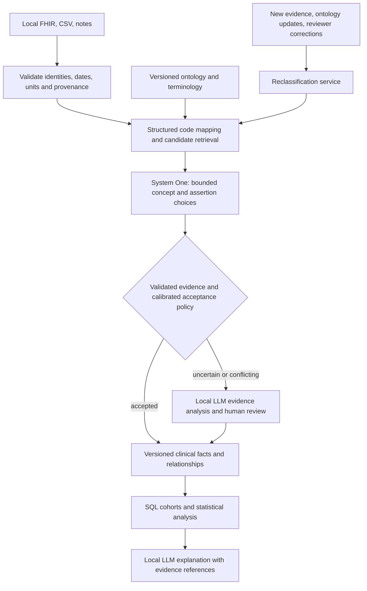

> **Start here:** [Current build](artifacts/agere-population-stack-v3/README.md), [engineering handoff](AGERE_CURRENT_HANDOFF.md), and [product direction](AGERE_PRODUCT_DIRECTION.md). The live workbench at http://127.0.0.1:8885/stack connects complete structured/text populations, retrieval and reranking, trained local research predictors, source-change mathematics, Jev/Perplexity reviews and frontier planning. All patient data are synthetic; the complete proposed product remains unfinished.

**October 9 local decision build:** [Kev MLX and native d1 adapters](LOCAL_DECISION_BUILD.md)
are installed and ran the [same bounded classification experiment](artifacts/agere-local-decisions-v1/REPORT.md).
Neither met the frozen acceptance gate or replaced the default reader. This is a
new matched run, separate from the historical chart-to-JSON experiment.

# Local clinical insights: baseline and build plan

Latest increment: [longitudinal evidence](LONGITUDINAL_BUILD.md) connects temporal
population queries and episode context to the live question interface. The completed
[research intake](AGERE_RESEARCH_INTAKE_2026-10-09.md) maps the other chat's findings
into the existing build backlog, with population-health/VBC/OAP core priorities.

Working product name: **Agere**. See [the current architecture and training strategy](AGERE.md)
and [the EdgeEvals model review](research/agere/EDGE_MODELS.md) for the October 8 synthesis.

Created October 6, 2026. Synthetic research demonstration, not a clinical decision system.

## Local specialist stack — October 8 execution

Granite retrieval, BGE reranking and frozen BioClinical representations now execute
locally alongside a simulator-trained joint patient/recording model. See the
[build record and commands](AGERE_LOCAL_MODELS.md), the
[patient evidence report](artifacts/agere-neural/hard16-cold-v2/index.html), and the
[verified cold/warm receipt](artifacts/agere-neural/verification.json).
The neural branch is bounded to the reported cases; clinical conclusions remain
conditional. The [reviewed-label training path](BUILD_NEXT.md) is implemented but
still needs actual reviewed labels. The [shareable architecture PDF](output/pdf/agere-proposed-architecture.pdf)
describes the broader proposed stack, including future components.

## Connected stack — current entry point

The [integration record](AGERE_CONNECTED_STACK.md) consolidates the earlier research and
connects the existing components through a versioned source ledger. Open the
[evidence workspace](artifacts/agere-stack/index.html), or run:

```sh
.venv/bin/python -m clinical_core.stack --world /Users/mikel/insight-engine/data/worlds/hard16_llm --namespace hard16_llm --database artifacts/agere-stack/verified-final.sqlite3 --output artifacts/agere-stack/run.json --report artifacts/agere-stack/index.html --max-packets 24
.venv/bin/python -m clinical_core.service --stack-run artifacts/agere-stack/run.json
```

The `/stack` endpoint is read-only. No network model calls or OCR execution occur in
this runner. Imported document versions, trained passage selection and compatible
measurement series now feed the same source-grounded review flow. Later sections
record earlier build stages rather than claiming every researched component is active.

## Conditional reasoning — latest update

The [new build record](research/agere/CONDITIONAL_REASONING_BUILD.md) documents a working
decision kernel for unresolved evidence, smallest sufficient fact sets, joint information
needs, dependency caching and an assumption-based information-value calculator.
Open [the interactive reasoning lab](artifacts/agere-reasoning/lab.html) to explore fictional
inputs. This layer preserves uncertainty; it does not promote extracted labels to clinical facts.
The [upstream evidence contract](research/agere/UPSTREAM_EVIDENCE_CONTRACT.md) supports the
separate synthetic-world work. No new model weights were trained in this update.

```sh
.venv/bin/python -m clinical_core.reasoning --run artifacts/agere/hard16-run.json --database artifacts/agere-reasoning/verified-dependencies.sqlite3 --output artifacts/agere-reasoning/hard16-warm.json
.venv/bin/python -m clinical_core.service --reasoning-run artifacts/agere-reasoning/hard16-warm.json
```

The read-only API adds `/reasoning`. The warm run reused 7,828 operators for 3,914 synthetic
assessments with zero external model calls. All assessments remain unresolved in this layer;
these counts demonstrate reuse, not patient benefit or measured monetary savings.

## Model-independent learning

Agere is not committed to Qwen. The [revised foundation decision](research/agere/FOUNDATION_DECISION.md)
adds clinical encoders, MedGemma and Liquid d1 as distinct-role/family candidates.
The [offline review screen](artifacts/agere-learning/review.html) connects 60 synthetic
development tasks to an immutable correction log and model-independent training exports.
All labels currently await actual review; no new weights were trained in this update.
Use `python -m clinical_core.learning --help` for preparation, import and export commands.

## Agere evidence product — latest build

The [consolidated build record](AGERE_BUILD_PLAN.md) connects the model decisions,
mathematical ideas and research from other industries to the first evidence/observability
implementation. Open [the synthetic product view](artifacts/agere/index.html) or
[the hardest-world view](artifacts/agere/hard16.html) to inspect dated assertions,
outside-care reports, holds, transactions, source coverage and missing information.

```sh
.venv/bin/python -m clinical_core --output artifacts/agere/sample-run.json --database artifacts/agere/evidence.sqlite3 --report artifacts/agere/index.html --evaluate
.venv/bin/python -m clinical_core.service --agere-run artifacts/agere/sample-run.json
```

The loopback API adds `/agere` for this saved run. Existing `/answers` results remain
their saved versions until regenerated. New HF/barrier/outside question responses use
the evidence-review contract rather than exposing legacy gap labels as confirmed gaps.
This build adds persistent assertions and per-patient assessment reuse; it does not
train additional weights or make automatic care decisions. Arrival filtering applies
where `available_date` is supplied; historical arrival completeness remains unknown
for the original corpus. Earlier sections below describe their earlier build stages.

## Actual local training — October 8 research update

The [training build report](TRAINING_BUILD_REPORT.md) records newly fitted evidence and
question-routing models, exported plan supervision and opt-in stack components.
The [technical review](research/model-economics/RESEARCH_REPORT.md) covers token economics,
Hugging Face, DeepMind, astronomical signal methods and quantum-inspired tensor models.
These models remain experimental: the difficult-world compression check lost relevant
evidence, and question routing is not reliable enough for automatic execution.
Use `python -m clinical_core.experimental --help` in the project venv to run the additions.

## Full corpus, question registry and hosted provider update

See [the build report](STACK_BUILD_REPORT.md) for the current implementation and live API results.
The full source library and 13 existing worlds are present on disk (they are Git-ignored,
which the earlier limited inventory missed). `clinical_core.corpus` loads their feeds
without opening hidden truth. The baseline has now processed every world locally.

```sh
cd /Users/mikel/clinical-insights-local
.venv/bin/python run_corpus.py
.venv/bin/python -m clinical_core --world /Users/mikel/insight-engine/data/worlds/hard16_llm --output artifacts/full-world.json --evaluate
.venv/bin/python -m clinical_core.service
```

The read-only loopback API provides `/questions`, `/worlds` and
`/answers/HF-01?world=hard16_llm` at `http://127.0.0.1:8876`. It serves saved,
versioned results; it does not trigger hosted inference. `config/questions.json`
retains all 76 prior questions and adds 64. Six data-quality questions are executable,
six clinical/discovery questions have limited implementations, and 128 remain explicit
specifications. Missing implementations return `not_implemented`, not a fabricated answer.

`artifacts/corpus/manifest.json` records source hashes, counts, source families and
prospective partitions. `partitions.json` keeps clones and repeated world IDs in
the same family partition. Training/calibration IDs are permitted only in development
worlds; historical engine development was not proven blind to these families.
No model was trained by the corpus run. Raw source snapshots and local results use
approximately a gigabyte in SQLite; source files are retained independently.

`clinical_core.providers` adds typed Jev and Claude adapters, validated references,
explicit hosted opt-in, call and dollar-reservation limits, an optional response cache,
and experimental routing. Jev is pinned to `jev-1.13.0`; Claude uses the configured
API model ID and records the returned ID. Model outputs remain unvalidated proposals.
No calibrated automatic-acceptance policy has been established. HTTP overload can
route to the configured frontier provider or to review, preserving the service failure.

The first live synthetic comparison and usage ledger are in
`artifacts/live-provider-pilot/`. The user authorized a $10 total ceiling. Scripts
refuse to repeat a completed pilot automatically. The reservation limit is deliberately
conservative for the bounded requests and checked public token rates, not a provider
account billing limit. Successful-call token costs exclude hardware, labor and tax;
failed requests without usage remain unpriced rather than being reported as free.
Credentials stay in the backend environment and were not copied into this project.

## Shared local runtime — October 8 update

This personal-laptop build is independent of Lumeris, TextQL and the employer's
ontology. It uses the synthetic CareSignal sample and the local insight-engine
decision bank. Employer integration is a future adapter, not a dependency.

Run the integrated baseline and its separately loaded synthetic evaluation:

```sh
cd /Users/mikel/clinical-insights-local
python3 -m clinical_core --evaluate
python3 -m unittest -v
```

`artifacts/latest-run.json` contains newly computed patient judgments, exploratory
sample insight cards, exact note quote locations, runtime measurements and limits.
`artifacts/latest-run-evaluation.json` is separate from inference output.
`artifacts/core.sqlite3` preserves source snapshots and cached run outputs. Repeating
an identical run reuses its result; changed source content or code versions create
a new run. Caching is currently whole-run, not incremental per-patient extraction.

The input adapter allowlists source fields and excludes saved engine answers and
hidden truth. Evaluation only loads synthetic truth after inference, checks the
source snapshot, and uses the original truth cutoff. The selected sample contains
400 synthetic patients, so its results do not reproduce full-world benchmark
metrics or establish real-world performance. Source time handling here is based on
event dates, not a complete historical arrival-time model.

The chart-reader interface now supports both the deterministic lexicon and an
experimental local MLX model. **The lexicon remains the default.**
The local engine dependency is `/Users/mikel/insight-engine`; use `--engine-root`
to select its location. `clinical_core/contracts.py` defines the reader interface;
`ie/engine/judge.py` now accepts a reader without changing its default behavior.

The first local-model pilot is described below. Further model choices and training
must demonstrate improvements against the same cases and on separate evaluation data.
The broader plan is [the two-track roadmap](../caresignal-mvp/deliverables/vbc-intelligence/DUAL_TRACK_PLAN.md).

## Run now

### Real local model pilot (October 8)

The installed reader uses `mlx-community/Qwen3-4B-Instruct-2507-4bit`, pinned to
revision `50d427756c6b1b2fe0c0a10f67fbda1fc8e82c1b`. It is a general instruction
model, **not healthcare fine-tuned**. It interprets chart evidence; the existing
code still deduplicates notes, extracts EF/conditions, combines structured feeds,
and discovers population patterns. This is not yet a multi-model ensemble.

```sh
cd /Users/mikel/clinical-insights-local
.venv/bin/python -m clinical_core --reader mlx --sample artifacts/pilot/sample.json --output artifacts/pilot/mlx-run.json --evaluate
.venv/bin/python -m clinical_core --reader lexicon --sample artifacts/pilot/sample.json --output artifacts/pilot/lexicon-run.json --evaluate
.venv/bin/python report_pilot.py
.venv/bin/python -m unittest -v
```

Read [the measured pilot report](artifacts/pilot/REPORT.md) and
[all patient/subject mismatches](artifacts/pilot/comparison.json). The cohort is a
fixed, label-independent selection of 20 synthetic patients. Earlier failed
prompts and results are preserved in `artifacts/pilot-v1/` and `artifacts/pilot-v2/`.
Prompt revisions use the same development cohort; **those reruns are not held-out
validation**. [A separate check](artifacts/holdout/REPORT.md) uses 20 other patient
IDs with the frozen prompt. Both groups come from the same synthetic world and
may share source library templates; this is not independent clinical, world,
site, temporal, or source-patient-family validation.

Every inference loads verified local files with Hugging Face offline flags and
remote code disabled. There is no hosted model fallback. The separate
`download_model.py` script downloads public weights without an account token or
patient data. `models/qwen3-4b/manifest.json` pins the revision and file hashes;
`requirements-mlx.lock` records the isolated Python environment. GPU inference
needs Metal access; a sandbox that hides the GPU cannot run this MLX backend.

The adapter accepts only known subject/type pairs and sentence IDs that exist in
the supplied chart. It copies evidence text from the source; the model cannot
invent the quote text. Source linkage does not establish entailment or accuracy.
Invalid, truncated or explicitly uncertain model output routes to review instead
of generating outreach. Routine missing documentation retains the original
benchmark heuristics and their limitations. Model-proposed review is not calibrated.

`artifacts/extraction-cache/` preserves raw responses and measured token/time/memory
statistics per content-addressed chart extraction. Source changes or model/prompt
changes invalidate this cache. Whole-run caching avoids inference for identical
requests. Stored model-call/timing metrics describe the original run;
`current_model_calls` and `current_compute_seconds` describe a cache retrieval.
MLX memory is not whole-process memory, and compute dollars are not yet measured.

For a fresh environment, create a Python 3.12 virtual environment, install
`requirements-mlx.lock`, and run `download_model.py`. The model download is the
network-enabled setup step. To freeze a new evaluation cohort, use
`prepare_pilot.py --output artifacts/new-pilot --count 20 --seed your-fixed-seed`
before inference; the script refuses to overwrite a frozen selection.

### Original small rule-only demo

```sh
cd /Users/mikel/clinical-insights-local
python3 demo.py
python3 -m unittest -v
```

Open `report.html`. `results.json` contains source evidence, offsets, classifications and versions.
Only Python's standard library is needed. There are no network calls, model downloads, telemetry,
or real patient records. Model inference is **not implemented or tested** in this baseline.

## Proposed architecture

Updated scope from the user: the system sits across claims, clinical data, pharmacy, labs and
risk adjustment. This is a patient-centered semantic data layer with typed evidence and derived
features. The ontology provides common meaning without flattening the sources into one diagnosis list.

### Source semantics and ingestion

| Source | Preserve | Avoid inferring |
|---|---|---|
| Claims | Claim/line IDs, service and adjudication dates, diagnosis positions, procedure codes, status, replacements, amounts | A billed diagnosis is a confirmed current condition |
| Clinical | Encounter, author, document version, assertion, experiencer, event time | A mention proves active disease |
| Pharmacy | Prescription versus dispense, product/ingredient mapping, days supply, reversals | A fill proves ingestion or adherence |
| Labs | Specimen/result time, value, unit, reference range, corrected result status | Incompatible units or missing values are comparable |
| Risk adjustment | Program, model and payment year, versioned category mappings, source evidence, review/submission status | A model-suggested condition is eligible for coding or payment |
| Enrollment | Member identity crosswalks, coverage intervals, payer/product, source availability | No observed claim means no service occurred |

Resolve patient/member IDs and dates before cross-source joins; quarantine ambiguous matches.
Retain original records in a local raw layer. Normalize them into source-aware relational facts,
then derive reusable features and versioned phenotypes. Use explicit relationships such as
`billed_for`, `documented_in`, `dispensed`, `measured`, `supports` and `contradicts`.
Graph relationships can initially live in SQL tables; a separate graph database is optional.

Risk models and mappings must come from the relevant program's official release for the correct
year. The prototype does not calculate HCCs, RAF, eligibility, reimbursement or coding recommendations.
An explicit rule engine handles verified mappings and hierarchies; the model can help assess
documentation sufficiency and route discrepancies to review. Retrospective analysis must distinguish
what happened from what was known at the prediction/index date to avoid label leakage.

The synthetic report now includes three claims, two pharmacy transactions (one reversed), and
two demo risk-feed entries. They are presented alongside clinical evidence rather than silently
treated as confirmations. P02 deliberately has conflicting note and claim evidence. Full claim
adjudication, enrollment, identity linkage, and cross-source temporal reconciliation remain to build.



The ontology is a shared source of concepts, synonyms, hierarchies, and constraints throughout
the pipeline. The System One model and local LLM can be different local models. The former
is optimized for choosing among options; the latter generates and interprets language.
They are complementary roles, not three mandatory model passes over every record.

Here “reclassifier” means the service that revisits earlier annotations when evidence,
terminology, rules, or models change. It need not be a separate trained model. If “reranker”
was intended instead, that is a different component: it orders candidate concepts or evidence
before classification and can be benchmarked as an optional retrieval improvement.

## Data and ontology

Use FHIR for ingestion when supplied by the source and an OMOP-oriented relational model for
analytics. SNOMED CT, RxNorm and LOINC supply standardized clinical concepts; use their official,
appropriately licensed releases and mappings. FHIR and OMOP are data standards, not interchangeable
ontologies. Preserve source codes and unmapped values. This demo uses clearly marked DEMO IDs;
it contains neither official terminology releases nor a complete OMOP implementation.

Each annotation should preserve patient and encounter linkage, document ID and hash, exact evidence
offsets, event time and recording time, concept and ontology release, assertion, experiencer,
temporality, candidate set, probability distribution, model revision/quantization, prompt/schema
version, decision policy and review state. Separate these dimensions in production; the demo
combines them into a short assertion label. Never infer disease absence from missing documentation.

Append a new annotation revision rather than overwriting the source or earlier interpretation.
Reprocess only affected records, inspect cohort changes, and allow rollback. Do not use an LLM's
self-reported confidence as a calibrated probability. Do not automatically overwrite a verified
source code or reviewer correction with a model suggestion.

## Local deployment here

The inspected machine is an Apple M5 MacBook Pro with 24 GB unified memory. A quantized roughly
4B decision model plus a quantized 4–8B instruction LLM is a reasonable initial feasibility target,
not a measured memory or speed guarantee. Context caches and the OS consume additional memory;
start with sequential model loading and bounded evidence windows. Ollama and llama-server were
not found on PATH in this check; common Ollama/LM Studio application locations were absent.

Candidate decision models from the linked board include lev, decider-4b and Kev 4B. Select the
winner on this task's reviewed data, not aggregate board rank. Mapika publishes an open-weight
typed-decision implementation, but its current model card says MPS was not checked for v2.1.
Verify the exact Apple-compatible runtime, revision, native choice readout and quantization before
installation. Asking a normal chat model to emit JSON is a useful baseline but does not reproduce
the native System One interface or its probabilities. The board does not disclose sufficient
adapter settings to reproduce its runs exactly.

For the generative model, benchmark two small instruction models using the same question plans
and evidence packets. llama.cpp provides local serving and schema-constrained outputs; compatibility
still depends on the selected model. Bind services to loopback, restrict file access, and prohibit
remote fallback. Downloads may require internet during setup; inference can then run offline.
Use synthetic/deidentified development data first. Real patient data requires appropriate access,
storage, logging, retention and backup controls; local hosting alone does not establish compliance.

## First experiment

Question: which patients have documented present type 2 diabetes and a latest HbA1c above a chosen
threshold in a specified observation window? Return cohort membership, denominator, exact source
evidence, missingness and uncertain cases. The demo uses >8% solely as an illustrative filter.

Build a clinician-reviewed test set split by patient and, where possible, site/time. Keep evaluation
cases separate from training and calibration. Include negation, family history, historical disease,
conflicting notes, unknown concepts, missing labs, unit conversion, repeated measurements and
instruction-like text inside notes. Measure candidate recall, concept/assertion precision and recall,
calibration, precision versus automatic acceptance coverage, cohort agreement, evidence support,
latency and peak memory. Synthetic unit tests establish software behavior, not clinical accuracy.

Compare (1) code/rule baseline, (2) local LLM alone, (3) System One plus ontology, and (4) the
combined pipeline. Add a reranker only if its incremental accuracy justifies latency. A second
model may repeat the first model's mistake; disagreement should trigger review, not a majority vote
treated as truth. Define acceptance thresholds from the clinical use case and reviewed calibration
data rather than adopting the leaderboard's 95% target.

Database queries must compute counts, latest measurements and denominators. The LLM can propose a
restricted query plan and explain validated results; it should not invent counts or run arbitrary SQL.
Descriptive cohorts do not demonstrate causality: treatment-effect studies need confounder handling,
explicit design, appropriate statistical methods and external validation.

## Current baseline scope

Eight synthetic patients, nine labs, two ontology nodes, two annotation versions, and five semantic
tests. Reclassification adds the T2DM synonym and changes the illustrative cohort from one to two
patients while retaining all 16 annotations. Unsupported sentences route to review. The rules only
recognize authored templates and are intentionally unsuitable for unrestricted clinical notes.
The original `demo.py` has no real data ingestion, native System One adapter, local LLM, learned reranker, trained classifier,
clinician review workflow or deployment security controls have been implemented yet.

## Sources

- [EdgeEvals System One leaderboard](https://edgeevals.ai/system-one/?references=1)
- [Benchmark methodology](https://edgeevals.ai/system-one/methodology/?references=1): a preview using
  authored non-patient cases; labels have not yet been reviewed by clinicians or certified coders.
- [OMOP Common Data Model](https://ohdsi.github.io/CommonDataModel/)
- [OMOP 5.4 vocabulary structure](https://ohdsi.github.io/CommonDataModel/cdm54.html)
- [FHIR overview](https://fhir.hl7.org/fhir/overview.html)
- [Mapika decider-4b model card](https://huggingface.co/Mapika/decider-4b)
- [llama.cpp server documentation](https://github.com/ggml-org/llama.cpp/blob/master/tools/server/README.md)

### Persistent program workspace

The current synthetic stack has a persistent review/program workspace at
`http://127.0.0.1:8885/programs`. Complete population findings become owned work
with source evidence, due dates and operational history. See
[PROGRAM_WORK_BUILD.md](PROGRAM_WORK_BUILD.md) for implementation, execution
receipts, run commands and the distinction between staff reports and verified outcomes.
