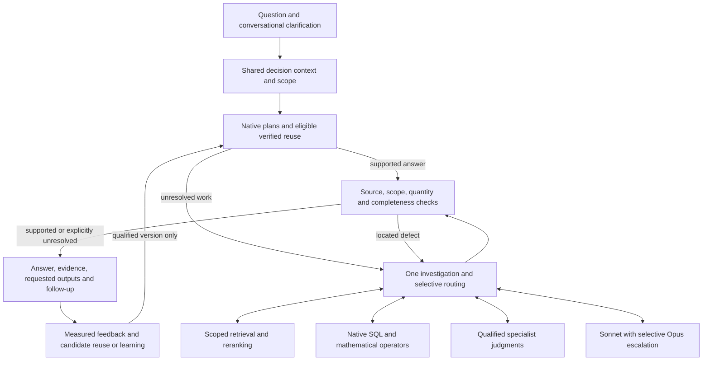

# Agere

## Evidence-grounded analytics with selective model execution

**Project Wollstonecraft · Technical whitepaper · 11 November 2026**

**Edition:** current local engineering candidate. **Implementation basis:** `b91e0f2e6558c6d3ecdc2388b988f9637718ef5f`, branch `codex/integration-20261026`. All reported healthcare workflow evidence is synthetic. This document is prepared for technical review; it has not been published. Engineering delivery, model/clinical qualification, and customer deployment are separate claims.

## Abstract

Agere is a conversational analytics application designed to connect a user's question to reproducible computation, source-supported interpretation, and inspectable outputs. Its central design is a shared decision context: the original question, entity and population scope, time window, source revisions, analytical operations, unresolved dependencies, costs, and subsequent work remain linked throughout execution.

The application combines database operations and mathematical methods with selective retrieval, bounded specialist judgments, and frontier language models. Native plans and eligible verified reuse are attempted before optional model routing. An unresolved question can enter a single investigation that uses existing analytical tools, retrieves supporting records, asks for clarification, and escalates model capability when necessary. Assertions remain subject to source, entity, date, domain, quantity, and completeness checks. Saved progress permits recovery without reconstructing the entire analysis.

The current implementation demonstrates connected local engineering behavior. One ordinary warehouse-count request completed in 2.887 seconds with no model calls. A separate retained-report optimization reduced observed assembly time from 91.990 to 34.590 seconds while preserving output hashes. These are narrowly scoped observations, not evidence of overall clinical accuracy or lower cost per correct answer. The retained population analysis now has a confirmed machine source/coverage review, and all nine finite local engineering requirements pass with scoped current evidence. Local student deployment, broad 25-question semantic qualification, independent clinical/model assurance and customer deployment remain unfinished. The contribution proposed here is an evidence-aware execution and learning architecture; its economic and clinical advantages remain hypotheses to establish.

## 1. Product purpose and scope

The intended product answers questions across healthcare data: clinical and medication context, access and care completion, population programs, longitudinal outcomes, provider and facility operations, financial performance, and payer or contract conditions. Population health, value-based care, and outcome-aligned payment remain central uses without defining the limits of the product.

A useful answer must explain its population and denominator, distinguish observed facts from interpretations, show its supporting records, and make missing prerequisites visible. A request for a financial opportunity must preserve the difference between an estimated opportunity and realized savings. A missing claim must not silently become evidence of missing treatment. A report of a past clinician role must not become a claim of current responsibility.

The intended buyers are healthcare organizations whose analysts and operational teams need this traceability across heterogeneous records. That is a product-positioning hypothesis, not evidence of market demand, pricing, procurement readiness, or customer adoption. The present evidence supports a local synthetic-data prototype.

The reusable architecture separates source adapters, semantic contracts, operators, model roles, and output/work interfaces. Another industry would need its own governed mappings, quantities, entities, rules, and qualification evidence. Reusing the architecture does not make healthcare definitions valid in a different industry or establish zero-effort portability.

## 2. How a question moves through the stack

The stack is conditional. A question does not pay for every component, and an available model is not automatically used.

**Bind the request.** The conversation layer carries the original question, clarifications, entity/population membership and dates into the shared context. Explicit scope must survive planning and execution. When a saved cohort conflicts with an explicit warehouse-wide request, the planner must resolve the conflict rather than silently broaden the cohort.

**Try native execution and eligible reuse.** Counts, filters, joins, aggregations, and compatible saved plans can execute without generative reasoning. The current cascade delays optional question classification until the native/reuse prefix declines. Corrections and explicit continuations retain their priority. A reused program still needs compatible inputs, source versions and policy; a cached answer is not automatically current.

**Investigate what remains.** The shared investigator has access to existing SQL, analytical operators, document search, specialist judgment and clarification. Prior rejected proposals and their reasons travel into that investigation as execution history, not as evidence. Sonnet is the configured entry model for frontier investigation, with selective Opus escalation in the same investigation. Configuration does not prove current provider availability or an optimal routing policy.

**Check and persist.** The output carries native results, citations, qualifications, unresolved premises, cost accounting and a saved context. Localized repair targets a located defect. An interrupted provider call can preserve a new unfinished context and a recovery link while keeping the original snapshot intact. A partial answer is not promoted to a complete answer by saving it.

**Produce requested outputs and follow-through.** Conversation, evidence inspection, requested reports, work ownership and subsequent questions use the same context. Supported internal follow-through is distinct from real-world outreach, payment execution or care delivery.

Current execution connections are implemented in the existing [cascade](../../clinical_core/agere/clinical/proposers.py), [investigator](../../clinical_core/agere/clinical/backstop_agent.py), [analytical tool boundary](../../clinical_core/agere/clinical/analysis_tools.py), [request language](../../clinical_core/agere/clinical/request_language.py), and [service](../../clinical_core/agere/service.py). Their scoped delivery is recorded in [E1](../../artifacts/agere-stack-integration-2026-11-11/delivery-receipt.json).

## 3. Evidence is a runtime contract

A source-supported assertion needs more than a citation label. Its identity includes the source record and revision, entity, exact field or text span, relevant event and availability times, semantic domain, value and unit, and interpretation status. Derived results add their executed operation and dependencies.

Four boundaries are especially important:

1. **Meaning:** a prescribed drug, a reported medication list, a dispensing claim and observed administration are different observations. Payment, adjudication, balance and patient hardship are also different concepts.
2. **Time:** event time describes when something happened; availability time describes when it became knowable. A later correction cannot silently enter an earlier prospective analysis.
3. **Scope and completeness:** a model preview is not the full result relation. An aggregate over clipped input must retain incomplete ancestry. Missing or unread sources must remain visible.
4. **Interpretation:** supported, contradicted, uncertain, unassessed and missing evidence are different states. Model agreement is not independent clinical adjudication.

The investigator's connected search uses the existing hybrid retriever and configured reranker alongside retained lexical matches. Returned spans must match the readable source, correct entity and allowed dates. Retrieval failure is explicit; pagination does not repeatedly rerank the same request. Search ranking helps allocate attention but cannot prove that an unreturned fact is absent. The bulk document reader has separate configuration, so enabling search reranking does not mean that every document-reading operation uses it. [E1](../../artifacts/agere-stack-integration-2026-11-11/delivery-receipt.json)

## 4. Division of work: code, mathematics and models

| Role | Work assigned | Current boundary |
|---|---|---|
| Native database and classical code | Scope, joins, counts, arithmetic, source projection, dependencies and reproducible output construction | Connected to the ordinary question path; semantic premises still require support |
| Analytical operators | Descriptive and longitudinal analysis, financial reconciliation, operational and statistical methods through declared contracts | Existing engines are exposed through the investigator; a registered operator is not proof of validated performance on every input |
| Retrieval and reranking | Find and prioritize relevant source passages while preserving source identity | Hybrid search connected; retrieval quality and completeness require their own evidence |
| System One specialists | Small, typed judgments for appropriate, qualified roles | Interfaces and gates exist; current-contract local student deployment is incomplete |
| Frontier LLMs | Interpret unfamiliar requests, compose tools, resolve difficult reasoning and synthesize supported findings | Sonnet/Opus subscription transport configured; availability depends on the provider |
| Execution reuse and learning | Reuse compatible verified work; capture corrections and compare candidate improvements | Connected with acceptance/invalidation boundaries; trained generative bottles remain off |

The ordinary tool boundary exposes existing operations for trajectories, survival, calibration, demand and capacity, program effects, financial and contract analysis, network questions, and source/knowledge inspection. Whether an operation can answer a particular request depends on its required inputs and assumptions. A causal operator cannot create an identifiable effect from observational records that lack its required design. A prediction path can correctly report that usable targets are unavailable rather than fabricate a risk estimate.

The research also includes implemented mathematical primitives whose usefulness is conditional. For example, [the change-point primitive](../../clinical_core/signal_math.py) uses a Gaussian block fitness when measurement uncertainties are supplied. For a block of observations, with weights `w_i = 1/σ_i²`, it uses `W = Σw_i`, `S = Σw_i x_i`, and fitness `S²/(2W)`, with a segmentation penalty. This follows established Bayesian Blocks work; it does not turn a statistical change into a diagnosis or supply missing assay error estimates. [Scargle et al.](https://arxiv.org/abs/1207.5578)

[The information-value calculator](../../clinical_core/information_value.py) accepts explicit priors, observation likelihoods, utilities and costs. Its decision-theoretic objective is the expected improvement in the best available decision after acquiring additional information. It does not learn reliable clinical priors from sparse records or autonomously acquire care. Proposed joint patient-state/observation models, tensor interactions and automatic algorithm search remain research candidates, not claimed deployed capabilities.

## 5. Routing economics and escalation

The goal is low total cost for an acceptable answer. A cheap call that causes multiple repairs can cost more than a stronger model that completes the same work once. Conversely, asking a frontier model to perform a deterministic database count introduces avoidable generation.

A useful accounting definition is:

`C_answer = Σ C_attempt + C_local_compute + C_review + C_recovery`

The sum includes failed and interrupted attempts. API-equivalent token estimates, subscription allocation, actual invoices and unpriced work are different quantities. An unknown term makes the total unknown; zero new provider calls does not mean zero total computational cost.

The design objective is to choose among eligible routes using expected total cost and answer quality, under the workflow's requirements. The current implementation is a guarded cascade, not a demonstrated global optimizer. Existing scope and acceptance checks determine whether a candidate can finish; optional routing operates after native/reuse opportunities. Frontier escalation should preserve useful work and failure reasons rather than restart analysis blindly. A provider limit is a dependency, not a reason to repeat the request.

Selective model execution has established precedent. FrugalGPT studies prompt adaptation, approximation and cascades; RouteLLM studies learned selection between stronger and weaker models. These motivate Agere's economic design but their benchmark savings do not transfer to this healthcare stack without measurement. [FrugalGPT](https://arxiv.org/abs/2305.05176), [RouteLLM](https://arxiv.org/abs/2406.18665)

## 6. Bottling and measured improvement

Agere distinguishes **execution reuse** from **training a smaller model**. Reusing a parameterized verified computation can avoid repeated planning while still running current data through the relevant guards. Distilling a reusable decision into model weights requires compatible examples, a current input contract, calibration, comparison and an explicit promotion decision. Neither means copying a prior answer into a new population or date range.

The intended improvement cycle is: preserve the attempt and source context; identify a reusable capability or located failure; create a candidate; compare it with the incumbent on appropriate separated evidence; promote only within its demonstrated role; retain a recovery version. Source changes and observed regressions can invalidate reuse. Unverified outputs remain candidates, not training truth merely because a model generated them.

This distinction matters in the current build. The configured student directory contains no deployed weights. Older student manifests do not establish compatibility with the current input contract and were not promoted. The student feature flag therefore must not be described as active qualified local inference. Trained generative bottles are also disabled. Guarded execution reuse and feedback paths are connected, but autonomous recursive clinical improvement has not been demonstrated. [E1](../../artifacts/agere-stack-integration-2026-11-11/delivery-receipt.json)

Information-bottleneck research motivates preserving task-relevant information while reducing representation size; it does not itself validate Agere's passage selection. Conformal methods are relevant to calibrated uncertainty under their assumptions; they are not a blanket guarantee under arbitrary site or time shift. These are research foundations, not borrowed clinical guarantees. [Tishby et al.](https://arxiv.org/abs/physics/0004057), [Angelopoulos and Bates](https://arxiv.org/abs/2107.07511)

## 7. Research contribution and limits of novelty

Retrieval-augmented generation already combines learned language generation with external information. Cascades, model routing, database optimizers, dependency caches and typed verification also predate this project. Agere does not claim to have invented those methods. [Lewis et al.](https://arxiv.org/abs/2005.11401)

The proposed contribution is their coordinated use around one decision context: jointly preserve what the data mean, what is observable, which computations support the answer, where uncertainty remains, what additional evidence could resolve it, and what the entire attempt history costs. Healthcare makes these boundaries consequential, while the interfaces are intended to be reusable beyond it.

The product thesis is falsifiable: compared on equivalent inputs and acceptance criteria, this composition should reduce avoidable model work and repeated analysis while preserving or improving useful answer quality. Current receipts demonstrate some mechanisms; they do not establish overall superiority, patentable novelty, product-market fit, clinical benefit, or an industry-leading analytics stack. Adding every researched model would not establish any of those claims.

The user-supplied DecisionRAG reading remains a retrieval candidate in the research handoff. It is not implemented here, and no cost or accuracy advantage from that paper is attributed to this release. Optional research does not expand the current finish line.

## 8. Measured engineering observations

These results retain their original scope. No new broad acceptance campaign was run to prepare this document.

| Observation | Recorded result | What it establishes and what it does not |
|---|---|---|
| Ordinary question: “How many patients are in the connected warehouse?” | Initially HTTP 400; after scope-binding repair, HTTP 200, 2.887 seconds, zero paid/model calls | Demonstrates one ordinary native question. The returned 3,882 is the disclosed living/non-duplicate default, not the raw 4,115-row roster. One timing observation is not a latency benchmark. [E2](../../artifacts/agere-stack-integration-2026-11-11/ordinary-question-after-receipt.json) |
| Assembly of the same retained 124-row partial report | 91.990 → 34.590 seconds; extra evidence bundle 60,903,777 → 66,116 bytes; same HTML/JSON/CSV hashes and answer fingerprint | Demonstrates less duplicated serialization while keeping sealed investigation references. It does not validate the underlying clinical interpretation or total workflow economics. [E3](../../artifacts/agere-complete-roster-2026-11-10/report-reference-delivery-receipt.json) |
| Interrupted-investigation recovery | New partial context reopens; original unchanged; unknown total preserved; UI recovery link present; no automatic retry | Authored local HTTP/API and shipped JavaScript failure scenario, with one synthetic attempt and zero actual provider calls. It establishes recovery behavior, not live-provider reliability. [E4](../../artifacts/agere-resume-persistence-2026-11-11/workflow-proof.json) |
| Historical aggregate release evidence | Six individual engineering workflows recorded as passed; aggregate release acceptance remains blocked | Evidence is assembled from multiple dates and implementation scopes. It cannot establish all 25 cases or current whole-product acceptance at this whitepaper's commit. [E5](../../artifacts/agere-complete-roster-2026-11-10/current-release-final.json) |

The retained population investigation now returns an answered, machine-confirmed agenda with **128 rows and 140 native population sets**. It separates observed amounts, descriptive explanations, rule-based program nominations and named contract-dependent opportunities. It lists six payer-input prerequisites and does not estimate realizable savings without them. The final continuation used 25 provider attempts, with $18.575728068 known API-equivalent cost and three unpriced attempts. Earlier failures and partial trajectories remain retained; this continuation total is not the full original question cost. Persistence required no new provider calls. The source/coverage verdict is an uncalibrated machine judgment, not independent clinical qualification. [E6](../../artifacts/agere-analytical-completion-2026-11-11/confirmed-v5-save2/receipt.json)

A narrow identical-input count comparison returned **3,882 living/nonduplicate patients** from both the ordinary native path and Sonnet using governed SQL at the same source/date. Native execution took 2.856 seconds with no model calls; the completed Sonnet baseline took 14.233 seconds, two provider attempts and $0.1820358 API-equivalent cost. The first baseline incorrectly declined without using a tool; it is preserved. Requiring one model-selected initial tool action through the existing transport corrected that setup without supplying SQL or an answer. Across both baseline attempts, four provider calls cost $0.332718912 API-equivalent. Cash allocation and local compute remain unknown. This is one development observation for native counting, not a broad benchmark or complex-question cost-per-correct-answer claim. [E7](../../artifacts/agere-analytical-completion-2026-11-11/native-route-reconciliation.json)

The preceding analytical-release code archive is **6,301,565 bytes compressed**, with no copied warehouse, models or Python runtime. It installed and reopened the same saved answer in a fresh process with the question, answer, patient identities, investigation, workflow and work items preserved. This is a same-machine release with declared shared dependencies, not a standalone customer installation or a full-data backup. [E8](../../artifacts/agere-analytical-completion-2026-11-11/release-final/receipt.json)

The preceding analytical-release applicability reconciles the unchanged native engines and the changed recovery, quantity-repair, reviewer-transport and routing boundaries. The finite release contract reports **nine of nine local engineering requirements passed** across all ten scope areas. All 25 fixed-case outcomes are preserved; this does not turn historical partial results into a current all25 pass. [E9](../../artifacts/agere-analytical-completion-2026-11-11/current-release-final.json), [E10](../../artifacts/agere-analytical-completion-2026-11-11/current-25case-disposition.json)

No broad matched cost-per-correct-answer result, independent clinical accuracy estimate or calibrated superiority claim is reported. Historical partial attempts remain part of the record and must be included when the corresponding economic comparison is completed.

The current authenticated-workspace increment connects existing login and tenant isolation to the same saved answer context. A compact authored-source workflow answered a 30-patient warehouse question with 10 matching patients, reopened it, grouped exactly those patients, and preserved the original question and parent evidence. Another tenant was refused; stale contexts and client-supplied replacement patient IDs were rejected. Unsupported saved-population transformations requested clarification. Both analysis and grouping used zero provider calls in this scoped example. The browser exposed the saved answer, source status, native grouping and original limitations. Unknown usage costs remain unknown, with a separate known subtotal. [E11](../../artifacts/agere-workspace-continuity-2026-11-11/attempt-3/workflow-receipt.json)

The subsequent authenticated-conversation increment connects the same shared planner, durable clarification/resume, scoped follow-up, complete conversation cost receipts and workspace-local learning observations. Viewer analysis cannot materialize workflow actions; a failed analysis is retained without falling through to a second engine. An explicit report request renders and reopens the exact saved evidence without a new model call. A 30-patient authored fixture retained the same 10 matching patients across conversation turns, rejected cross-tenant and changed-source continuation, and resumed an explicitly chosen contract scenario through the native engine. Missing contract inputs remained partial, and an unsupported response did not become a zero-patient finding. This is scoped engineering evidence, not clinical/model qualification. [E13](../../artifacts/agere-authenticated-conversation-2026-11-11/delivery-receipt.json)

The answer interface now leads with saved findings and limitations, with searchable, paged record details and complete CSV access. The main view retains all 57 records, 19 fields and 1,083 original CSV values in the inspected retained answer. The authenticated workspace reuses the presentation functions and removes its former 200-row display cutoff; an authored 237-row case retains its final record and late-appearing field. Invalidated answers remain blocked for continuation. Requested aggregate reports show the saved count or value rather than leading with zero result rows. These changes do not revise or qualify the underlying analysis. [E14](../../artifacts/agere-output-design-2026-11-11/final-delivery-receipt.json)

The earlier **6,305,353-byte** code archive includes the authenticated launcher. A fresh installed process signed in and reopened the linked saved answer with question, original question, patient identities, input scope, parent transformation and source intact. No analysis replay or database/model/runtime copy occurred. Startup uses the approved Claude subscription transport; the historical container still lacks a signed-in CLI/session and is not a qualified production deployment. The first archive installation failed its launcher allowlist check; that attempt is retained alongside the corrected release. [E12](../../artifacts/agere-workspace-continuity-2026-11-11/current-release-v2/receipt.json)

## 9. The finite completion boundary

The existing ten-area acceptance scope remains intact. This table states the required outcomes, not a replacement roadmap or a completion score.

| Area | Required completion outcome |
|---|---|
| 1. Native source meaning | Reusable evidence preserves fields, domain, entity, clocks, quantities and uncertainty |
| 2. Evidence dependencies | Missing or changed evidence produces specific review needs and affected-result invalidation |
| 3. Warehouse migration | Current source manifest, original cohort, received-row coverage and rollback remain explicit |
| 4. Context and interpretation | Source-linked local/specialist/frontier routes distinguish retrieval misses, interpretation failures and unassessed content |
| 5. Model qualification | Current-contract training/calibration/evaluation provenance supports a role-specific promotion or documented failure |
| 6. Clinical/program breadth | Versioned reusable criteria, payer prerequisites, preferences and owned internal work remain distinct |
| 7. Longitudinal outcomes | Time-safe targets and honest prediction uncertainty; no forced fit when targets are unusable |
| 8. Discovery and explanation | Applicable statistical methods produce inspectable findings with assumptions and meaningful baselines |
| 9. Financial/provider/contract performance | Actual amounts, lifecycle definitions and denominators reconcile; opportunities remain separate from realized outcomes |
| 10. Integrated product | Current ordinary workflows, all 25 fixed cases, unfamiliar supported composition, follow-up and portable local operation have applicable evidence |

The previously blocked retained analytical completion, native-route comparison and archive/reopen have recorded results. The current conversation and output-presentation changes are now included in a verified combined code-only archive. Its 6,314,444 bytes reference existing data, models and Python rather than copying them. The archived authenticated application reopens the saved 10-patient answer without new analysis; its generated main answer page exactly matches the current presentation source. [E14](../../artifacts/agere-output-design-2026-11-11/final-delivery-receipt.json) The remaining boundaries are broad ordinary-question generalization, role-specific model/clinical/method qualification, usable outcome labels and customer deployment. Compatible local student weights are not installed; guarded reuse and measured learning remain connected, but one-class learning targets do not justify promoting a student or generative bottle. These dependencies are not renamed as completed research or hidden behind the engineering score.

Independent model and clinical qualification requires suitable independent evidence. Existing local login, tenant-scoped answer access and viewer restrictions now have the scoped evidence above. Customer deployment still requires customer-validated access and connections, supported provider arrangements, operational support and an intended-use-specific assessment. These are explicit dependencies, not outcomes supplied by this document. OWASP/HHS work remains deferred under the current scope. Missing external qualification does not prohibit finishing independent engineering, and successful engineering does not establish clinical authority.

## 10. Evidence and reproducibility notes

The authoritative architecture and scope are the [October 11 baseline](../../AGERE_PRINCIPAL_REVIEW_2026-10-11.md), [current principal review](PRECOMMERCIAL_STACK_AUDIT_2026-11-02.md), [product direction](../../AGERE_PRODUCT_DIRECTION.md), [ten-area backlog](../../AUTONOMOUS_STACK_QUEUE.md), and [research handoff](../../AGERE_RESEARCH_HANDOFF.md). Older research plans are historical proposals when they conflict with current implementation receipts.

The application configuration used for the current local runtime is [the active warehouse profile](../../artifacts/agere-full-stack-rerun-2026-10-30/focused/evidence-work-network/active-config.json). The [runtime receipt](../../artifacts/agere-stack-integration-2026-11-11/runtime-receipt.json) records subscription-enabled startup without a new provider question; it does not prove continued process liveness at the time a reader opens this paper. The native count observation was made before that configuration was restored.

The accompanying evidence manifest records file hashes and each observation's scope. Receipts are local development evidence, not externally adjudicated results. Source code, retained attempts and synthetic results remain private. Preparing this whitepaper did not publish them, run a training campaign, access protected answers, use generator truth, or execute real care.
