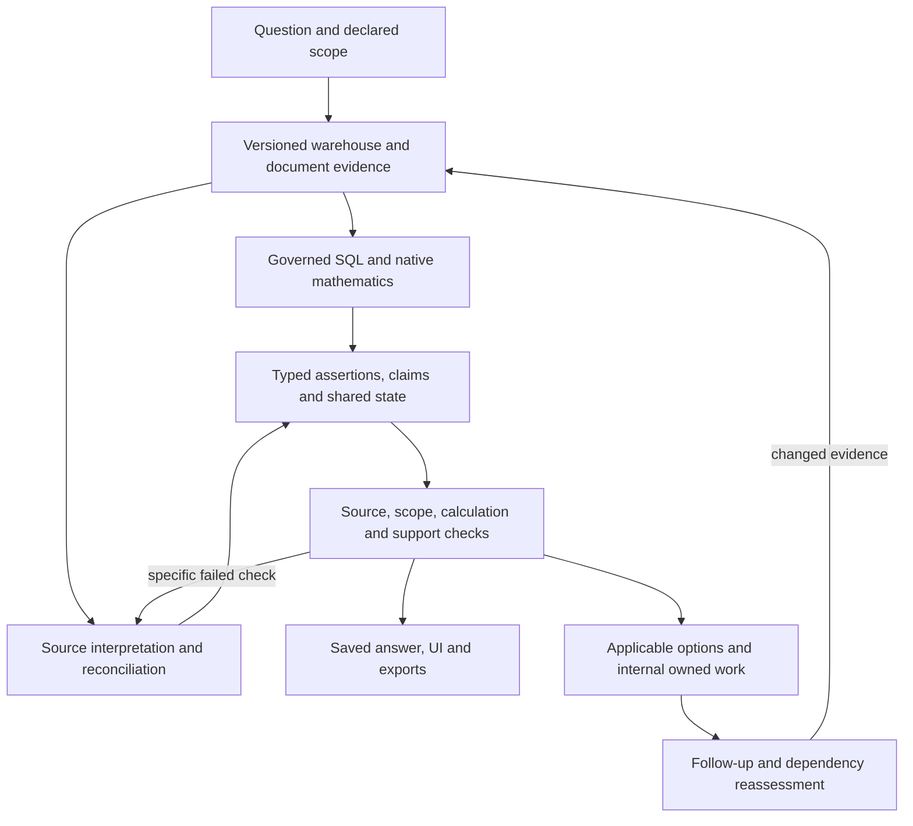

# Agere current local MVP delivery — 2026-10-30

Candidate branch: `codex/integration-20261026`. Current focused integration implementation: `95a681f`. Earlier scoped recovery release: `5f095dc`. Private draft PR: https://github.com/michaelplogan1-sketch/agere/pull/2.

**Latest candidate, October30 20:24UTC — G5 remains active.** The ordinary original-question run on4ddb3c1 returned57patients in1184.081729seconds (19m44s), adding1434validated priced attempts:52Haiku,30Sonnet,665Jev and687Perplexity. Known API-equivalent estimate$3.183520416:Haiku$0.192341,Sonnet$2.1451884,Jev$0.534024036,Perplexity$0.31196698. This is warm-source/cache performance, not a cold or matched cost-saving comparison or subscription invoice. Attempt1's195.874832seconds and zero new API attempts remain part of the history; no failure or unknown usage was removed.

That ordinary run remained partial and did not generate its requested exports. The handoff mistook the registered connection-local documentation view for a missing source table; seven final drafts reused one unchanged native table. New shared checks recognize the registered view/columns and compare actual bound native evidence independently of temporary view names or unused follow-up queries. The retrospective audit identifies one evidence state across all seven actual drafts. New medication checks flag the observed all-history/current-fill mismatch and69known out-of-group dose objects before model review. Current157targeted regressions pass;9profile/domain checks were rerun after the final list-preservation repair. Two historical test fixtures were corrected to exercise their intended current contracts; original failures/logs remain retained.

An offline authored correction then uses9existing native SQL/document/collection actions to preserve the original57-patient cohort and reapply the already governed12-month picked-up-fill definition. Results:19RAAS/ARNI,14evidence-based beta-blocker,13MRA,11SGLT2,and0allfour. All89dose/state source objects are retained:17GDMT-domain and72other/unclassified context. All57patient names,26current PCP assignments,106dated correspondence roles and152machine source findings survive. There is no established current cardiologist in this received source. The earlier claim that26PCP assignments were dropped was disproved: the raw result retained records for all26but mixed current and other clinician roles. Current reading projection uses the original role/snapshot evidence to distinguish them. No omission guard was shipped on that disproved hypothesis.

The corrected candidate saves and canonically reopens as `ANS-2cfa9fbc612c74e12be1d189`, with current source/derivation/premise checks passing, and generates named interactive HTML,109-page PDF,JSON andCSV through the existing saved-report builder. All1,425corrected result cells match the CSV; the PDF embeds the complete context; all89dose objects and all152source findings match their native evidence. Rendering/recovery used zero new provider calls and left all4,829ledger rows unchanged. PDF patient pages2and27 and the actual browser reading view were inspected. Runner-only export/assertion errors were fixed without repeating the source/provider job; original scripts/logs remain in the evidence folder.

This is an **authored correction and presentation/persistence check**, not a newly accepted ordinary autonomous run, independent semantic/clinical qualification, learned-model promotion or installed-runtime recovery. The ordinary result's four unresolved machine source-support packets remain unqualified; no new support decision is fabricated or inherited. Next: finish the ordinary controller's same-request repair/delivery using retained current native evidence, then demonstrate relevant checked reuse/model-role learning and current installed acceptance/recovery. All ten acceptance areas remain. Primary/default unchanged; schedulerPAUSED.

Current evidence: `artifacts/agere-full-stack-rerun-2026-10-30/native-scope-correction/receipt.json`; ordinary receipt and actual-draft audit under `ordinary-after-fallback-repair/`. Durable report/evidence copy: `/Users/mikel/clinical-insights-local/artifacts/agere-integrated-delivery-2026-10-30/native-scope-correction/`. Current local report preview: http://127.0.0.1:8891/v3/patient-review.html . It is a report preview; the integrated8890application server is stopped.

## Earlier candidate evidence (preserved)

**New candidate, October30 afternoon:** received patient and clinician names are now captured by exact source ID in the shared saved context, with dated clinical observations, current versus referral/correspondence roles, theoretical-program review rationale and a four-pillar medication/dose matrix across HTML/PDF/CSV. The offline57-patient rendering preserves all1,653original cells,228pillar fields,225original machine findings and17dose/state rows; its PDF is105pages versus239, with the complete context embedded. This is a rendering of the retained partial analysis, not a newly accepted answer.

Browser review then exposed a background-only paragraph mislabeled as a beta-blocker reason. The shared reader now requires both a source/entity link and an independent typed decision that the selected block documents the requested relation, beyond polarity/time/subject. Native replay withheld23unlinked candidates as addressable gaps, retained57patients/106dated roles and used zero providers. A matched two-case live probe through Jev and Perplexity rejected the original background-only block and retained the actual medication non-use account:2.146seconds,5appended validated attempts,known API estimate$0.000618576. That is a narrow regression, not clinical precision or recall qualification. See `artifacts/agere-source-entity-link-2026-10-30/support-probe/receipt.json` and `cost.json`; original source and prior ledger rows stayed unchanged.

The recovery transport also keeps complete prior feedback in existing native result views:1,376,421original-request bytes become33,601bytes in the offline executor check; the complete compiled message is63,108bytes. Outcome and failure observations persist independently of model fitting/candidate selection; protected evaluation remains read-only.187focused regression checks pass. A new ordinary-route integrated cost run remains required before this candidate is reported as delivered; the old sealed result and recovery point remain intact.

The first ordinary-route attempt on556a5a4exposed a separate configuration defect before any new API call: missing typed adapter plus `AGERE_LOCAL_TYPED_FALLBACK=off` still entered the base-model long-prompt path. The owned attempt was interrupted after195.874832seconds; its source, code and prior ledger rows stayed unchanged and its trace is retained. Parent and worker now decline that unavailable path consistently;13native-worker regressions and93targeted routing/source/outcome checks pass. A new ordinary attempt is required; the interrupted attempt is not a cost/performance success.

**Scope correction following Mike's October 30 review:** the sealed nine checks below establish the six-case source/reconciliation/work path and local recovery. They do not establish the intended integrated model roles or full-stack MVP completion. Those six source-synthesis cases hard-code Claude; they bypass the ordinary Ask planner's System One document reader. G5 is active again for the explicitly requested integrated rerun. The normal Ask screen already calls `/api/stack/compose`; the verification path and completion framing were wrong.

The earlier integrated original HFrEF request remains saved as `ANS-c9cb98c5af2f6e4da23a7eae` (its8890server is stopped). All57 patients remain, with interactive HTML, JSON/CSV and a239-page PDF retaining the complete original context as an attachment. The answer stays partial/unverified; two machine source-support checks remain inconclusive. Both now have internal source-evidence review tasks. No independent clinical review or real care occurred.

**Earlier scoped engineering acceptance:9/9.** Those checks cover the six-case source/reconciliation/work path and tested local recovery, with all ten charter areas retained. They do not establish full-stack MVP completion, source-recall/model qualification or current clinical readiness. The original receipt and71GB recovery archive remain unchanged.

The shared source-to-answer-to-owned-work path now completes all six original individual questions and both full-roster population programs. It preserves explicit unknowns, immutable source lineage, failed attempts and exact canonical reopen. No external care or outreach was performed.

| Individual workflow | Selected received records | Complete groups | Internal review tasks | Engineering |
|---|---:|---:|---:|---|
| medication | 133 | 9 | 1 | passed |
| respiratory | 14 | 1 | 1 | passed |
| cardiometabolic | 113 | 6 | 1 | passed |
| functional | 25 | 2 | 1 | passed |
| appointment | 33 | 2 | 3 | passed |
| payer | 25 | 1 | 1 | passed |

Both respiratory and behavioral programs retain all 4,115 members, independently reconcile 112 and 129 documentary nominations, and preserve 241 internal software review handoffs. Combined with eight individual tasks, 249 tasks persist; these are internal software actions, not completed clinical services.

## Focused integrated workflow delivered; qualification remains open

The existing investigator uses field-specific whole-source retrieval and native patient applicability, complete source inventories, explicit unknowns and targeted expansion. Exact machine source-field observations retain provenance across rebatching; changed source, question, date, patient or provider policy misses. Native schema discovery keeps full lossless documentation accessible. Implicit d1/Kev fallback is opt-in because it has not earned its extra compute on this task.

Original-source preflight schedules14,469 rather than56,063 block-field tasks (74.19% fewer), retains all57 patients and106 dated clinician-role objects, and retains all69 prior machine-positive source candidates. This is candidate coverage, not a measured recall denominator. Resident system bytes fall217,811 to35,963 (83.49%), which is not an accuracy or dollar-saving claim. The source phase completed with225 bound machine findings; copied historical findings are not225 distinct clinically validated reasons. Completed extraction subsequently reconstitutes offline in4.49seconds with zero providers.

Native composition corrects the former35-patient cardiology-gap count to57 lacking established structured current assignment, including22 referral-only cases. It retains26 structured primary-care assignments and31 unresolved assignments,64 recent-fill medication groups across34 patients and17 GDMT-domain dose/state rows across13 patients. Fill proxies do not prove current use; dose/state rows include planned and unknown states. Historical clinician names/roles are retained without inventing a current assignment or mapping unprovided names to clinician IDs.

Verification returns diagnosed faults before unrelated votes and checks independent packets concurrently, retaining unchecked states and complete in-flight accounting. The existing lossless codec can share repeated JSON-string source context on the wire and restore every original string/value exactly. Three large packets now fit through exact lossless sharing; former envelope blocks are gone and actual semantic uncertainty remains distinct from an engineering envelope failure. The shared display now recognizes `proposed_review_steps` for all57 patients. The239-page report removes recursive audit duplication while retaining clinical fields, bound quotations and the full unchanged saved context.

The current95a681f revalidation returned in194.48seconds, adding10 validated requests:4 Claude coordination/composition calls through subscription,4 Jev and2 Perplexity checks. It reuses completed extraction; the typed verification calls still read source evidence. The preceding97ca2d7 check took99.53seconds/14newrequests. Neither is a cold-query benchmark. One restricted launch failed provider DNS and was interrupted; its pending Claude usage remains unknown. No failed/pending key was cleared or quietly resent.

Current offline fidelity audit: exact57-patient membership,228 medication-pillar cells with zero disagreement,225 compiled source/clock/entity/axis bindings with no schema/composition errors,106 dated roles and1,653 exact CSV cells. JSON rows match, current canonical reopen is not stale/invalidated, and the PDF contains all57 patient IDs,57 recommendation sections and57 focused-scope sections with no false absent-recommendation warning. Cover/patient/evidence/final pages were visually inspected; this is neither exhaustive page-by-page visual review nor independent semantic/clinical adjudication.262 earlier relevant regressions and69 current work/dependency regressions pass; these are overlapping groups, not an additive completion score.

The current UI created two source-evidence review tasks for `SYN-96669EC8-4BA` and `SYN-FB40A1A6-9E5`. A partial answer can now queue source review without becoming an accepted clinical answer. Clinical programs remain blocked; actual HTTP duplicate replay preserves both tasks, wrong populations/stale revisions are refused and source-review tasks cannot run care simulations. The complete original saved answer remains unchanged and partial. Review tasks are software records in an unassigned queue, not completed human review or contact.

Durable delivery: `/Users/mikel/clinical-insights-local/artifacts/agere-integrated-delivery-2026-10-30`. Its189 independently hash-verified files preserve current saved answer/work, complete exports, source observations, all rerun protocols/responses, code and consistent audit-only ledger snapshots. Current live accounting is never restored or replaced. The four cumulative rerun ledgers contain at least13.906614122USD API-equivalent with12 unpriced attempts; this is not the final-attempt cost, subscription invoice or whole-project total. Local compute and authentic reviewer effort remain unpriced. This evidence/code package is not a new full-runtime restore test; the earlier independently tested release remains the recovery point.

Receipts: `artifacts/agere-full-stack-rerun-2026-10-30/focused/evidence-work-network/` and its `delivery-receipt.json`. Independent source-selection recall, semantic attribution, role-specific calibration, cold performance, total-cost advantage and clinical qualification remain open. The next gate action is to inspect the two retained inconclusive dependencies against their exact source relationships, then resolve a named task-routing/qualification gap using existing evidence and suitable simple baselines. No new blanket scan or untargeted training campaign is justified.

## Question flow and component roles

The request retains its entity/population, dates, definitions and output requirements. Native calculations and source interpretation contribute to shared source-bound state. The path varies by question; an analytical result does not require a service intervention.

| Component | Role and current limit |
|---|---|
| Warehouse adapter, SQL and native analytical engines | Governed source access, cohort calculations, source reconciliation, temporal/process and financial operators. Native population audits use zero provider calls. |
| Keyword search, MiniLM, reciprocal-rank fusion and BGE reranker | Source retrieval and ranking. Six paired comparisons share candidates; relevance/recall and clinical superiority are unqualified. UltraBERT additionally supports catalog/terminology retrieval where available. Exhaustive review ranking is off. |
| Haiku and Sonnet through subscription | The ordinary Ask planner uses the intended Haiku/Sonnet ladder. The separate six-case source-synthesis, typed reconciliation and optional buyer-documentary planning path used Sonnet for all 176 requests; it does not prove the intended integrated division. Best-model selection per role is not established. |
| Jev/TypeSafe and Perplexity | Typed routing, source-bound document reading and support judgments in the integrated question route. Jev credit access is restored; new integrated-run calls to both providers succeed. The full57-patient workflow is saved; role/semantic qualification remains open. |
| Qwen3-4B-based local skills, Kev/d1 readers and local routers/classifiers | Narrow candidate tasks with role/source-family qualification boundaries. They are not established replacements for Claude on these workflows; no new default promotion. |
| Typed assertions, source plans, relation/date bindings and reconciliation | Bind findings and claims to entity, subject, source, timing, polarity and uncertainty; combine text evidence with native results. |
| Contract, quotation/reference, source and calculation checks | Validate inspectable relationships and target affected repair stages. Model judgments and whole-packet unknowns remain separate from clinical validation. |
| Exact caches and parameterized checked workplans | Reopen exact valid results or rerun guarded native work for changed parameters; source/scope/meaning/correction mismatches decline reuse. |
| Buyer/payer matching and decision/task stores | Attach applicable options, prerequisites, owners and internal follow-up while keeping benefits, consent and clinical authority explicit. |
| Code-built UI, HTML/PDF, JSON and CSV | Render saved results, uncertainty and provenance consistently. |
| Ledger, immutable receipts, SQLite transactions and release checkpoints | Preserve all attempts/accounting and durable work; failed-key protection, idempotency/CAS and restart/restore are separate checks. |

## Changes tied to Claude’s review

Claude inspected supplied material without repository execution. Observed code gaps are distinguished from causal hypotheses; the original review is retained unchanged at `docs/agere/reviews/2026-10-29-claude-chief-architect.md`.

| Review concern | Implemented behavior and evidence | Remaining limit |
|---|---|---|
| Relations reconstructed from prose | Existing typed assertion/state/composition now binds source observations and claim support to entities, relations, dates and source units. All six current cases preserve the full original source scopes. | Passing strict source/contract checks does not establish clinical interpretation accuracy. |
| Wrong quantitative domain and clinician roles | Original full HFrEF recheck independently matches all 228 source-policy cells; 15 requested-class dose observations remain distinct from 74 other and 9 unclassified. Three unsupported assignment observations were removed; dated documented roles are retained. | The review’s proposed causal explanations were hypotheses. That older review retains19 unknowns; the current focused result has two inconclusive machine support checks, with no independent clinical qualification. |
| Broad packet invalidation and weak repair feedback | Shared claim-local verification and stage-specific recovery retain unaffected evidence. Current recovery reparses saved source responses, exact quotes and citations; valid source passes survive later typed-output repair. | Provider-family correlation and verification accuracy remain unqualified. |
| Role-blind, expensive cascade | Current population mathematics uses no provider calls. Individual source-type baseline and optional buyer planner share exact source/answer bindings; all six same-input retrieval comparisons and all-attempt accounting pass. | No overall model winner or all-in cost saving is established; historical failed/partial arms remain preserved. |
| Learning and reuse without demonstrated transfer | Parameterized reuse changes years, reexecutes native calculations and matches 240 numeric cells on each transferred request with zero provider calls. Scoped negative feedback quarantines affected roles and retains rollback. | Machine labels are not clinician labels. No global/default model promotion or new broad training campaign. |
| Display and recovery gaps | Grouped report repair produces 32 record headings, zero false medication missingness warnings and a readable 34-page PDF. Current application packaging explicitly includes physical model mounts and canonical saved-answer reads in local operations mode. | Actual archived startup, canonical reopen, CAS/idempotency, restart, crash rollback and fresh restore pass. The current UI/API and independent durable evidence agree on nine engineering passes; clinical/model quality and production authority remain unassessed. |

## Current measured source and workflow evidence

- Source conformance independently matches all 2,396,490 received literal rows across 237 streams, the original 4,115-member roster and 39,763 unknown event dates. No generator truth or protected evaluation was opened.
- Independent authored adapter variant preserves equivalent semantics under renamed source fields, explicit missing mapping, correction/late-arrival handling and old-review reopening.
- Corrected balance, late arrival and conflicting latest snapshot each recompute one affected member while 4,114 remain exact. Missing patient attribution remains the specific acquisition dependency.
- Both population programs independently reconcile 694,445 financial rows, 43,654 accounts, 60,472 accounting identities and 628,822 service/adjudication/account links. Unresolved attribution and financial opportunity remain separate from realized savings.
- Prediction timing/outcome checks preserve the actual single-class eligible targets (107/253 recorded negatives). Estimates remain unavailable; no risk model is forced.
- Discovery reconciles 20,432 appointments, 12 monthly counts and 71,923 source hashes; exhaustive 2,048-partition baselines match. No causal effect is claimed.

The separate original full HFrEF recheck retains 57 patients, 53 native internal action records and 123 revised findings. Its 228 source-policy cells match, while 19 whole-packet judgments remain unknown. This earlier source-bound workflow remains partial/unverified; it is retained as supporting evidence rather than counted as another current complete workflow.

The current routing audit reopens all six exact canonical answers and unchanged tasks/follow-ups, compares source-type and optional buyer planning against the same answer/source versions, and retains all 176 provider request records (142 validated, 34 failed). It uses zero new provider calls. The actual failed request is refused against the read-only real ledger before reservation or network. Audit wall time is 1,222.6 seconds; this is native revalidation time, not a cold workflow speed benchmark. The shared ledger was moved atomically to durable local storage with byte/table identity and the original alias preserved.

## Actual local operations and current UI

The installed-operations run passed in 65.3 minutes. A consistent checkpoint sealed 34 databases and 678 files (71,334,221,021 bytes). Its executable archive contains 889 application/configuration files and 33,586 Python/runtime-library files. The archived interpreter actually started and reopened all eight decisions and all six canonical source answers.

The copied task advanced from revision 2 to 4 through an internal hold and prepared handoff. Duplicate replay returned the same update; a stale revision was refused. Restart retained committed work. A deliberate process exit during an uncommitted update to the actual copied task rolled that update back; committed work and idempotent replay survived. A fresh installation restored baseline revision 2 while the first installation retained revision 4. Original source work and all 176 shared provider-ledger rows remained unchanged. Hosted source inference and buyer-model planning were refused in local-operations mode. No qualification was transferred and no external action occurred.

The earlier scoped candidate is [localhost:8888/ask](http://127.0.0.1:8888/ask); the verified report is [localhost:8888/stack-evaluation](http://127.0.0.1:8888/stack-evaluation). Its API and actual browser table show nine engineering passes, two unassessed qualification requirements and one unassessed external requirement. The case overview retains diagnostic `not run` and `unvalidated` labels: current full-source transport is checked separately, same-input retrieval comparisons live in the routing capability, and clinical/model accuracy remains unqualified. No labels were changed to conceal those limits.

Durable local evidence is in `/Users/mikel/clinical-insights-local/artifacts/agere-current-mvp-2026-10-30/acceptance-evidence-v1`. It independently revalidates the current report, trace hashes, implementation and capability evidence without depending on the temporary checkout. It preserves all 176 native response receipts, including all 34 failed responses, plus verification sources and distinctly labeled earlier supporting reports. Current ledger accounting was never copied or restored.

The sealed executable release is `/Users/mikel/clinical-insights-local/artifacts/agere-current-mvp-2026-10-30/operations-v1/release`; the checkpoint is `/Users/mikel/clinical-insights-local/artifacts/agere-current-mvp-2026-10-30/operations-v1/checkpoint`. Installed and restored copies remain beside them. The tested launch uses the archived `runtime/python/bin/python3.12` and `bootstrap.py serve --port <local-port>`, with the recorded nonsensitive environment in `operations-v1/runtime-configuration.json` and `PYTHONPATH`/`PYTHONHOME` cleared. This is a same-platform local package requiring its declared original external source/model resources and current shared ledger. It is not a standalone customer deployment. Install a sealed release into a fresh directory to roll back, retaining the previous installation and audit; never rewind the shared provider ledger.

## Full ten-area charter

| Area | Current evidence | Open dependency or limit |
|---|---|---|
| 1. Native source meanings | Full received-record conformance, typed source assertions and current individual/population composition | Source capture outside received contributions is unknown. |
| 2. Dependencies and acquisition | Correction, late arrival and conflict each affect one member; 4,114 stay exact; missing attribution stays bound | No external record acquisition is executed. |
| 3. Warehouse migration | Pinned original roster, all received rows/streams and independent adapter variant | Actual same-platform installation/recovery passed. Governed customer adapters and production authority remain external. |
| 4. Broader interpretation | Six original full-source questions and earlier clinical/utilization/access/financial compositions | Independent interpretation and clinical accuracy remain unqualified. |
| 5. Learning and model qualification | Scoped correction lineage, isolated candidates, parameterized reuse, regressions and rollback retained | Independent role-specific evaluation/calibration and justified promotion remain unmet. No broad training campaign or default activation. |
| 6. Clinical/program action support | Two full-roster programs, source/rule/buyer bindings and 249 internal review tasks | Benefits, clinical need, consent, actual service capacity and clinician authority remain unverified. |
| 7. Outcomes and prediction | Versioned 30-day targets, availability clocks and censoring; honest nonestimability | Selected eligible labels have one class; no qualified risk estimate or clinical outcome validation. |
| 8. Discovery and explanation | Source-linked appointment findings and exhaustive simple-baseline comparison | Artifact/process hypotheses remain hypotheses; no identified causal effect. |
| 9. Financial/contract performance | Independently reconciled received lifecycle amounts and versioned accountability definitions | Missing attribution/entitlement remains unresolved; opportunity is not realized savings. |
| 10. Full-stack product | Six complete individual workflows, two population programs, broad report parity and current routing/accounting | Actual archive/install/restart/restore, current UI/API and independently verified durable evidence passed. Model/clinical qualification and production prerequisites remain open. |

## Limits retained

All ten acceptance areas remain in `AUTONOMOUS_STACK_QUEUE.md`. Independent role-specific model/method qualification, qualified clinical review and authorized production connections remain separate requirements. Source sufficiency/capture, benefits, consent, real clinical capacity and clinician authority are not inferred from synthetic data. TypeSafe credits are restored and current Jev requests succeed; no purchase was made. Subscription allocation, unreturned usage, local compute and independent reviewer effort leave actual total cost unknown. Native validation includes multi-minute calls, so no overall speed claim is supported.

The primary default product is unchanged. The candidate is local and private; there is no main merge, publication, new service, external dispatch or qualification transfer.
