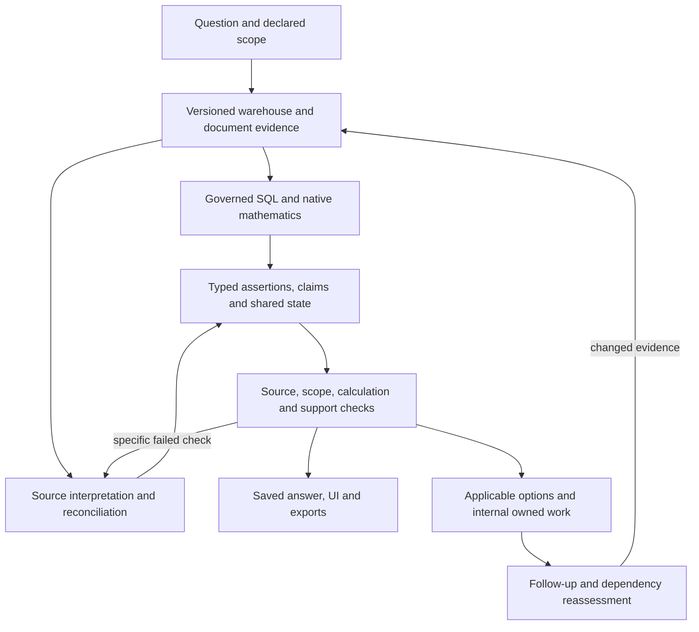

# Agere current local MVP delivery - updated October31,2026

Last sealed product code: `2a608b4` on `codex/integration-20261026`. Current candidate: `5488550`, with shared repairs verified offline and a single targeted continuation running. G5 remains active; the full ordinary answer and independent clinical/model qualification remain incomplete. All ten acceptance areas remain.

The new ordinary original-question run finished in **46 minutes,1,395priced attempts,$3.219368782API-equivalent**, returning57patients with partial status. Source, product code and all earlier10,918main-ledger rows stayed unchanged; no subscription limit occurred. Its correct12-month pillar flags were assembled beside a plan still derived from all-history flags:35patients had inconsistent gap plans. The guard correctly refused that final answer. This is a measured engineering failure, not clinical uncertainty. It was not a cold or matched benchmark.

Candidate repairs now distinguish patient-key membership from actual medication-value lineage and identify the exact stale final field. Four reused source field IDs that changed their questions/entities/relations are rejected before paid dispatch; genuinely changed meanings remain available under new IDs. The report projection retains86later bound reason readings and2,151separate medication-status observations that an older final-table join omitted. It recognizes the native RAAS alias and renders the new57patient output as a68page/215580byte clinical candidate rather than the116page fallback. All228pillar cells and original context values remain; source statements are not promoted into clinical truth.159combined checks plus50reuse/continuation checks pass. No provider calls were made for these offline checks.

The first targeted continuation was cancelled after the owner identified a recovery bug: replay stopped at an earlier failed pure composition and never restored the later completed source work. It added1296attempts/$0.574041198knownAPI-equivalent plus one unresolved pending request; these remain in accounting. It was not a successful result, and its initial-to-terminal ledger digest proof did not finish.

Recovery now reproduces only exact recorded pure-composition validation errors and continues to later work; changed failures, unexpected success, provider errors and source changes still stop.82focused checks pass. Actual61action/source recovery passed in46.756seconds with0newproviders and exact source/code/earlier ledger identities. It restores86later reason findings,2151status observations,1436regimen readings and203titration readings. The35older titration readings are not lost: exact assertion IDs match26frontier and9typed quarantines. All originals remain, and the manifest matches apart from prior_source_seeds counters. No clinical truth or new model weights are inferred.

The isolated8890server is stopped during integration; primary/default servers remain untouched. Exactly one owned targeted continuation is running on frozen5488550/source: `artifacts/agere-current-integrated-cost-2026-10-31/targeted-continuation-v2/run-receipt.json`. It reexecutes retained literal actions with four explicitly versioned field IDs, asks the existing controller to repair the plan and enumerate named fills, and inherits no draft or acceptance. It is a continuation rather than a new ordinary performance benchmark. The curated73page user PDF below remains available; the new68page report is a candidate until native/current-app checks finish. No new model weights or automatic model promotion.

Across the same six recorded rerun/regression ledgers, the ordinary run brings accounting to13,689attempts/$32.846188874knownAPI-equivalent plus13unpriced attempts; this excludes the running continuation. It is not total project cost, a subscription invoice, or a claim about paid dollars; local compute, reviewer effort and subscription allocation remain unpriced.

Latest user-requested report is a curated clinical packet: **57patients,73pages,228937bytes**. It leads with a cohort overview, patient names and dated clinical observations, PCP/current cardiology status, four-pillar medication and dose tables, program-review rationale and selected dated chart explanations. Historical signed cardiology correspondence stays distinct from current assignment. The clinical PDF contains no engineering receipts or embedded execution archive; no separate technical companion was created. Original analysis and all received evidence remain in the application records.

All228pillar cells,17doseobjects,64namedfillgroups and1083nativeCSVcells remain; all57names and source-bound excerpt segments were checked. Unresolved interpretations remain visibly marked.45focused report/profile/export regressions pass. Current reopening and allfour normalAPIformats match their recorded bytes with0provider calls. The saved context remains `ANS-4370962206a7c613180e34ea`; current report `DLV-DD2368CBC06B`. The subsequent guarded-download repair below reduced the measured PDF download to10.594seconds; the current ordinary-run and targeted-continuation results above govern the next action. This remains separate from whole-question latency.

Delivery receipt: `artifacts/agere-clinical-review-curation-2026-10-31/delivery-receipt.json`. Durable report: `/Users/mikel/clinical-insights-local/artifacts/agere-clinical-review-curation-2026-10-31/output/pdf/medication-optimization-patient-review.pdf`. Prior fullv6 and typed-feedbackv7 installation/recovery evidence remains intact; these unchanged operations were not repeated for a presentation-only change. Primary/default and main remain unchanged; scheduler remains PAUSED.

The next measured shared repair is now delivered: the report-download HTTP route delegates directly to the existing guarded read_format path rather than loading the same context once first. Existing context/source/bundle/recorded-byte checks remain.20report/export regressions pass; allfour liveAPIformats are byte-identical and missing-context/missing-report/invalid-format controls reject with400. Sequential before/after timings: PDF13.348→10.594s, HTML9.236→6.545s, JSON9.448→6.544s, CSV9.053→6.406s. Both runs used the same saved context/source/files and caches were allowed; this is a local saved-report measurement, not whole-question speed or cost superiority. Zero new provider attempts. Receipt: `artifacts/agere-report-download-performance-2026-10-31/delivery-receipt.json`.

The three independently missing source dimensions were reviewed over the original 57 patients and1,408 registry-matched whole documents. The source pass took1,333.187817 seconds,1,389 priced attempts/$2.535783488API-equivalent:750 Perplexity,584 Jev,42 Haiku and13 Sonnet. It selected1,436 dated regimen readings,238 titration explanations and no explicit individual tolerated maximum. Together with84 unchanged original reason readings, that is1,758 current machine source bindings; eight earlier pilot versions remain retained separately. These are annotations, not independent clinical events, current-treatment facts or clinical-recall measurements. Warm exact finding reuse made zero new calls; cache counters changed, so full-row byte equality was not claimed.

Source qualification is unresolved. The final typed review plus independent remaining-patient continuation observed155 of 164 transport parts:95 supported,48 uncertain and12 with model objections; nine parts remain explicitly unchecked. The original ten disputed readings on two patients were reread using the unchanged exact question/span/full source and a different subscription reader; it reaffirmed all ten in13.72 seconds, two Sonnet calls/$0.0917484API-equivalent. That disagreement remains visible. The UI and PDF now label uncertain/disputed source accounts, retaining originals and all review lineage. No verifier threshold, source-support gate or clinical label was changed to manufacture a pass.

The final review added96 Jev/Perplexity calls/$0.246677712; the independent continuation added392 calls/$0.933634766. Its result files and all 392 attempts were saved, but temporary-checkout file loss interrupted final receipt verification at midnight. Exact frozen code and unchanged source identity were subsequently recovered and independently verified; the original failure and companion postprocess receipt remain. The lost final pre-run ledger digest was not retroactively claimed as verified. Private Git history, surviving local commits and four uncommitted continuity files were preserved; Git metadata and current evidence now also have durable storage. The cause of the temporary file loss was not independently established.

A measured report-serving failure also drove a shared fix: exact SQL dependency parsing is reused while current schema, definitions, corrections, source, drift and sealed-evidence checks still run. On the same saved context in one unprofiled process, original reopening was9.896866 seconds, candidate cold parsing6.314570 seconds, and warm reopening2.688081 seconds. Complete returned context and dependency checks were identical. Actual current API context and all four export routes pass; export requests took8.66–15.27 seconds in that run. This is a saved-report measurement, not a cold question-to-answer speedup. The current context is still about414 MB and the HTML about76 MB; further representation work remains justified.

Learning remains guarded: parameterized native workplans and exact source/question/span/model/policy observation reuse are operational. Scoped frontier-reading quarantine is append-only, and ambiguous or aggregate feedback supplies no corrected clinical label. The current source disagreements and partial full request are ineligible for accepted-answer bottling or training-label promotion. That internal typed-cache gap is now repaired and applied. Compiled assertion IDs bind directly to the actual typed applicability and relation/subject/time/polarity cache observations. Fifty immutable bindings cover nine disputed readings plus one unaffected control; forty-five typed decisions are suspended through append-only events. Unchanged disputed blocks return nine explicit unknowns with zero old finding reuse and zero provider calls, while the control and every original observation payload remain exact. Context-isolation/local-reader retries cannot bypass suspension. Concurrent conflicting readings are preserved and suspended; losing a cached payload cannot clear a retained suspension. Genuine changed-source inputs receive their own judgments. Eighty-three focused tests pass. The original source interpretations and objections remain unadjudicated, not medical training labels. No new model weights, task thresholds or default-model promotion were made.

| Component | Current measured role |
| --- | --- |
| Native registry, SQL and typed composition | Registered medication scope, population/date windows,57 fill counts,228 pillar flags, dose/reference domain and exact source/result bindings. |
| Jev and Perplexity | Independent source applicability, relation/subject/time/polarity judgments and final source/claim checks. Both contributed; no winner or clinical accuracy is established. |
| Claude subscription | Planner/investigation and residual exact-source span repair. The ordinary run's dominant frontier allocation was planning/investigation, not source repair alone. |
| Ultrabert / Qwen and other local roles | Existing candidate capabilities remain available by their registered role; ranking/readers were not qualified or activated as a universal substitute in this source pass. Their useful role requires an appropriate workflow baseline. |
| Bottling and recursive improvement | Exact observation reuse, reexecuted parameterized workplans, localized negative feedback, regressions and retained recovery. Unresolved model votes remain observations rather than truth labels. |

A direct ten-span cache lineage audit resolves all fifty cached decisions: forty-nine selected Perplexity responses and one Jev response, across applicability, relation support, polarity, subject and time. This describes the chosen readings in this targeted set, not all provider attempts or a model winner. Independent questions and the provider ladder are distinct; both providers do not automatically vote on every field. All original request hashes remain attached.

Across the same six named rerun/regression ledgers:10,998 attempts,$29.052778894knownAPI-equivalent and12 earlier unpriced attempts. This is not total project cost or a subscription invoice; local compute, human reviewer effort and subscription allocation remain unpriced. The ordinary original-question run itself was2,612 attempts/$2.959865186and remained partial. Development verification and source-completion spend above must not be presented as the marginal cost of a new accepted answer.

Current evidence: `artifacts/agere-g5-source-clock-2026-10-30/current-readable-report-v2/`, `report-serving-latency-v1/`, `complete-regimen-source-v1/`, `remaining-source-qualification-v2/postprocess-receipt.json` and the durable recovery receipt at `/Users/mikel/clinical-insights-local/artifacts/agere-integration-recovery-20261031/restoration.json`. Remaining dependencies include independent source-family/model/clinical qualification, viable outcome labels, authentic workload/reviewer economics and production authority. Current installed recovery passed in 1143.994 seconds: canonical current reopening, exact downloads, 57 internal review items, idempotency/revision guards, restart, interrupted-transaction rollback, changed-source refusal and fresh restore; all test servers stopped and shared accounting/original source stayed unchanged. This is local engineering evidence, not clinical qualification.

## Preceding original-question and source-routing measurements

**Latest measured work, October30 evening, America/Chicago — G5 remains active.** The exact original question ran through the ordinary compose controller without an owned-recovery prefix, injected draft or accepted answer. It returned57originalpatients and HTML/PDF/JSON/CSV in2,317.844775seconds (38m38s), adding2,612validated priced attempts:67Haiku,13Sonnet,1,164Jev and1,368Perplexity. Recorded API-equivalent usage was$2.959865186, about80%Claude. Existing runtime caches were allowed; this is not a cold or matched cost-saving benchmark. The answer remained partial because a native medication-group check rejected its final lineage.

Exact request-lineage accounting splits that ordinary run into19frontier source-repair calls/$0.1566681,2,532typed source calls/$0.595392786,and61other frontier generations (planning/investigation)/$2.2078043. The costly part was mostly outside source repair. Rechecking all14actual native-table drafts under old/current group validation removes the group-only objection on ten later drafts while preserving the real broad-domain objections on the first four. This is an observed guard correction and historical allocation, not a guaranteed future cost saving.

The measured fault was in the shared guard: an exact class filter inside a CTE/subquery was not recognized as narrowing an earlier broad result. The fix follows the actual lexical table reference; it does not allow an exact filter on one alias, joined reference or UNION branch to certify a broader branch. The unchanged saved57-patient trace moves from one group objection to zero in0.444seconds with zero provider calls. Parent/subtype, OR/NOT/CASE, counted-population, JSON lineage and native assembly protections remain covered.

Document routing now validates registered medication entities before reading source text and checks necessary entity links before paid source decisions. The actual malformed `gdmt_dose` entity is rejected in2.25ms; the dose/titration task belongs in the question/relation. A two-patient cached typed comparison preserved all33findings:2,936scheduled field/block decisions became387model-eligible decisions and2,549explicit native unknowns, with47transport batches becoming7. That was measured before the subsequent registry enrichment; it is a narrow cached routing comparison, not current workload-wide savings. Unlinked sources remain addressable gaps, never clinical negatives.

The existing ingredient/brand/class registry now supplies source candidate selection and necessary entity binding as well as structured medication queries. With only the registeredGDMTname supplied, same-source retrieval selects1,408candidate documents instead of76from the original4,387document inventory. All1,332additional candidates have a whole-text registry link. These are candidate links, not clinical findings or measured clinical recall. Exact subtype and combination boundaries are tested. Independent applicability/axis/frontier judgments receive the exact registered member-class definition; the definition also guards source-observation reuse. Independently useful values/states and causal explanations are requested separately.212targeted regressions pass. No new model weights, thresholds or default model promotion.

A subsequent offline audit of the current ordinary result found a separate presentation wiring gap: all228pillar cells,17structured dose/state objects and39HF-subtype reason findings are intact in native results but absent from the clinical-card projection. The older sealed report used its supported earlier schema. Current projection repair is queued immediately after the active source job releases frozen product code, before any current report release. Native results and full evidence are preserved.

A targeted correction rechecked all eight old coupled dose candidates as16independent regimen/reason decisions with complete original contexts. It returned zero regimen observations and eight historical titration explanations in14.607seconds, using five calls/$0.019500284API-equivalent. These are repeated historical source statements, not eight independent clinical events. Warm exact replay took0.083753seconds/zero new calls. The final diagnostic collector initially mixed rowid and request-hash keys and listed the whole ledger as new; its immutable companion correction identifies the exact five new rows, matching the tool accounting. Original diagnostics remain retained.

Current native recompilation checks all84unchanged reason observations and the eight corrected historical explanations against their complete received sources, without buying another interpretation.55native actions preserve855unaffected cells for all57patients and attach402picked-up fill rows grouped into64named medications. Every one of57fill counts and228pillar flags independently matches those exact registered-class/date-scoped rows. Current care-team/use/tolerance limitations remain:26currentPCPassignments, no established current cardiologist, and no established current use in the17structured dose/state observations.

The existing final reviewer checked all59complete dependency packets in84.784seconds, with130Jev/Perplexity calls/$0.234549132 and no Claude calls. It found no diagnosed contradiction or source-context gap, but six packets remain uncertain and coverage remains partial. Uncertain feedback is not a proven source error or clinical truth. A source-only completion is now asking the three independently missing original dimensions—regimen, titration explanation and explicitly documented individual maximum tolerated dose—across the full original57patients. It uses native registry candidates, typed decisions and residual subscription repair. The completed mathematics, planner and four original reason fields are not repeated. Current result/report refresh follows that terminal receipt; no completion claim is made while it runs.

Before that current source-only job, the same six named ledgers retained9,119attempts,$25.244934528knownAPI-equivalent and12unpriced earlier attempts. This is not total project cost or a subscription invoice; compute and reviewer effort remain unpriced. Source-bound observations, guarded parameterized workplans and scoped quarantine provide operational learning. Unverified machine annotations are not clinical training labels, and full-trajectory learned selection still requires the existing complete confirmed-request gate.

Current evidence: `artifacts/agere-g5-source-clock-2026-10-30/ordinary-question-current-v1/`, `native-group-lineage-repair/`, `source-routing-preflight-v3/`, `registered-class-source-routing-v2/`, `dose-contract-recheck-v1/` (including its accounting correction), `current-native-recomposition-v3/` and `current-final-source-review-v1/`. The live source-only receipt is `complete-regimen-source-v1/run-receipt.json`. All ten acceptance areas remain. Independent source-family/model/clinical qualification, viable outcome labels, authentic workload/reviewer economics and external production prerequisites remain explicit dependencies.

## Preceding sealed source-bottling delivery (preserved)

Candidate branch: `codex/integration-20261026`. Current implementation: `fd576b1`. Private draft PR: https://github.com/michaelplogan1-sketch/agere/pull/2. Prior tested recovery `eb3929a` remains preserved.

**Latest measured candidate, October 30 evening (America/Chicago) — G5 source-bottling engineering increment verified; analysis remains partial.** Frontier source-span decisions now reuse exact source/question/span/model/policy observations across changed batches. Every reuse recompiles source bindings and preserves the original request lineage. Changed source text, dates, arrival metadata, patient, snapshot, question, model or policy prevents inheritance. Unknown remains unknown. Confident localized feedback suspends only its singular matching reading through an append-only event; it supplies no corrected clinical label. Aggregate or uncertain feedback cannot quarantine unrelated observations. Conflicting concurrent readings suspend reuse. Existing typed reading, final support checks and model ladder remain in place; no new model weights were fitted or activated.

A live **unseen B+C batch** comparison gives both approaches the same prior paid A+B and C-only provider responses. The prior whole-request cache required one new Haiku call:5.201768seconds,$0.00113052API-equivalent. Source-bound reuse required zero calls and0.001965seconds; native findings matched exactly. Earlier complete requests were genuine cache hits in the comparison, so the baseline was not made cold. This small authored component case demonstrates transfer across batching, not whole-workflow or clinical superiority. The separate four-call live qualification cost$0.00467066API-equivalent and verified changed neighbors, added fields, changed arrival metadata and scoped quarantine. All earlier failures, including a sandbox DNS failure with provider-reported zero usage, remain retained.

The **ordinary existing document-review tool** was also exercised on one current synthetic warehouse note and its two existing unadjudicated fields. Prior TypeSafe observations were reused; unresolved spans used Haiku then Sonnet. The first pass took8.869317seconds,two calls,$0.02594572API-equivalent. Its repeat returned identical native rows in0.017812seconds with zero calls. This is a source-tool check rather than a full original-question rerun; it does not adjudicate the source timing disagreement. The two alternative verifier contracts explored earlier were not promoted.166 relevant offline checks pass, including unchanged acceptance thresholds, source/clock/question guards, exact quotes, unknown preservation, immutable observations, scoped feedback and failure handling.

The current **57-patient report** was regenerated offline under the new policy: all1,254native cells and64named medication groups remain exact, and its110-pagePDF embeds the exact complete current context. Current context `ANS-7c19f2275d2c9ce29b770888`; deliverable `DLV-F9F7BC456057`. Browser checks confirm named-patient search, partial status and no horizontal overflow. The isolated current app at http://127.0.0.1:8890/ask serves exact HTML/PDF/JSON/CSV bytes; current workspace: http://127.0.0.1:8890/action-center?context=ANS-7c19f2275d2c9ce29b770888 . Report preview: http://127.0.0.1:8891/v7/patient-review.html . The live context has0reviewitems. Names, dated observations,26currentPCPs and the unestablished current cardiology/use/tolerance fields retain their evidence limits.

**Fresh installation/recovery v5 passed in1,059.259580seconds.** The archived application and Python reproduced the current source-review rows with providers prohibited. Canonical current reopening, exact report downloads,57disposable internal review items,idempotency,stale-revision refusal,restart,uncommitted-WAL rollback,real changed-source refusal and fresh restore passed. Original source/work and shared accounting remained unchanged; all disposable servers stopped. The current candidate remains isolated on8890; primary/default and the paused scheduler retain their prior state. An inherited optional diagnostic path was prevented from appending to a completed trace; exact original trace bytes and permissions were verified and restored, with current test/process receipts retained.

Across the same six named rerun/regression ledgers, accounting now retains **6,372ledger attempts,$22.031019926knownAPI-equivalent and12unpriced earlier attempts**. This increment added44attempts,$0.038675674knownAPI-equivalent, including the rejected verifier experiments, all live qualification/comparison calls and the preserved DNS failure. These are not total project cost or subscription invoice charges; local compute and authentic reviewer effort remain unpriced. The repeat and transfer cases do not establish amortized workload-wide savings.

Current evidence: `artifacts/agere-g5-source-clock-2026-10-30/`; report/API verification: `artifacts/agere-full-stack-rerun-2026-10-30/source-bottling-current-release/`; installed archive and recovery: `/Users/mikel/clinical-insights-local/artifacts/agere-integrated-delivery-2026-10-30/current-installed-source-bottling-v5/`. Hash-sealed current evidence is in the sibling `source-bottling-delivery/` bundle. All ten acceptance areas remain. G5 still requires independent role/source-family and clinical qualification, viable outcome labels, authentic full-workload/reviewer economics and external production prerequisites. Source interpretation remains partial; current treatment, individual tolerance and model superiority are not established.

## Previous sealed engineering evidence (preserved)

**Previous measured candidate, October31 00:15UTC — G5 remains active; analysis remains partial.** The current named57-patient report canonically reopens under current policy and preserves all1,254native result cells inCSV. Its110-pagePDF embeds the exact complete current context and contains all64medication names. Patient names, dated clinical observations,26current PCPassignments, historical/referral roles and explicit absence of an established current cardiologist remain distinct. Current context `ANS-268f5cd8a87b74dca8659e38`; deliverable `DLV-EACE9CC83FE9`. Finalization made zero provider calls and left all6,248main-ledger rows unchanged. Source and code remained unchanged. Local current report preview: http://127.0.0.1:8891/v6/patient-review.html .

The two previously unasked narrative fields were executed through existing focused review:1,426of4,387documents selected;1,406dated candidate regimen readings retained; no explicit individual tolerated-maximum finding returned within that scope. This is not chart-wide absence, established snapshot-current treatment or clinical adjudication. The1,000.657second job appended975priced attempts:41Haiku,7Sonnet,413Jev and514Perplexity;API-equivalent estimate$1.907862072. Claude accounted for$1.39948618of that estimate. No new trained weights were fitted or activated.

Adding those candidates exposed15patient dependencies above the verifier envelope, rather than a clinically diagnosed source fault. Reversible value-dictionary factoring alone made the largest packet larger (617,564bytes) and was rejected. The existing dependency compiler now moves source-local assertions together with complete matching source contexts into required child packets. Every original value is reconstructed exactly; no documents, observations or claims are sampled. Final field uses travel with each observation, so a correct source observation cannot silently establish a different drug, entity or field. Pure deferred source fields are checked by those children; a mechanical parent confirms only exact native binding. Missing, detached, duplicated, changed, contradicted or unknown children prevent overall acceptance.161relevant regressions pass. All15previously oversized cases fit in the offline qualification with unchanged code. Two live authored controls retain a linked reason and withhold a background-only candidate; this is not clinical/generalization qualification. Initial encoding/format, positive-control and harness failures remain in the receipts.

The standard current-result review now reaches source semantics instead of failing on input size. It checked58of162scheduled physical packets before a diagnosed dependency stopped further scheduling:44supported,1contradicted and117unknown (including104not yet scheduled). Two confident feedback entries concern the same underlying assertion/source note: a continuation/plan statement was labeled with a timing disagreement. That is a model judgment, not verified clinical ground truth. The complete original note, candidate and feedback remain retained; no date or clinical state was rewritten to satisfy a reviewer. Additional regimen readings remain provisional. Coverage remains `answers_partially`. This review took138.177seconds, appended164priced typed-provider attempts, used zero Claude calls and preserved all prior accounting/source/code. The earlier88-attempt standard review and every failed or unresolved trajectory remain accounted.

The first actual current installation failed on missing nested risk-adjustment configuration. A later installed start preserved the exact source identity but invalidated planning policy: JSONL reviewed-knowledge files were omitted, leaving an empty catalog. Complete failed archives/receipts remain. Runtime packaging now includes recursive JSON, JSONL, CSV, text and CQL dependencies, and an isolated application copy must produce the exact source planning-policy identity.76package/profile/report checks passed;17targeted report checks passed again after the final formula presentation change. No saved dependency hash was bypassed or rewritten. Cold APFS SQLite copies are read-transaction fenced and checked; nonempty WAL uses SQLite online backup.35databases in the measured checkpoint used independent cold clones, rather than physically rewriting approximately59GB.

Visual inspection found structured headline/formula objects printed as prose. The dashboard now shows a normal analytical heading and preserves the structured fields in optional audit details. The PDF preserves unresolved specifications in the exact evidence attachment rather than its clinician summary. Current source/export/current-context checks still match all1,254native cells and64medication groups. Actual browser search returns one of57patients for Mateo Hill, with named spironolactone fills, dates and current-use uncertainty; zero object headings and no horizontal overflow. PDF cover and representative patient/reason pages were visually inspected. Current PDF110pages. No missing source evidence was invented to complete the summary.

**Current scoped engineering delivery is sealed.** Actual installed recovery v4 passed in1,024.719seconds on frozeneb3929a: canonical current answer/profile reopening, exactPDF/JSON/CSVdownloads,57internal evidence-review items, idempotent creation, stale-revision refusal, restart, uncommitted WAL rollback, real changed-source invalidation/refusal and fresh restore all passed. Original source/work and shared accounting remained unchanged. All owned recovery servers stopped. Failed configuration, sandbox and deliberately interrupted visual-QA attempts remain preserved. This is engineering recovery evidence; source interpretation, model/clinical qualification and external production prerequisites remain separate.

The current isolated app is ready at http://127.0.0.1:8890/ask (PID50478/session85708), with the current saved context and all four report formats verified exactly under the normal app. Primary/default remains unchanged; scheduler remainsPAUSED. Current live answer has0reviewitems:57were exercised on the disposable installation, not represented as real current clinical work. Current workspace: http://127.0.0.1:8890/action-center?context=ANS-268f5cd8a87b74dca8659e38 . The separately served report preview remains http://127.0.0.1:8891/v6/patient-review.html . All ten acceptance areas remain; G5 remains unqualified.

The current accounting snapshot spans six named rerun/regression ledgers:6,328attempts,knownAPI-equivalent$21.992344252,12unpriced earlier attempts. It is not total project cost or a subscription invoice; local compute and human review remain unpriced. See `artifacts/agere-full-stack-rerun-2026-10-30/current-finalized-report/all-attempt-accounting.json`. Learning in this increment means persisted source observations/reuse, complete native replay, measured failure feedback and regression controls. Improved trained-model accuracy has not been demonstrated and no new weights or default model were promoted.

Current finalization evidence: `artifacts/agere-full-stack-rerun-2026-10-30/current-finalized-report-final/receipt.json` and `visual-qa.json`; transport: `source-transport-qualification-deferral/partition-qualification.json`, `source-transport-live-controls-v2/receipt.json`, `source-transport-diagnosis/deferral-final-regressions.log`; source verdict: `current-source-partition-review/assessment.json`. Physical current test receipt: `/Users/mikel/clinical-insights-local/artifacts/agere-integrated-delivery-2026-10-30/current-installed-recovery-v4/run-receipt.json`. Separate hash-verified evidence remains at `current-partial-report-evidence/manifest.json` (121files,1,908,992,205bytes) and current final report/diagnostics at `current-final-report/manifest.json` (47files,558,144,082bytes) under `/Users/mikel/clinical-insights-local/artifacts/agere-integrated-delivery-2026-10-30/`. Those two copies preserve earlier evidence/running snapshots. The new sealed receipt is `artifacts/agere-full-stack-rerun-2026-10-30/current-finalized-report-final/delivery-receipt.json`; its separate sealed-current-delivery copy retains the passed recovery and current candidate proof.

The learning eligibility audit examined only the current owned observation store and input contract:128eligible unique decision states,124supported and4contradicted machine labels. An always-supported baseline has96.875%agreement with those labels while missing every contrary label. That is not a qualified support shortcut or clinical accuracy. No fit or activation was performed. Teacher/source observations, verified native replay and guarded parameter transfer remain available; source-family evaluation, trustworthy contrary labels and clinical review remain prerequisites for a defensible model update. See `current-finalized-report-final/learning-eligibility.json`. No protected answer set or generator truth was used.

## Earlier candidate evidence (preserved)

**Latest measured candidate, October30 21:50UTC — G5 remains active.** Product commit `387df4f` includes native medication-column lineage (`e65d742`), semantic equivalence that excludes only operational result-assembly hashes (`cd4ae7a`), and a generic instruction requiring named medication evidence (`387df4f`). The original-question ordinary continuation now saved57patients and automatically generated its report:1,242.610482seconds,37new attempts (32Haiku,5Sonnet),$2.1154705API-equivalent. Combined with its retained parent ordinary attempt:$5.298990916. This is a warm retained-source continuation, not a cold comparison, subscription invoice or broad speed/cost result. The trace retains one anomalous574.73second Haiku request reporting128,076output tokens and two internal CLI turns; useful application work and internal transport recovery are not conflated.

The temporal guard's earlier failure was reproduced as a false positive: an old medication view supplied patient membership keys to the repaired result, rather than historical medication values. Column-origin tracing now handles registered macro sources and pure membership subqueries while still rejecting actual old-value dependencies. The exact retained result has zero scope errors. Reexecution of all50ordinary native actions then exposed three operational assembly-hash differences despite identical values. Semantic comparison now omits only those input-receipt hashes; original audit receipts, source IDs, values, domain, membership and projection checks remain intact. All50actions subsequently reexecuted identically. Relevant159lineage/scope regressions,11profile regressions and75semantic/reuse regressions pass. No learned candidate or clinical interpretation was promoted.

Native source completion through existing SQL/collection tools preserves all1,026ordinary result cells and adds402dated fill observations grouped into64named medications. Every one of228pillar flags independently matches those source rows. Counts remain19RAAS/ARNI,14evidence-based beta-blocker,13MRA,11SGLT2,and0allfour. The57patient report retains17GDMTdose/state rows,152machine source findings,106dated correspondence roles and26current PCPassignments. No current cardiologist assignment is established. All17dose/state rows explicitly lack established current use; product strength or a reference upper dose is not an individual tolerated maximum.

The complete current source check now passes all58dependency packets in57.173873seconds with no source-context gaps, unchecked packets or diagnosed faults. It used58Jev and58Perplexity calls,$0.196639814API-equivalent and zero Claude. The earlier31-call localized check and six-call changed-packet probe remain in accounting; their failures/unknowns were not erased. This is machine source-support evidence, not independent clinical qualification. Coverage still rates the answer partial (`answers_partially`,0.78): the original narrative review asked four barrier questions but did not explicitly request regimen/dose or individual tolerated-maximum statements. A focused follow-up is now reading only those two missing literal fields for the original57patients, using existing typed-first reading and subscription repair. The original reason review and planning are not repeated.

The current saved report (`ANS-8b39b46e75e05cc3b4e9df88`, `DLV-BB77F946FB0D`) canonically reopens with current dependencies. All1,197native result cells matchCSV; all64medication names appear in its112-pagePDF, which embeds the exact full current context. Browser search locates the named patient, drug, fill date/count and exact12-month window. Rendering/export verification used zero new provider calls. The report remains partial while the missing source fields and current installed restart/restore checks are completed. Local preview: http://127.0.0.1:8891/v4/patient-review.html . Primary/default product and previous recovery remain unchanged; schedulerPAUSED.

Independent authored qualification now includes16source/entity-relation examples across eight healthcare topics with expected labels excluded from provider inputs. Source-mention and mention-plus-causal-word baselines produce8and4false positives respectively. Under isolated provider caches, Jev and Perplexity each withhold all8misleading target blocks, while leaving3and5true examples unresolved, predominantly on temporal classification. This small authored regression does not establish clinical recall, cross-domain superiority or a default model choice. An initial shared-cache comparison was invalidated and retained; all four paid attempts cost$0.00188617API-equivalent. No training, threshold tuning or model promotion occurred.

Current evidence: `artifacts/agere-full-stack-rerun-2026-10-30/ordinary-scope-recovery/`, `retained-review-after-semantic-equivalence/`, `native-fill-evidence-completion/`, `complete-current-source-check/`, `current-report-acceptance/`; source-role qualification: `artifacts/agere-relation-qualification-2026-10-30/isolated-provider-comparison/`. The targeted follow-up and current installed recovery remain unsealed. All ten acceptance areas and independent model/clinical/external prerequisites remain.

## Earlier candidate evidence (preserved)

**Latest candidate, October30 20:24UTC — G5 remains active.** The ordinary original-question run on4ddb3c1 returned57patients in1184.081729seconds (19m44s), adding1434validated priced attempts:52Haiku,30Sonnet,665Jev and687Perplexity. Known API-equivalent estimate$3.183520416:Haiku$0.192341,Sonnet$2.1451884,Jev$0.534024036,Perplexity$0.31196698. This is warm-source/cache performance, not a cold or matched cost-saving comparison or subscription invoice. Attempt1's195.874832seconds and zero new API attempts remain part of the history; no failure or unknown usage was removed.

That ordinary run remained partial and did not generate its requested exports. The handoff mistook the registered connection-local documentation view for a missing source table; seven final drafts reused one unchanged native table. New shared checks recognize the registered view/columns and compare actual bound native evidence independently of temporary view names or unused follow-up queries. The retrospective audit identifies one evidence state across all seven actual drafts. New medication checks flag the observed all-history/current-fill mismatch and69known out-of-group dose objects before model review. Current157targeted regressions pass;9profile/domain checks were rerun after the final list-preservation repair. Two historical test fixtures were corrected to exercise their intended current contracts; original failures/logs remain retained.

An offline authored correction then uses9existing native SQL/document/collection actions to preserve the original57-patient cohort and reapply the already governed12-month picked-up-fill definition. Results:19RAAS/ARNI,14evidence-based beta-blocker,13MRA,11SGLT2,and0allfour. All89dose/state source objects are retained:17GDMT-domain and72other/unclassified context. All57patient names,26current PCP assignments,106dated correspondence roles and152machine source findings survive. There is no established current cardiologist in this received source. The earlier claim that26PCP assignments were dropped was disproved: the raw result retained records for all26but mixed current and other clinician roles. Current reading projection uses the original role/snapshot evidence to distinguish them. No omission guard was shipped on that disproved hypothesis.

The corrected candidate saves and canonically reopens as `ANS-2cfa9fbc612c74e12be1d189`, with current source/derivation/premise checks passing, and generates named interactive HTML,109-page PDF,JSON andCSV through the existing saved-report builder. All1,425corrected result cells match the CSV; the PDF embeds the complete context; all89dose objects and all152source findings match their native evidence. Rendering/recovery used zero new provider calls and left all4,829ledger rows unchanged. PDF patient pages2and27 and the actual browser reading view were inspected. Runner-only export/assertion errors were fixed without repeating the source/provider job; original scripts/logs remain in the evidence folder.

This is an **authored correction and presentation/persistence check**, not a newly accepted ordinary autonomous run, independent semantic/clinical qualification, learned-model promotion or installed-runtime recovery. The ordinary result's four unresolved machine source-support packets remain unqualified; no new support decision is fabricated or inherited. Next: finish the ordinary controller's same-request repair/delivery using retained current native evidence, then demonstrate relevant checked reuse/model-role learning and current installed acceptance/recovery. All ten acceptance areas remain. Primary/default unchanged; schedulerPAUSED.

Current evidence: `artifacts/agere-full-stack-rerun-2026-10-30/native-scope-correction/receipt.json`; ordinary receipt and actual-draft audit under `ordinary-after-fallback-repair/`. Durable report/evidence copy: `/Users/mikel/clinical-insights-local/artifacts/agere-integrated-delivery-2026-10-30/native-scope-correction/`. Current local report preview: http://127.0.0.1:8891/v3/patient-review.html . It is a report preview; the integrated8890application server is stopped.

## Earlier candidate evidence (preserved)

**New candidate, October30 afternoon:** received patient and clinician names are now captured by exact source ID in the shared saved context, with dated clinical observations, current versus referral/correspondence roles, theoretical-program review rationale and a four-pillar medication/dose matrix across HTML/PDF/CSV. The offline57-patient rendering preserves all1,653original cells,228pillar fields,225original machine findings and17dose/state rows; its PDF is105pages versus239, with the complete context embedded. This is a rendering of the retained partial analysis, not a newly accepted answer.

Browser review then exposed a background-only paragraph mislabeled as a beta-blocker reason. The shared reader now requires both a source/entity link and an independent typed decision that the selected block documents the requested relation, beyond polarity/time/subject. Native replay withheld23unlinked candidates as addressable gaps, retained57patients/106dated roles and used zero providers. A matched two-case live probe through Jev and Perplexity rejected the original background-only block and retained the actual medication non-use account:2.146seconds,5appended validated attempts,known API estimate$0.000618576. That is a narrow regression, not clinical precision or recall qualification. See `artifacts/agere-source-entity-link-2026-10-30/support-probe/receipt.json` and `cost.json`; original source and prior ledger rows stayed unchanged.

The recovery transport also keeps complete prior feedback in existing native result views:1,376,421original-request bytes become33,601bytes in the offline executor check; the complete compiled message is63,108bytes. Outcome and failure observations persist independently of model fitting/candidate selection; protected evaluation remains read-only.187focused regression checks pass. A new ordinary-route integrated cost run remains required before this candidate is reported as delivered; the old sealed result and recovery point remain intact.

The first ordinary-route attempt on556a5a4exposed a separate configuration defect before any new API call: missing typed adapter plus `AGERE_LOCAL_TYPED_FALLBACK=off` still entered the base-model long-prompt path. The owned attempt was interrupted after195.874832seconds; its source, code and prior ledger rows stayed unchanged and its trace is retained. Parent and worker now decline that unavailable path consistently;13native-worker regressions and93targeted routing/source/outcome checks pass. A new ordinary attempt is required; the interrupted attempt is not a cost/performance success.

**Scope correction following Mike's October 30 review:** the sealed nine checks below establish the six-case source/reconciliation/work path and local recovery. They do not establish the intended integrated model roles or full-stack MVP completion. Those six source-synthesis cases hard-code Claude; they bypass the ordinary Ask planner's System One document reader. G5 is active again for the explicitly requested integrated rerun. The normal Ask screen already calls `/api/stack/compose`; the verification path and completion framing were wrong.

The earlier integrated original HFrEF request remains saved as `ANS-c9cb98c5af2f6e4da23a7eae` (its8890server is stopped). All57 patients remain, with interactive HTML, JSON/CSV and a239-page PDF retaining the complete original context as an attachment. The answer stays partial/unverified; two machine source-support checks remain inconclusive. Both now have internal source-evidence review tasks. No independent clinical review or real care occurred.

**Earlier scoped engineering acceptance:9/9.** Those checks cover the six-case source/reconciliation/work path and tested local recovery, with all ten charter areas retained. They do not establish full-stack MVP completion, source-recall/model qualification or current clinical readiness. The original receipt and71GB recovery archive remain unchanged.

The shared source-to-answer-to-owned-work path now completes all six original individual questions and both full-roster population programs. It preserves explicit unknowns, immutable source lineage, failed attempts and exact canonical reopen. No external care or outreach was performed.

| Individual workflow | Selected received records | Complete groups | Internal review tasks | Engineering |
|---|---:|---:|---:|---|
| medication | 133 | 9 | 1 | passed |
| respiratory | 14 | 1 | 1 | passed |
| cardiometabolic | 113 | 6 | 1 | passed |
| functional | 25 | 2 | 1 | passed |
| appointment | 33 | 2 | 3 | passed |
| payer | 25 | 1 | 1 | passed |

Both respiratory and behavioral programs retain all 4,115 members, independently reconcile 112 and 129 documentary nominations, and preserve 241 internal software review handoffs. Combined with eight individual tasks, 249 tasks persist; these are internal software actions, not completed clinical services.

## Focused integrated workflow delivered; qualification remains open

The existing investigator uses field-specific whole-source retrieval and native patient applicability, complete source inventories, explicit unknowns and targeted expansion. Exact machine source-field observations retain provenance across rebatching; changed source, question, date, patient or provider policy misses. Native schema discovery keeps full lossless documentation accessible. Implicit d1/Kev fallback is opt-in because it has not earned its extra compute on this task.

Original-source preflight schedules14,469 rather than56,063 block-field tasks (74.19% fewer), retains all57 patients and106 dated clinician-role objects, and retains all69 prior machine-positive source candidates. This is candidate coverage, not a measured recall denominator. Resident system bytes fall217,811 to35,963 (83.49%), which is not an accuracy or dollar-saving claim. The source phase completed with225 bound machine findings; copied historical findings are not225 distinct clinically validated reasons. Completed extraction subsequently reconstitutes offline in4.49seconds with zero providers.

Native composition corrects the former35-patient cardiology-gap count to57 lacking established structured current assignment, including22 referral-only cases. It retains26 structured primary-care assignments and31 unresolved assignments,64 recent-fill medication groups across34 patients and17 GDMT-domain dose/state rows across13 patients. Fill proxies do not prove current use; dose/state rows include planned and unknown states. Historical clinician names/roles are retained without inventing a current assignment or mapping unprovided names to clinician IDs.

Verification returns diagnosed faults before unrelated votes and checks independent packets concurrently, retaining unchecked states and complete in-flight accounting. The existing lossless codec can share repeated JSON-string source context on the wire and restore every original string/value exactly. Three large packets now fit through exact lossless sharing; former envelope blocks are gone and actual semantic uncertainty remains distinct from an engineering envelope failure. The shared display now recognizes `proposed_review_steps` for all57 patients. The239-page report removes recursive audit duplication while retaining clinical fields, bound quotations and the full unchanged saved context.

The current95a681f revalidation returned in194.48seconds, adding10 validated requests:4 Claude coordination/composition calls through subscription,4 Jev and2 Perplexity checks. It reuses completed extraction; the typed verification calls still read source evidence. The preceding97ca2d7 check took99.53seconds/14newrequests. Neither is a cold-query benchmark. One restricted launch failed provider DNS and was interrupted; its pending Claude usage remains unknown. No failed/pending key was cleared or quietly resent.

Current offline fidelity audit: exact57-patient membership,228 medication-pillar cells with zero disagreement,225 compiled source/clock/entity/axis bindings with no schema/composition errors,106 dated roles and1,653 exact CSV cells. JSON rows match, current canonical reopen is not stale/invalidated, and the PDF contains all57 patient IDs,57 recommendation sections and57 focused-scope sections with no false absent-recommendation warning. Cover/patient/evidence/final pages were visually inspected; this is neither exhaustive page-by-page visual review nor independent semantic/clinical adjudication.262 earlier relevant regressions and69 current work/dependency regressions pass; these are overlapping groups, not an additive completion score.

The current UI created two source-evidence review tasks for `SYN-96669EC8-4BA` and `SYN-FB40A1A6-9E5`. A partial answer can now queue source review without becoming an accepted clinical answer. Clinical programs remain blocked; actual HTTP duplicate replay preserves both tasks, wrong populations/stale revisions are refused and source-review tasks cannot run care simulations. The complete original saved answer remains unchanged and partial. Review tasks are software records in an unassigned queue, not completed human review or contact.

Durable delivery: `/Users/mikel/clinical-insights-local/artifacts/agere-integrated-delivery-2026-10-30`. Its189 independently hash-verified files preserve current saved answer/work, complete exports, source observations, all rerun protocols/responses, code and consistent audit-only ledger snapshots. Current live accounting is never restored or replaced. The four cumulative rerun ledgers contain at least13.906614122USD API-equivalent with12 unpriced attempts; this is not the final-attempt cost, subscription invoice or whole-project total. Local compute and authentic reviewer effort remain unpriced. This evidence/code package is not a new full-runtime restore test; the earlier independently tested release remains the recovery point.

Receipts: `artifacts/agere-full-stack-rerun-2026-10-30/focused/evidence-work-network/` and its `delivery-receipt.json`. Independent source-selection recall, semantic attribution, role-specific calibration, cold performance, total-cost advantage and clinical qualification remain open. The next gate action is to inspect the two retained inconclusive dependencies against their exact source relationships, then resolve a named task-routing/qualification gap using existing evidence and suitable simple baselines. No new blanket scan or untargeted training campaign is justified.

## Question flow and component roles

The request retains its entity/population, dates, definitions and output requirements. Native calculations and source interpretation contribute to shared source-bound state. The path varies by question; an analytical result does not require a service intervention.

| Component | Role and current limit |
|---|---|
| Warehouse adapter, SQL and native analytical engines | Governed source access, cohort calculations, source reconciliation, temporal/process and financial operators. Native population audits use zero provider calls. |
| Keyword search, MiniLM, reciprocal-rank fusion and BGE reranker | Source retrieval and ranking. Six paired comparisons share candidates; relevance/recall and clinical superiority are unqualified. UltraBERT additionally supports catalog/terminology retrieval where available. Exhaustive review ranking is off. |
| Haiku and Sonnet through subscription | The ordinary Ask planner uses the intended Haiku/Sonnet ladder. The separate six-case source-synthesis, typed reconciliation and optional buyer-documentary planning path used Sonnet for all 176 requests; it does not prove the intended integrated division. Best-model selection per role is not established. |
| Jev/TypeSafe and Perplexity | Typed routing, source-bound document reading and support judgments in the integrated question route. Jev credit access is restored; new integrated-run calls to both providers succeed. The full57-patient workflow is saved; role/semantic qualification remains open. |
| Qwen3-4B-based local skills, Kev/d1 readers and local routers/classifiers | Narrow candidate tasks with role/source-family qualification boundaries. They are not established replacements for Claude on these workflows; no new default promotion. |
| Typed assertions, source plans, relation/date bindings and reconciliation | Bind findings and claims to entity, subject, source, timing, polarity and uncertainty; combine text evidence with native results. |
| Contract, quotation/reference, source and calculation checks | Validate inspectable relationships and target affected repair stages. Model judgments and whole-packet unknowns remain separate from clinical validation. |
| Exact caches and parameterized checked workplans | Reopen exact valid results or rerun guarded native work for changed parameters; source/scope/meaning/correction mismatches decline reuse. |
| Buyer/payer matching and decision/task stores | Attach applicable options, prerequisites, owners and internal follow-up while keeping benefits, consent and clinical authority explicit. |
| Code-built UI, HTML/PDF, JSON and CSV | Render saved results, uncertainty and provenance consistently. |
| Ledger, immutable receipts, SQLite transactions and release checkpoints | Preserve all attempts/accounting and durable work; failed-key protection, idempotency/CAS and restart/restore are separate checks. |

## Changes tied to Claude’s review

Claude inspected supplied material without repository execution. Observed code gaps are distinguished from causal hypotheses; the original review is retained unchanged at `docs/agere/reviews/2026-10-29-claude-chief-architect.md`.

| Review concern | Implemented behavior and evidence | Remaining limit |
|---|---|---|
| Relations reconstructed from prose | Existing typed assertion/state/composition now binds source observations and claim support to entities, relations, dates and source units. All six current cases preserve the full original source scopes. | Passing strict source/contract checks does not establish clinical interpretation accuracy. |
| Wrong quantitative domain and clinician roles | Original full HFrEF recheck independently matches all 228 source-policy cells; 15 requested-class dose observations remain distinct from 74 other and 9 unclassified. Three unsupported assignment observations were removed; dated documented roles are retained. | The review’s proposed causal explanations were hypotheses. That older review retains19 unknowns; the current focused result has two inconclusive machine support checks, with no independent clinical qualification. |
| Broad packet invalidation and weak repair feedback | Shared claim-local verification and stage-specific recovery retain unaffected evidence. Current recovery reparses saved source responses, exact quotes and citations; valid source passes survive later typed-output repair. | Provider-family correlation and verification accuracy remain unqualified. |
| Role-blind, expensive cascade | Current population mathematics uses no provider calls. Individual source-type baseline and optional buyer planner share exact source/answer bindings; all six same-input retrieval comparisons and all-attempt accounting pass. | No overall model winner or all-in cost saving is established; historical failed/partial arms remain preserved. |
| Learning and reuse without demonstrated transfer | Parameterized reuse changes years, reexecutes native calculations and matches 240 numeric cells on each transferred request with zero provider calls. Scoped negative feedback quarantines affected roles and retains rollback. | Machine labels are not clinician labels. No global/default model promotion or new broad training campaign. |
| Display and recovery gaps | Grouped report repair produces 32 record headings, zero false medication missingness warnings and a readable 34-page PDF. Current application packaging explicitly includes physical model mounts and canonical saved-answer reads in local operations mode. | Actual archived startup, canonical reopen, CAS/idempotency, restart, crash rollback and fresh restore pass. The current UI/API and independent durable evidence agree on nine engineering passes; clinical/model quality and production authority remain unassessed. |

## Current measured source and workflow evidence

- Source conformance independently matches all 2,396,490 received literal rows across 237 streams, the original 4,115-member roster and 39,763 unknown event dates. No generator truth or protected evaluation was opened.
- Independent authored adapter variant preserves equivalent semantics under renamed source fields, explicit missing mapping, correction/late-arrival handling and old-review reopening.
- Corrected balance, late arrival and conflicting latest snapshot each recompute one affected member while 4,114 remain exact. Missing patient attribution remains the specific acquisition dependency.
- Both population programs independently reconcile 694,445 financial rows, 43,654 accounts, 60,472 accounting identities and 628,822 service/adjudication/account links. Unresolved attribution and financial opportunity remain separate from realized savings.
- Prediction timing/outcome checks preserve the actual single-class eligible targets (107/253 recorded negatives). Estimates remain unavailable; no risk model is forced.
- Discovery reconciles 20,432 appointments, 12 monthly counts and 71,923 source hashes; exhaustive 2,048-partition baselines match. No causal effect is claimed.

The separate original full HFrEF recheck retains 57 patients, 53 native internal action records and 123 revised findings. Its 228 source-policy cells match, while 19 whole-packet judgments remain unknown. This earlier source-bound workflow remains partial/unverified; it is retained as supporting evidence rather than counted as another current complete workflow.

The current routing audit reopens all six exact canonical answers and unchanged tasks/follow-ups, compares source-type and optional buyer planning against the same answer/source versions, and retains all 176 provider request records (142 validated, 34 failed). It uses zero new provider calls. The actual failed request is refused against the read-only real ledger before reservation or network. Audit wall time is 1,222.6 seconds; this is native revalidation time, not a cold workflow speed benchmark. The shared ledger was moved atomically to durable local storage with byte/table identity and the original alias preserved.

## Actual local operations and current UI

The installed-operations run passed in 65.3 minutes. A consistent checkpoint sealed 34 databases and 678 files (71,334,221,021 bytes). Its executable archive contains 889 application/configuration files and 33,586 Python/runtime-library files. The archived interpreter actually started and reopened all eight decisions and all six canonical source answers.

The copied task advanced from revision 2 to 4 through an internal hold and prepared handoff. Duplicate replay returned the same update; a stale revision was refused. Restart retained committed work. A deliberate process exit during an uncommitted update to the actual copied task rolled that update back; committed work and idempotent replay survived. A fresh installation restored baseline revision 2 while the first installation retained revision 4. Original source work and all 176 shared provider-ledger rows remained unchanged. Hosted source inference and buyer-model planning were refused in local-operations mode. No qualification was transferred and no external action occurred.

The earlier scoped candidate is [localhost:8888/ask](http://127.0.0.1:8888/ask); the verified report is [localhost:8888/stack-evaluation](http://127.0.0.1:8888/stack-evaluation). Its API and actual browser table show nine engineering passes, two unassessed qualification requirements and one unassessed external requirement. The case overview retains diagnostic `not run` and `unvalidated` labels: current full-source transport is checked separately, same-input retrieval comparisons live in the routing capability, and clinical/model accuracy remains unqualified. No labels were changed to conceal those limits.

Durable local evidence is in `/Users/mikel/clinical-insights-local/artifacts/agere-current-mvp-2026-10-30/acceptance-evidence-v1`. It independently revalidates the current report, trace hashes, implementation and capability evidence without depending on the temporary checkout. It preserves all 176 native response receipts, including all 34 failed responses, plus verification sources and distinctly labeled earlier supporting reports. Current ledger accounting was never copied or restored.

The sealed executable release is `/Users/mikel/clinical-insights-local/artifacts/agere-current-mvp-2026-10-30/operations-v1/release`; the checkpoint is `/Users/mikel/clinical-insights-local/artifacts/agere-current-mvp-2026-10-30/operations-v1/checkpoint`. Installed and restored copies remain beside them. The tested launch uses the archived `runtime/python/bin/python3.12` and `bootstrap.py serve --port <local-port>`, with the recorded nonsensitive environment in `operations-v1/runtime-configuration.json` and `PYTHONPATH`/`PYTHONHOME` cleared. This is a same-platform local package requiring its declared original external source/model resources and current shared ledger. It is not a standalone customer deployment. Install a sealed release into a fresh directory to roll back, retaining the previous installation and audit; never rewind the shared provider ledger.

## Full ten-area charter

| Area | Current evidence | Open dependency or limit |
|---|---|---|
| 1. Native source meanings | Full received-record conformance, typed source assertions and current individual/population composition | Source capture outside received contributions is unknown. |
| 2. Dependencies and acquisition | Correction, late arrival and conflict each affect one member; 4,114 stay exact; missing attribution stays bound | No external record acquisition is executed. |
| 3. Warehouse migration | Pinned original roster, all received rows/streams and independent adapter variant | Actual same-platform installation/recovery passed. Governed customer adapters and production authority remain external. |
| 4. Broader interpretation | Six original full-source questions and earlier clinical/utilization/access/financial compositions | Independent interpretation and clinical accuracy remain unqualified. |
| 5. Learning and model qualification | Scoped correction lineage, isolated candidates, parameterized reuse, regressions and rollback retained | Independent role-specific evaluation/calibration and justified promotion remain unmet. No broad training campaign or default activation. |
| 6. Clinical/program action support | Two full-roster programs, source/rule/buyer bindings and 249 internal review tasks | Benefits, clinical need, consent, actual service capacity and clinician authority remain unverified. |
| 7. Outcomes and prediction | Versioned 30-day targets, availability clocks and censoring; honest nonestimability | Selected eligible labels have one class; no qualified risk estimate or clinical outcome validation. |
| 8. Discovery and explanation | Source-linked appointment findings and exhaustive simple-baseline comparison | Artifact/process hypotheses remain hypotheses; no identified causal effect. |
| 9. Financial/contract performance | Independently reconciled received lifecycle amounts and versioned accountability definitions | Missing attribution/entitlement remains unresolved; opportunity is not realized savings. |
| 10. Full-stack product | Six complete individual workflows, two population programs, broad report parity and current routing/accounting | Actual archive/install/restart/restore, current UI/API and independently verified durable evidence passed. Model/clinical qualification and production prerequisites remain open. |

## Limits retained

All ten acceptance areas remain in `AUTONOMOUS_STACK_QUEUE.md`. Independent role-specific model/method qualification, qualified clinical review and authorized production connections remain separate requirements. Source sufficiency/capture, benefits, consent, real clinical capacity and clinician authority are not inferred from synthetic data. TypeSafe credits are restored and current Jev requests succeed; no purchase was made. Subscription allocation, unreturned usage, local compute and independent reviewer effort leave actual total cost unknown. Native validation includes multi-minute calls, so no overall speed claim is supported.

The primary default product is unchanged. The candidate is local and private; there is no main merge, publication, new service, external dispatch or qualification transfer.
