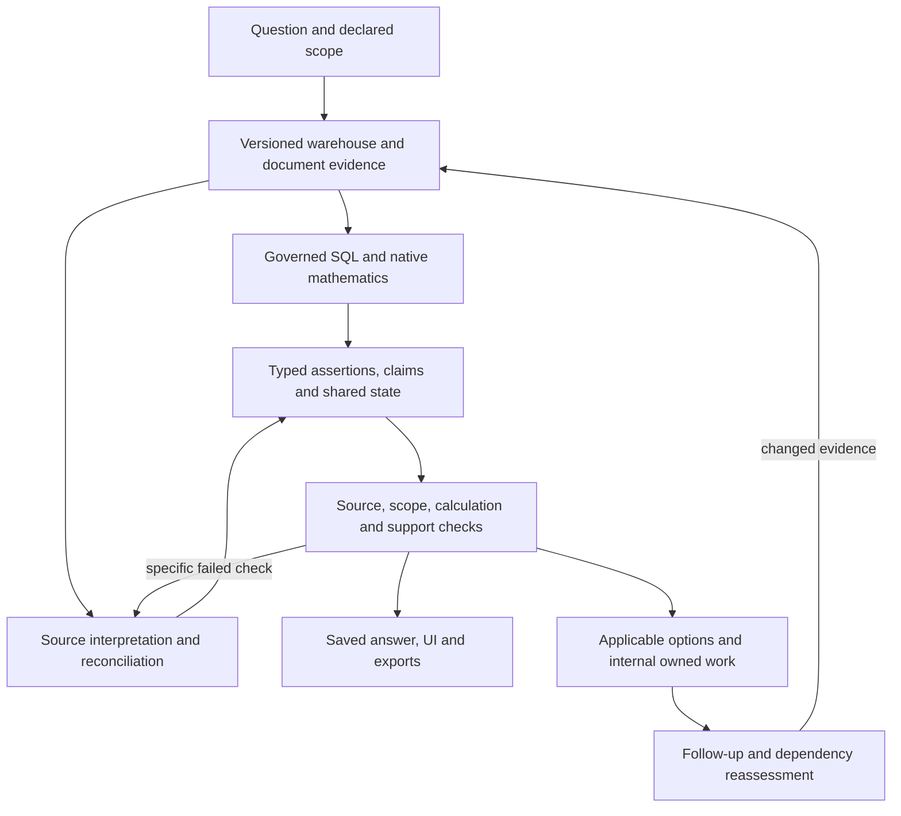

# Agere current local MVP delivery — 2026-10-30

Candidate branch: `codex/integration-20261026`. Product implementation: `5f095dc`; later checkpoint commits do not change the pinned product. Private draft PR: https://github.com/michaelplogan1-sketch/agere/pull/2.

**Local engineering acceptance: 9 of 9 requirements passed.** All ten charter areas remain represented. Independent model/method qualification, qualified clinical review and authorized production connections remain unassessed. Full research/clinical/product-charter acceptance is not claimed.

The shared source-to-answer-to-owned-work path now completes all six original individual questions and both full-roster population programs. It preserves explicit unknowns, immutable source lineage, failed attempts and exact canonical reopen. No external care or outreach was performed.

| Individual workflow | Selected received records | Complete groups | Internal review tasks | Engineering |
|---|---:|---:|---:|---|
| medication | 133 | 9 | 1 | passed |
| respiratory | 14 | 1 | 1 | passed |
| cardiometabolic | 113 | 6 | 1 | passed |
| functional | 25 | 2 | 1 | passed |
| appointment | 33 | 2 | 3 | passed |
| payer | 25 | 1 | 1 | passed |

Both respiratory and behavioral programs retain all 4,115 members, independently reconcile 112 and 129 documentary nominations, and preserve 241 internal software review handoffs. Combined with eight individual tasks, 249 tasks persist; these are internal software actions, not completed clinical services.

## Question flow and component roles

The request retains its entity/population, dates, definitions and output requirements. Native calculations and source interpretation contribute to shared source-bound state. The path varies by question; an analytical result does not require a service intervention.

| Component | Role and current limit |
|---|---|
| Warehouse adapter, SQL and native analytical engines | Governed source access, cohort calculations, source reconciliation, temporal/process and financial operators. Native population audits use zero provider calls. |
| Keyword search, MiniLM, reciprocal-rank fusion and BGE reranker | Source retrieval and ranking. Six paired comparisons share candidates; relevance/recall and clinical superiority are unqualified. UltraBERT additionally supports catalog/terminology retrieval where available. Exhaustive review ranking is off. |
| Claude Sonnet through subscription | Current source-reading, typed reconciliation and optional buyer-documentary planning. All 176 provider requests in this six-case ledger used Sonnet. The legacy Haiku/Sonnet ladder remains; best-model selection per role is not established. |
| Jev/TypeSafe and Perplexity | Bounded source-based classification/support judgments in the separate full healthcare verification work. New Jev calls are unavailable after credits exhaustion. |
| Qwen3-4B-based local skills, Kev/d1 readers and local routers/classifiers | Narrow candidate tasks with role/source-family qualification boundaries. They are not established replacements for Claude on these workflows; no new default promotion. |
| Typed assertions, source plans, relation/date bindings and reconciliation | Bind findings and claims to entity, subject, source, timing, polarity and uncertainty; combine text evidence with native results. |
| Contract, quotation/reference, source and calculation checks | Validate inspectable relationships and target affected repair stages. Model judgments and whole-packet unknowns remain separate from clinical validation. |
| Exact caches and parameterized checked workplans | Reopen exact valid results or rerun guarded native work for changed parameters; source/scope/meaning/correction mismatches decline reuse. |
| Buyer/payer matching and decision/task stores | Attach applicable options, prerequisites, owners and internal follow-up while keeping benefits, consent and clinical authority explicit. |
| Code-built UI, HTML/PDF, JSON and CSV | Render saved results, uncertainty and provenance consistently. |
| Ledger, immutable receipts, SQLite transactions and release checkpoints | Preserve all attempts/accounting and durable work; failed-key protection, idempotency/CAS and restart/restore are separate checks. |

## Changes tied to Claude’s review

Claude inspected supplied material without repository execution. Observed code gaps are distinguished from causal hypotheses; the original review is retained unchanged at `docs/agere/reviews/2026-10-29-claude-chief-architect.md`.

| Review concern | Implemented behavior and evidence | Remaining limit |
|---|---|---|
| Relations reconstructed from prose | Existing typed assertion/state/composition now binds source observations and claim support to entities, relations, dates and source units. All six current cases preserve the full original source scopes. | Passing strict source/contract checks does not establish clinical interpretation accuracy. |
| Wrong quantitative domain and clinician roles | Original full HFrEF recheck independently matches all 228 source-policy cells; 15 requested-class dose observations remain distinct from 74 other and 9 unclassified. Three unsupported assignment observations were removed; dated documented roles are retained. | The review’s proposed causal explanations were hypotheses. The full review still has 19 unknown whole-packet judgments. |
| Broad packet invalidation and weak repair feedback | Shared claim-local verification and stage-specific recovery retain unaffected evidence. Current recovery reparses saved source responses, exact quotes and citations; valid source passes survive later typed-output repair. | Provider-family correlation and verification accuracy remain unqualified. |
| Role-blind, expensive cascade | Current population mathematics uses no provider calls. Individual source-type baseline and optional buyer planner share exact source/answer bindings; all six same-input retrieval comparisons and all-attempt accounting pass. | No overall model winner or all-in cost saving is established; historical failed/partial arms remain preserved. |
| Learning and reuse without demonstrated transfer | Parameterized reuse changes years, reexecutes native calculations and matches 240 numeric cells on each transferred request with zero provider calls. Scoped negative feedback quarantines affected roles and retains rollback. | Machine labels are not clinician labels. No global/default model promotion or new broad training campaign. |
| Display and recovery gaps | Grouped report repair produces 32 record headings, zero false medication missingness warnings and a readable 34-page PDF. Current application packaging explicitly includes physical model mounts and canonical saved-answer reads in local operations mode. | Actual archived startup, canonical reopen, CAS/idempotency, restart, crash rollback and fresh restore pass. The current UI/API and independent durable evidence agree on nine engineering passes; clinical/model quality and production authority remain unassessed. |

## Current measured source and workflow evidence

- Source conformance independently matches all 2,396,490 received literal rows across 237 streams, the original 4,115-member roster and 39,763 unknown event dates. No generator truth or protected evaluation was opened.
- Independent authored adapter variant preserves equivalent semantics under renamed source fields, explicit missing mapping, correction/late-arrival handling and old-review reopening.
- Corrected balance, late arrival and conflicting latest snapshot each recompute one affected member while 4,114 remain exact. Missing patient attribution remains the specific acquisition dependency.
- Both population programs independently reconcile 694,445 financial rows, 43,654 accounts, 60,472 accounting identities and 628,822 service/adjudication/account links. Unresolved attribution and financial opportunity remain separate from realized savings.
- Prediction timing/outcome checks preserve the actual single-class eligible targets (107/253 recorded negatives). Estimates remain unavailable; no risk model is forced.
- Discovery reconciles 20,432 appointments, 12 monthly counts and 71,923 source hashes; exhaustive 2,048-partition baselines match. No causal effect is claimed.

The separate original full HFrEF recheck retains 57 patients, 53 native internal action records and 123 revised findings. Its 228 source-policy cells match, while 19 whole-packet judgments remain unknown. This earlier source-bound workflow remains partial/unverified; it is retained as supporting evidence rather than counted as another current complete workflow.

The current routing audit reopens all six exact canonical answers and unchanged tasks/follow-ups, compares source-type and optional buyer planning against the same answer/source versions, and retains all 176 provider request records (142 validated, 34 failed). It uses zero new provider calls. The actual failed request is refused against the read-only real ledger before reservation or network. Audit wall time is 1,222.6 seconds; this is native revalidation time, not a cold workflow speed benchmark. The shared ledger was moved atomically to durable local storage with byte/table identity and the original alias preserved.

## Actual local operations and current UI

The installed-operations run passed in 65.3 minutes. A consistent checkpoint sealed 34 databases and 678 files (71,334,221,021 bytes). Its executable archive contains 889 application/configuration files and 33,586 Python/runtime-library files. The archived interpreter actually started and reopened all eight decisions and all six canonical source answers.

The copied task advanced from revision 2 to 4 through an internal hold and prepared handoff. Duplicate replay returned the same update; a stale revision was refused. Restart retained committed work. A deliberate process exit during an uncommitted update to the actual copied task rolled that update back; committed work and idempotent replay survived. A fresh installation restored baseline revision 2 while the first installation retained revision 4. Original source work and all 176 shared provider-ledger rows remained unchanged. Hosted source inference and buyer-model planning were refused in local-operations mode. No qualification was transferred and no external action occurred.

The live candidate is [localhost:8888/ask](http://127.0.0.1:8888/ask); the verified report is [localhost:8888/stack-evaluation](http://127.0.0.1:8888/stack-evaluation). Its API and actual browser table show nine engineering passes, two unassessed qualification requirements and one unassessed external requirement. The case overview retains diagnostic `not run` and `unvalidated` labels: current full-source transport is checked separately, same-input retrieval comparisons live in the routing capability, and clinical/model accuracy remains unqualified. No labels were changed to conceal those limits.

Durable local evidence is in `/Users/mikel/clinical-insights-local/artifacts/agere-current-mvp-2026-10-30/acceptance-evidence-v1`. It independently revalidates the current report, trace hashes, implementation and capability evidence without depending on the temporary checkout. It preserves all 176 native response receipts, including all 34 failed responses, plus verification sources and distinctly labeled earlier supporting reports. Current ledger accounting was never copied or restored.

The sealed executable release is `/Users/mikel/clinical-insights-local/artifacts/agere-current-mvp-2026-10-30/operations-v1/release`; the checkpoint is `/Users/mikel/clinical-insights-local/artifacts/agere-current-mvp-2026-10-30/operations-v1/checkpoint`. Installed and restored copies remain beside them. The tested launch uses the archived `runtime/python/bin/python3.12` and `bootstrap.py serve --port <local-port>`, with the recorded nonsensitive environment in `operations-v1/runtime-configuration.json` and `PYTHONPATH`/`PYTHONHOME` cleared. This is a same-platform local package requiring its declared original external source/model resources and current shared ledger. It is not a standalone customer deployment. Install a sealed release into a fresh directory to roll back, retaining the previous installation and audit; never rewind the shared provider ledger.

## Full ten-area charter

| Area | Current evidence | Open dependency or limit |
|---|---|---|
| 1. Native source meanings | Full received-record conformance, typed source assertions and current individual/population composition | Source capture outside received contributions is unknown. |
| 2. Dependencies and acquisition | Correction, late arrival and conflict each affect one member; 4,114 stay exact; missing attribution stays bound | No external record acquisition is executed. |
| 3. Warehouse migration | Pinned original roster, all received rows/streams and independent adapter variant | Actual same-platform installation/recovery passed. Governed customer adapters and production authority remain external. |
| 4. Broader interpretation | Six original full-source questions and earlier clinical/utilization/access/financial compositions | Independent interpretation and clinical accuracy remain unqualified. |
| 5. Learning and model qualification | Scoped correction lineage, isolated candidates, parameterized reuse, regressions and rollback retained | Independent role-specific evaluation/calibration and justified promotion remain unmet. No broad training campaign or default activation. |
| 6. Clinical/program action support | Two full-roster programs, source/rule/buyer bindings and 249 internal review tasks | Benefits, clinical need, consent, actual service capacity and clinician authority remain unverified. |
| 7. Outcomes and prediction | Versioned 30-day targets, availability clocks and censoring; honest nonestimability | Selected eligible labels have one class; no qualified risk estimate or clinical outcome validation. |
| 8. Discovery and explanation | Source-linked appointment findings and exhaustive simple-baseline comparison | Artifact/process hypotheses remain hypotheses; no identified causal effect. |
| 9. Financial/contract performance | Independently reconciled received lifecycle amounts and versioned accountability definitions | Missing attribution/entitlement remains unresolved; opportunity is not realized savings. |
| 10. Full-stack product | Six complete individual workflows, two population programs, broad report parity and current routing/accounting | Actual archive/install/restart/restore, current UI/API and independently verified durable evidence passed. Model/clinical qualification and production prerequisites remain open. |

## Limits retained

All ten acceptance areas remain in `AUTONOMOUS_STACK_QUEUE.md`. Independent role-specific model/method qualification, qualified clinical review and authorized production connections remain separate requirements. Source sufficiency/capture, benefits, consent, real clinical capacity and clinician authority are not inferred from synthetic data. TypeSafe new calls are unavailable after credits exhaustion; no purchase or repeated probing. Subscription allocation, unreturned usage, local compute and independent reviewer effort leave actual total cost unknown. Native validation includes multi-minute calls, so no overall speed claim is supported.

The primary default product is unchanged. The candidate is local and private; there is no main merge, publication, new service, external dispatch or qualification transfer.
