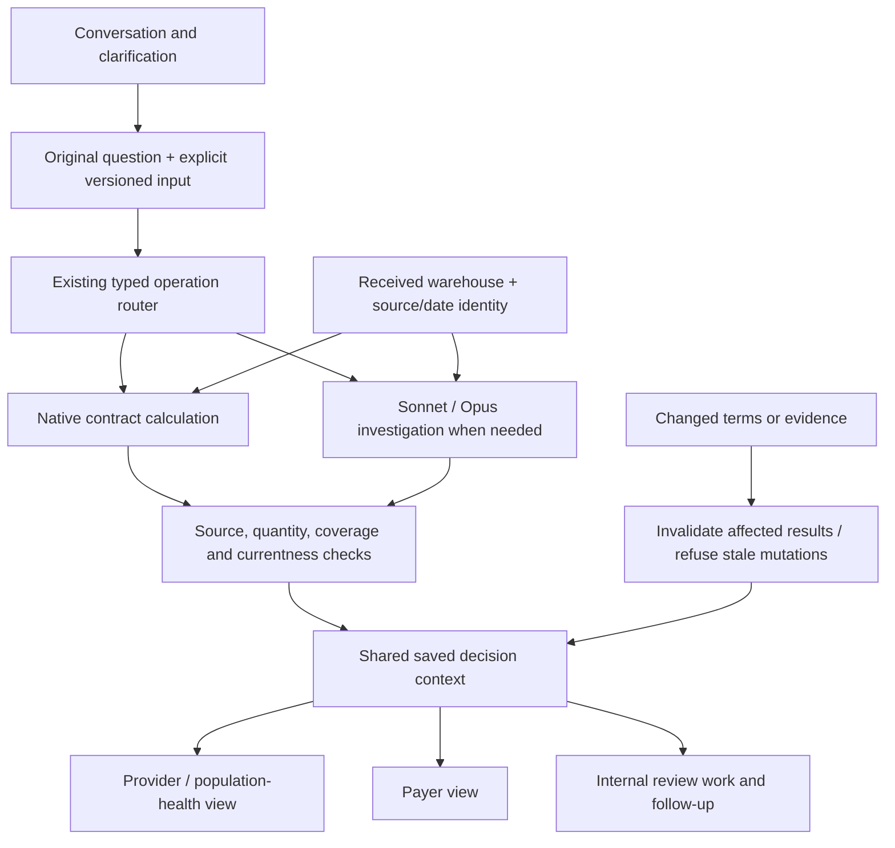

# Wollstonecraft: synthetic contract-performance engineering evaluation

Draft, November 10, 2026. Local development evidence; not published, independently clinically qualified, or ready for customer deployment.

## Finding

The selected synthetic contract workflow now connects explicit input selection, native computation, payer/provider views, saved analysis, internal review work, changed-term invalidation and rollback. The final development comparison also found a substantial failure: the frozen Agere arm took 267.44 seconds and 30 provider attempts, then returned a partial answer. A targeted repair subsequently delivered the complete requested native report through ordinary HTTP entry in 36.06 seconds with four new provider attempts. Those observations are separate. They do not establish general superiority, an accuracy advantage, or a market-ready product.

The current candidate has an explicit remaining delivery dependency: packaging and a clean installation rehearsal. The saved storage rule refuses package creation/opening below 60 GB free; approximately 43 GB is available. No new warehouse, model, Python-runtime or cache copy was created to work around that refusal.

## Purpose and research basis

Agere, Project Wollstonecraft, aims to turn business questions into inspectable analytical decisions and useful follow-through at a measured total inference cost. Healthcare is the synthetic proving ground. Population health and value-based payment remain central examples within a broader healthcare charter; other industries are an architectural portability goal, not a demonstrated release claim.

The design combines ordinary code and mathematics with model judgments. Received source identities, entity/date roles, units, missingness and versioned assumptions are carried through a shared decision context. Native operations perform joins, exposure accounting, cent arithmetic and registered rule evaluation. Typed models can select an operation or judge coverage; Sonnet/Opus can investigate requests that the governed route cannot support. These roles need separate evidence. A fast small-model vote is not automatically a qualified semantic judgment, and a correct calculation does not establish clinical appropriateness.

The [October 11 architectural baseline](../../AGERE_PRINCIPAL_REVIEW_2026-10-11.md), [current principal review](PRECOMMERCIAL_STACK_AUDIT_2026-11-02.md), [product direction](../../AGERE_PRODUCT_DIRECTION.md) and [research handoff](../../AGERE_RESEARCH_HANDOFF.md) retain the project rationale and wider requirements. They are design history, not independent proof that every researched method is implemented or qualified. The separate Documents research corpus was not accessed for this evaluation. No new model catalog, training campaign, service or industry implementation was added. Parameterized reuse remains optional; bottling is off in the evaluated economical runtime profile.

The proposed differentiation is the connected combination of source-bound analysis, native execution, selective model use, reusable evidence and persistent work. This evaluation does not prove that nobody else has combined these methods. It contains no exhaustive prior-art review, customer willingness-to-pay evidence or market-size estimate. Provider/population-health and payer teams are buyer hypotheses to validate after the synthetic engineering release.

## Executed stack

The ordinary repaired request used the existing System One operator router. Its four new attempts were two Jev and two Sonnet calls; earlier routing responses could be cached. This is a warm development confirmation. The failed frozen arm used seven Jev, eleven Sonnet and twelve Opus attempts. No model performed the contract's financial arithmetic.

## Inputs, scope and observed result

The received warehouse configuration identifies source SHA256 `99d39a1bc4b899e5632f91776077cfa221cc6cc9812ac8b5de60318ce6ad4940`, observation date `2030-05-27`, and semantic version `semantic-layer/20`. The evaluation preserves that source and its original received roster. The selected contract subset is not a replacement warehouse or a population cap.

The explicit registered input is `demo-vbc-2029-c3`: payer `WH-PAYER-C3`, performance period January–December 2029, benchmark $1,000 per recorded member-month, illustrative sharing rate 50%, and approximate CBP quality target 70%. These terms are authored synthetic demonstration assumptions, not a received payer offer or executed contract. The registered CBP approximation has reference specifications from other measurement years; its use here does not establish a valid 2029 contract specification.

| Native result | Observed value | Meaning |
| --- | ---: | --- |
| Recorded attributed members | 413 | Members with the selected received payer/member-month attribution |
| Recorded member-months | 4,385 | Not inferred event-date eligibility or enrollment completeness |
| Included metric claims | 3,842 | Same patient, payer and attributed member-month; excluded categories retained separately |
| Observed allowed cost | 168,827,048 cents ($1,688,270.48) | Received payer allowed amounts; not provider revenue or cash |
| Authored benchmark | 438,500,000 cents ($4,385,000.00) | Scenario benchmark multiplied by recorded exposure |
| Positive benchmark variance | 269,672,952 cents ($2,696,729.52) | Scenario arithmetic; not realized causal savings or settlement |
| Approximate quality | 9 / 46 | Registered approximation, incomplete capture/clinical suitability unestablished |
| Illustrative provider share | $0 | Authored quality target is not met; no payment entitlement established |
| Complete partitions | 12 months; 116 practices | Descriptive contributions, not causal attribution |

Integer cents and native ratios are retained. The ordinary HTTP member table presents two-decimal USD: 2,065 monetary cells match that presentation rule. Strict conversion of rounded PMPM displays back to cents differs in 357 cells, by at most approximately half a cent. That display rounding is disclosed separately from the exact native checks. Overview cards round amounts to whole dollars. The existing browser member preview shows 200 rows and explicitly offers the complete 413-row CSV; monthly and practice CSVs contain all 12 and 116 rows.

Missing source capture, unavailable clinical evidence, event-date eligibility outside recorded exposure, risk adjustment, completion factors, causal benefit and settlement entitlement are not invented. Internal evidence-review work does not authorize outreach or real care.

## Comparison design and results

The frozen [protocol](../../artifacts/agere-contract-release-2026-11-10/protocol.json) supplied the same authored terms and approximate quality definition to all three arms. The received semantic representation and source clock were shared. Raw-schema frontier received schemas and SQL access. Governed frontier additionally received the existing governed definitions and analytical tools. Agere used the normal product planner and checks. Raw-schema here means the received semantic SQLite schema, not independent ingestion of raw clinical documents.

The question requested every attributed member, both buyer views, complete monthly/practice drivers, observed cost, benchmark, variance, approximate quality and limitations. Execution order was frozen before collection: governed frontier, raw-schema frontier, Agere. Learning writes were disabled during these arms; source/code/earlier-attempt identities were checked. There was one wording per arm, on a known development workflow. No population accuracy, p50/p90 latency, randomized statistical comparison or clinical gold-standard result can be estimated from it.

| Frozen arm | Analysis seconds | New caller-visible attempts | Known API-equivalent USD | Observed outcome |
| --- | ---: | ---: | ---: | --- |
| Governed-tools Sonnet | 47.94 | 4 | 0.440932 | Native finance reconciled; final member table present, full monthly/practice arrays omitted; contradictory missing-output prose |
| Raw-schema Sonnet | 63.77 | 5 | 0.401454 | Partial monthly result; no complete member/practice/quality outputs; $385.00 headline PMPM differs from received ratio rounded to $385.01 |
| Agere before repair | 267.44 | 30 | 7.707270254 | Native finance reconciled; source-bound quantitative prose rejected, final answer partial |

The raw-schema model reported tool unavailability. All four recorded SQL calls and all five caller-visible provider attempts returned without recorded service errors. The cause of that statement is unestablished; it is not recorded as a proven provider outage.

| Separate development observation | Analysis seconds | New attempts | Known API-equivalent USD | Scope |
| --- | ---: | ---: | ---: | --- |
| Ordinary Agere request after routing repair | 36.06 | 4 | 0.37792312 | Same full wording; normal HTTP entry, complete 413/12/116 report and save/reopen; warm targeted confirmation, not a replacement frozen arm |
| Current provenance/native confirmation | Not compared | 0 | 0 new provider usage | Re-executed the retained typed plan after a metadata correction; current saved HTTP/browser view; no fresh ordinary planning claim |

Earlier named-command development evidence remains separate: native initial calculation 4.47 seconds/two Jev attempts/$0.000212184 API-equivalent, changed-term calculation 5.33 seconds/two Jev attempts, and a governed-Sonnet comparison 20.22 seconds/four attempts/$0.4741395. Those simpler entry points are not substitutes for the full wording above. Exact-repeat, changed-parameter and changed-source behaviors are evidence about reuse/currentness, not additional independent accuracy samples.

The three frozen arms consumed 39 caller-visible attempts and $8.549656254 known API-equivalent usage. Including the separate four-attempt repair gives 43 attempts and $8.927579374; all 43 recorded attempts are validated and priced. The earlier development work is additional separate usage. Subscription cash allocation, provider-internal CLI attempts, local compute and human review cost remain unknown. No cost per independently useful answer or clinical accuracy percentage is claimed.

## Failure located and correction demonstrated

The frozen Agere arm's native numbers were not the problem. Jev selected the contract operation, but generic numeric filling treated the explicit contract identifier/year as unplaced method parameters. The existing operation also did not declare its intrinsic month/practice grouping to the generic question checks. The fallback then repeatedly tried to express already-computed quantities through the generic prose compiler.

The correction binds exactly one explicitly named registered input and its matching period to the existing typed operation. Unknown/multiple IDs, a conflicting year or additional numeric constraints still defer. The engine now declares its actual monthly/practice partitions. Its complete native execution, source/current-input identity and full field/scope/uncertainty contract are available to the existing semantic coverage check; literal binding does not certify every extra free-text request.

Browser inspection found a second issue: wording-based lint attached an unrelated claim-financial-metric annotation. The answer now carries the actual executed contract operation in `computed_as`. The financial algorithm, units, source-role checks and clinical thresholds were not changed. After this metadata correction, the retained plan was re-executed with no provider calls and saved as current context `ANS-72bdb20a4fbffdeeb17f13f2`. Historical contexts remain preserved and can become stale under changed code bindings.

The independent received-source financial reference reconciles 4,879 keyed projection cells for each complete native report: summary, all members, all months and all practices. This count includes row keys as well as financial values. It includes both the failed frozen Agere computation and the repaired native computations. It establishes the declared financial projection, not independent clinical validation. The final affected suite ran 170 tests: 169 passed and one opt-in integration check skipped. Failed test/scorer assumptions and intermediate declines remain recorded; they are not provider outcomes.

Currentness/work evidence created 60 internal review items, persisted one status change, rejected mutation after a benchmark edit and recovered the prior context/work exactly after restoring base terms. The prior connected input delivery separately recomputed the edited benchmark and preserved the 60 original/59 revised work histories. The newest metadata change does not alter those mutation methods, but these earlier contexts are not silently restamped as current under its new code digest.

The repaired router's certificate remains uncalibrated/unverified. Jev did not decide the complete coverage judgment; its cross-check was below the existing decision threshold and Perplexity was unavailable. This evaluation does not turn those annotations into qualification, lower thresholds or launch a broad recalibration campaign. Native reconciliation, output completeness and actual UI behavior support the scoped engineering result only.

## Release decision and remaining dependencies

**Accept the demonstrated workflow as a scoped synthetic engineering candidate; do not call it a packaged release or full MVP.** The frozen comparison does not support the combined accuracy/cost superiority hypothesis. It exposed a costly orchestration failure; the targeted correction is useful development evidence, with generalization still unmeasured.

The [full ten-area backlog](../../AUTONOMOUS_STACK_QUEUE.md) and [all25 observed-case history](../../artifacts/agere-current-25case-2026-11-09/summary.json) remain intact. The November 9 frozen collection recorded 19 partial ordinary answers, two preserved exceptions, Q22/Q23 blocked, Q24 rendered and Q25 passed its declared engineering scenario. Later repairs do not rewrite that history. The first synthetic release is narrower than the permanent charter.

The remaining delivery step is a code-only same-machine package and clean-start rehearsal with explicit references to the existing Python environment, received warehouse, model resources and mutable usage/work stores. The [package preflight](../../artifacts/agere-contract-release-2026-11-10/package-preflight.json) refused creation under the [saved disk rule](../../AGERE_STORAGE_PLAN.md). A concrete [package proposal](../../artifacts/agere-contract-release-2026-11-10/code-only-package-proposal.json) identifies the code bytes, dependencies and no-copy scope. It is a proposal, not a produced archive, a backup or a clean-install success. Sufficient free space or an explicit user change to that package rule is required before executing it.

Independent clinical/measure validation, calibrated model-role qualification, broader workflow generalization, complete recoverable backup and customer hosting/security/integration prerequisites remain separate. OWASP/HHS work stays deferred. No new provider campaign is needed merely to repeat this passing workflow. No automatic push, scheduler restart, main merge, external publication or real care action is authorized by this release decision.

## Reproducibility and recovery

The evidence root is [agere-contract-release-2026-11-10](../../artifacts/agere-contract-release-2026-11-10). `protocol.json`, `code.json`, per-arm `receipt.json`, complete compressed results and `new-provider-attempts.json.gz` retain original collection. `engineering-score.json` is regenerated by `score_evaluation.py` using the received-source financial reference and read-only exact result-cache lookups where HTTP uses native references. Regenerating that score makes no provider call and does not execute a new analytical question. It requires the declared existing native-result store.

`ordinary-repair-v1/current-work-term-proof.json` records the work/currentness checks. `provenance-v1/receipt.json` and `ui-finished.json` record the current native and browser proof. The [delivery receipt](../../artifacts/agere-contract-release-2026-11-10/delivery-receipt.json) binds this increment's code and evidence. Use the durable checkout and pinned active configuration; do not copy a large database or implicitly rebuild semantic materialization to rehearse it.

Prior local recovery commits are `33dd05f9` (preceding checkpoint) and `9ea7e635` (connected input/work delivery). A rollback must preserve current mutable work, input revision history, evidence and ledger; old saved contexts retain their original code/source bindings. No reset, data deletion or qualification transfer follows from choosing a prior code revision.
