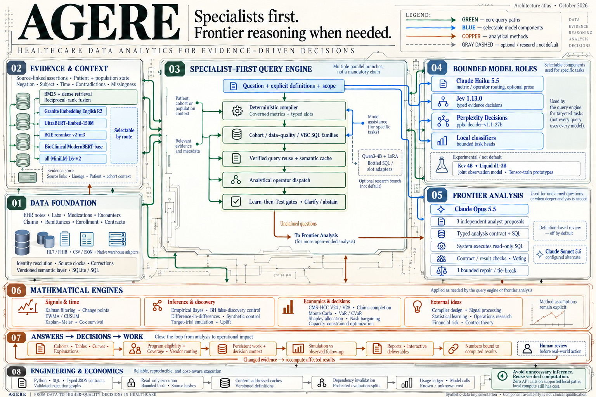

# Agere: why the stack exists

October 19, 2026. Source baseline: `8687121`; live architecture plus selectable and research branches. All demonstrated patient data are synthetic.

The engineering proposition is selective computation: preserve the question's meaning, use reusable domain code where it applies, and spend on model inference where it adds capability. Several routes share one execution and evidence contract. The poster shows the major subsystem families, not every source file or a mandatory sequence of model calls.

## Component rationale

| Component | Problem it addresses / why include it | Dispatch and tradeoff | Source |
|---|---|---|---|
| Source adapters, identities, clocks, semantic tables | Clinical and financial records disagree in naming, timing and revision. Normalize delivered evidence before any reasoning. | Required foundation. Correct SQL cannot rescue incorrect source mapping. | `onboarding/workspace.py`, `clinical/semantic_layer.py` |
| Deterministic question compiler | Repeatedly generating definitions and code for understood questions adds avoidable variation and inference. Compile supported meaning into explicit operations. | First opportunity to answer. Decline qualifiers it cannot represent; limited grammar is preferable to silently broadening a population. | `clinical/local_compiler.py` |
| Governed metrics and SQL families | Numerators, denominators, windows and units should be explicit and reusable. Parameterized families cover many combinations without a separate bespoke query for each. | Deterministic parsing where possible; a small model may fill bounded slots. Incorrect domain definitions remain possible and require independent checks. | `clinical/metrics.py`, `clinical/metric_families.py`, `clinical/cohort_families.py` |
| Verified-query reuse and semantic cache | Repeated questions and eligible paraphrases should reuse work. | Reuse is conditioned on matching context and relevant slots. Similar text alone is insufficient; invalidation is part of correctness. | `clinical/semantic_cache.py`, `clinical/economical_planner.py` |
| BM25, dense retrieval and reciprocal-rank fusion | Exact clinical terminology and semantic paraphrases have different retrieval failure modes. Combine signals before selecting evidence. | Retrieval narrows candidate material. A relevant-looking passage is not proof of clinical entailment or complete evidence. | `clinical_core/hybrid_retrieval.py`, `clinical_core/neural_stack.py` |
| all-MiniLM-L6-v2, Granite Embedding English R2, UltraBERT-Embed-150M | Compact semantic representations for configured retrieval/routing paths. | Selectable components, not three mandatory encoders per question. Encoding has local compute cost even without API charges. | `clinical_core/local_encoders.py`, installed model manifests |
| BGE reranker v2-m3; BioClinical ModernBERT-base | Rerank candidate passages; provide clinical-text representations for bounded interpretation tasks. | Route-specific. Reranking cannot recover evidence omitted by retrieval; an embedding is not a clinical decision. | `clinical_core/neural_stack.py`, `clinical_core/local_encoders.py` |
| Claude Haiku 5.5 | Map unfamiliar phrasing to a known metric/operator or produce optional bounded prose. | Prefer choosing typed operations to inventing their mathematics. Slot validation still decides what may execute. | `clinical/metric_router.py`, `clinical/operator_router.py`, `plans/narrative.py` |
| Jev 1.13.0; Perplexity Decisions (`pplx-decider-v1.1-27b`); local task heads | Bounded evidence classifications and typed decisions where the configured path supports them. | Specialized choices can reduce free-form generation. Acceptance and task-specific calibration matter more than model size. | `clinical/therapy_barriers.py`, `clinical/context_student.py`, `gateway.py` |
| Learn-then-Test cascade gates | Control when a calibrated cheap route can claim an answer and when it must defer. | Guarantees are conditional on calibration, binding and distribution assumptions. Uncertified routes are identified; this is not a universal correctness certificate. | `clinical/cascade.py`, `clinical/conformal.py` |
| Claude Opus 5.5 analysts | Handle questions outside specialist coverage while retaining executable outputs. | Three proposals; typed contracts; system-run read-only SQL; result checks; at most one mechanical repair/tie-break. More expensive than one call. Same-model proposals can share errors; voting is not proof. | `hybrid/live.py`, `hybrid/contract.py`, `hybrid/execute.py`, `clinical/together.py` |
| Claude Sonnet 5.5 alternate | Preserve configured alternative/historical hybrid policies. | Not the current default analyst or repair model. The registered historical E study arm remains explicitly pinned. | `bench/study/common.py` |
| Mathematical operators | A language model can choose an analysis; the implementation should compute the estimator, exclusions and uncertainty. | Dispatch only for relevant questions. Method availability does not establish identified causal effects or clinically valid predictions. | `clinical/capability_registry.py` |
| Plans, work, simulation and deliverables | Carry the computed population and evidence into program routing, saved decisions and reviewable outputs. | Scenarios stay separate from observed outcomes. Generated deliverable numbers must bind to tool results. Human review precedes real-world action. | `plans/`, `simulator/`, `deliverables/` |
| Typed graphs, source hashes, caches and ledger | Make execution bounded, reproducible, attributable and inspectable. | Engineering controls support reliability but do not independently validate source semantics or clinical meaning. | `clinical/analysis_graph.py`, `clinical/graph_contracts.py`, `gateway.py` |

Paths above are relative to `clinical_core/agere/` unless they start with `clinical_core/` or `bench/`.

## Mathematical and external ideas

* **Compiler and database design:** typed intermediate graphs, parameter validation, reusable query plans, content-addressed caches and dependency invalidation.
* **Signal processing and process control:** Kalman trajectories, uncertainty-weighted change points, EWMA/CUSUM and matched early-event signatures.
* **Statistics and causal inference:** Kaplan–Meier/Cox survival, empirical Bayes, false-discovery control, difference-in-differences, synthetic controls, target-trial emulation and uplift. Each requires its own observable inputs and assumptions.
* **Finance and actuarial reasoning:** CMS-HCC factors, claims completion, Monte Carlo scenarios, VaR/CVaR and contract settlement arithmetic.
* **Operations research and game theory:** capacity-constrained selection, Shapley allocation and Nash bargaining under explicit objectives and assumptions.

These are established concepts assembled for healthcare workloads. Combining them is not evidence that Agere invented the underlying methods.

## Optional and research branches

Qwen3-4B bottled SQL/slot LoRA paths exist but are off by default. They aim to turn previously verified work into reusable local inference; availability is not a promotion decision. Kev 4B and Liquid d1-3B experiments did not satisfy their frozen acceptance rules and did not replace the default reader. Joint observation and tensor-train prototypes remain experimental. Showing these as disabled/research branches is deliberate: complexity alone is not a reason to ship a component.

## Cost statements we can substantiate now

| Observation | Measured model API cost | What it supports |
|---|---:|---|
| Live population-count request: 4,095 synthetic patients, 0.49 seconds, zero new paid calls | **$0.0000** | A concrete supported question can execute without a model API charge. |
| Nine independently reconciled Gold 10 questions, saved S1 Agere run | **$0.00 total** | All nine passed the registered scorer without incremental model API charges on that small workload. |
| Same nine questions, saved S1 Opus SQL baseline | **$1.89 total** | Seven passed; a small observed comparison, not general model or vendor superiority. |
| Subsequent complex grouped-query repair check | **$0.151273 new API estimate** | This specific verification used cached prior requests plus new requests. It is not a cold-query price or general per-question quote. |

Recommended external wording:

> On a live 4,095-person synthetic warehouse, Agere answered a population-count question in 0.49 seconds with zero model API calls and $0 in incremental model API charges. Other questions may require paid models; per-request usage is recorded.

Local hardware, setup, ingestion, embeddings, model preparation, maintenance, failed/unpriced requests and human review are not all included in these amounts. API estimates are usage-based estimates, not reconciled invoices. Unknown cost is never zero. No new paid evaluation was performed to prepare this guide.

For a customer workload, report the fractions answered by each route, cold and warm costs, abstentions, correctness, retries and review effort. Average cost depends on that workload mix. Compare the **total cost per correctly completed task** with a capable baseline that has equivalent evidence and tools. A cheaper route that answers the wrong question is not a saving.

Evidence: `artifacts/product-workflows/frontier-fallback-2026-10-19/live-specialist-result.json`, `repaired-result.json`, and [saved analytical evidence](../study/PROOF_STATUS.md). Existing synthetic checks establish finite behavior, not clinical qualification.

## Image provenance

Generated and revised with the built-in OpenAI image-generation tool. The tool did not expose its underlying model version; no claim about an exact model name or worldwide ranking is made. No Runway upgrade or paid external image generation was used. The [original prompt](stack-atlas-prompt-2026-10-19.txt) and [targeted correction](stack-atlas-edit-2026-10-19.txt) are retained. Gray dashed branches are optional/research; selectable model lists do not mean every model runs for every question.
