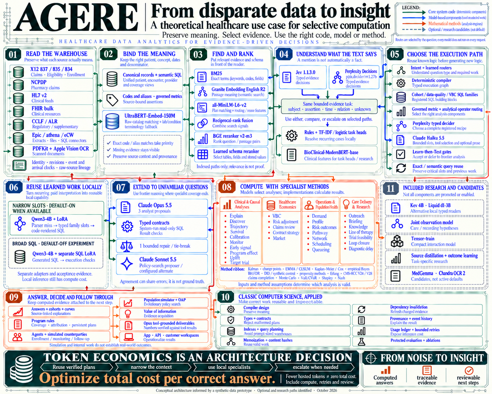

# Agere: how the full stack answers a question

October 19, 2026 · 100 component/role entries · all 29 registered analytical engines. Current image: LinkedIn conceptual-use-case edition; earlier posters are superseded.

**The architectural advantage is to preserve meaning, select relevant evidence, interpret ambiguous language in bounded tasks, and execute the right calculation. Each layer addresses a different source of error. Selective routing and reuse are intended to improve economics at the same time.**

A health warehouse provides records. A defensible answer also needs the correct patient identity, time window, concept mapping, denominator, interpretation of notes, estimator and source lineage. Agere supplies those mechanisms above the warehouse. It does not run every component for every question.

## The roles that were previously too vague

**Jev and Perplexity overlap.** They implement the same typed evidence-decision role: supplied state plus named questions, allowed choices and probabilities. Agere supports selecting either, comparing them, or an optional Jev → Perplexity → Claude cascade for unresolved therapy-barrier cases. Perplexity has an additional configured job selecting curated analysis recipes. These are routing choices, not mutually exclusive model capabilities.

**Qwen is not one undifferentiated experiment.** The narrow Qwen3-4B LoRA translates language into slots that existing code turns into SQL. A separate broader LoRA writes SQL directly. The narrow slot adapter is enabled by default when its model is available and runs only after a parser miss or missing slots; the broader SQL adapter is default-off. They have different acceptance evidence. The old chart-to-JSON experiment is a third historical use and does not evaluate the later narrow-slot adapter.

**UltraBERT is not a second chat assistant.** Its two specific jobs are raw-catalog retrieval and thresholded lab/condition terminology fallback. MiniLM helps routing/reuse, Granite helps passage retrieval, BGE reranks passages, and the learned schema reranker selects database items. These layers work on different objects.

**The intended accuracy benefit is a chain of specific protections:** source identity and clocks prevent mixing records; definitions preserve the requested denominator; retrieval/reranking expose useful evidence; typed readers distinguish what that evidence says; SQL and mathematical operators compute; contracts and provenance make the result checkable. A missing prerequisite still remains missing.

## Three question paths

| Question type | Relevant route | Why those parts are needed |
|---|---|---|
| Count / cost / cohort | Scope → compiler or governed family → SQL → result checks | Evaluate the full defined population; retrieved top snippets are not a denominator. |
| What does this note establish? | Patient/date scope → lexical+dense search → reranker → rules/local head or Jev/Perplexity → source-bound assertion | Relevance, truth of an assertion, subject and time are separate decisions. |
| Unfamiliar analytical question | Scope/schema selection → applicable engine or Opus analyst contracts → system-run SQL/math → checked answer | Extend coverage without allowing prose to substitute for computation. |

These are explanatory routes, not a claim that a new composite example was executed in this documentation turn. An indexed full-stack build and a customer workspace need not expose identical retrieval facilities.

## Complete component map

Named components from the handoff, current code/model registry, original atlas, all registered PRODUCT analytic engines, and named research/candidate branches. A component is a model, mechanism or product subsystem, not every Python function or dependency.

Each entry includes the job, the error it addresses, its economic purpose, current status and source. Optional and research entries remain in the map.

### Data and meaning

#### Native feed parsers

**Job:** Read X12 837/835/834, NCPDP, HL7 v2, FHIR bulk, CMS CCLF/ALR and Epic/athena/eCW extracts.
**Why it helps:** Claims, payments, enrollment and clinical events have different structures and revision rules; preserve their meaning before querying.
**Economics:** Parse and normalize once; reuse the resulting records.
**Status:** Implemented; adapter coverage is format-specific.
**Source:** [docs/agere/NATIVE_FEED_INVENTORY.md](../../../docs/agere/NATIVE_FEED_INVENTORY.md)

#### Warehouse connectors and workspaces

**Job:** Connect to Snowflake, BigQuery, Databricks, Postgres, SQLite, DuckDB and file drops through configured adapters.
**Why it helps:** Bind queries to the customer’s actual schema and snapshot rather than a generic invented database.
**Economics:** Workspace profiling and mapping are reused across questions.
**Status:** Implemented; each connection requires its SDK/configuration.
**Source:** [clinical_core/agere/onboarding/connectors.py](../../../clinical_core/agere/onboarding/connectors.py)

#### Profiling, mapping and activation

**Job:** Profile fields and values, map canonical domains, retain raw tables, persist mapping review and run workspace verification.
**Why it helps:** A correct-looking query is useless if a source field was mapped to the wrong concept. Raw passthrough retains access beyond modeled tables.
**Economics:** Resolve recurring mappings once; avoid rediscovering schema on each question.
**Status:** Implemented; ambiguous mappings retain review states.
**Source:** [clinical_core/agere/onboarding/workspace.py](../../../clinical_core/agere/onboarding/workspace.py)

#### Identity, revisions and source clocks

**Job:** Keep patient identity, record versions, event dates and arrival dates.
**Why it helps:** Avoid mixing people, counting replacements twice, or using evidence that arrived after the requested cutoff.
**Economics:** Shared preprocessing replaces repeated chart reconstruction.
**Status:** Core data contracts.
**Source:** [clinical_core/agere/clinical/semantic_layer.py](../../../clinical_core/agere/clinical/semantic_layer.py)

#### Canonical records and semantic SQL layer

**Job:** Expose patient, encounter, measurement, medication, enrollment, claim and payment meanings as queryable entities.
**Why it helps:** Keep order, fill, use and administration distinct; preserve reversals and the meaning of financial amounts.
**Economics:** Reusable SQL tables make common answers computational rather than generative.
**Status:** Core; source support varies by workspace.
**Source:** [clinical_core/agere/clinical/semantic_layer.py](../../../clinical_core/agere/clinical/semantic_layer.py)

#### Codes, aliases and domain definitions

**Job:** Use explicit ICD/SNOMED, LOINC, RxNorm/NDC and other received code mappings and controlled vocabularies.
**Why it helps:** Connect user language to the appropriate condition, measurement or medication without relying on name similarity alone.
**Economics:** Deterministic mappings avoid hosted interpretation for known terms.
**Status:** Exact code/alias matching precedes embedding fallback.
**Source:** [clinical_core/agere/clinical/concepts.py](../../../clinical_core/agere/clinical/concepts.py)

#### Patient state and source-bound assertions

**Job:** Track assertion, subject, time, relation, conflicts and missing evidence separately.
**Why it helps:** A past family-history mention must not become a current patient condition; a planned referral must not become completed care.
**Economics:** Structured assertions can be reused by multiple queries.
**Status:** Implemented bounded interpretation; unresolved facts remain unresolved.
**Source:** [clinical_core/agere/clinical/semantic_reader.py](../../../clinical_core/agere/clinical/semantic_reader.py)

#### PDFKit and Apple Vision OCR

**Job:** Extract text from PDFs and scans with source coordinates.
**Why it helps:** Make non-tabular source material inspectable and retain its relationship to the original document.
**Economics:** Native extraction avoids a hosted model call for routine OCR.
**Status:** Native extraction path; OCR quality still matters.
**Source:** [config/agere/models.json](../../../config/agere/models.json)

### Retrieval and reranking

#### BM25 lexical retrieval

**Job:** Rank candidate passages or schema items by exact words and weighted term matches.
**Why it helps:** Medical codes, drug names and rare field names can matter more than broad semantic similarity.
**Economics:** Cheap local candidate selection.
**Status:** Used in lexical/hybrid retrieval.
**Source:** [clinical_core/hybrid_retrieval.py](../../../clinical_core/hybrid_retrieval.py)

#### Reciprocal-rank fusion

**Job:** Merge lexical and dense rankings without treating their raw scores as interchangeable.
**Why it helps:** A candidate found by one retrieval method can survive even when the other misses it.
**Economics:** Combines existing search signals without another generative call.
**Status:** Used in passage/catalog retrieval.
**Source:** [clinical_core/hybrid_retrieval.py](../../../clinical_core/hybrid_retrieval.py)

#### BGE reranker v2-m3

**Job:** Score a question and each shortlisted passage together, then reorder candidates.
**Why it helps:** Separate passages that merely mention the topic from those more directly relevant to the question.
**Economics:** Spend local reranking compute on a shortlist; send less irrelevant text to downstream models.
**Status:** Available on indexed retrieval paths; not every workspace has a passage index.
**Example / method:** Question: did the patient decline treatment? A directly relevant refusal passage should outrank a general drug mention.
**Source:** [clinical_core/agere/clinical/warehouse_retrieval.py](../../../clinical_core/agere/clinical/warehouse_retrieval.py)

#### Learned schema reranker

**Job:** Rank tables, columns, streams, fields and stored values using lexical, embedding and small logistic-model features.
**Why it helps:** A SQL writer needs the right field and exact stored value; hiding them in a huge catalog creates avoidable query errors.
**Economics:** A focused schema slice uses fewer prompt tokens.
**Status:** Integrated schema-selection layer.
**Source:** [clinical_core/agere/clinical/schema_rerank.py](../../../clinical_core/agere/clinical/schema_rerank.py)

#### Source windows and protected evidence

**Job:** Keep full token windows, source offsets, patient/date scope and protected exception passages.
**Why it helps:** Avoid silent truncation or dropping the sentence that changes the interpretation. Top-ranked snippets still do not establish complete population coverage.
**Economics:** Bound the material being interpreted while preserving traceability.
**Status:** Index-dependent; missing indexes are explicit.
**Source:** [clinical_core/hybrid_retrieval.py](../../../clinical_core/hybrid_retrieval.py)

### Models and learned specialists

#### all-MiniLM-L6-v2

**Job:** Compact local embeddings for candidate-plan matching, routing features and eligible query reuse.
**Why it helps:** Recognize related phrasing without making a large model regenerate a known analysis.
**Economics:** Local embeddings and cached vectors avoid repeated hosted routing.
**Status:** Installed; role depends on route and workspace.
**Source:** [clinical_core/agere/clinical/economical_planner.py](../../../clinical_core/agere/clinical/economical_planner.py)

#### Granite Embedding English R2

**Job:** Create dense representations of source passages for semantic retrieval.
**Why it helps:** Find relevant wording even when the question and note use different terms.
**Economics:** Local indexed retrieval narrows downstream context.
**Status:** Installed retrieval branch; not an extra mandatory encoder on every query.
**Source:** [clinical_core/hybrid_retrieval.py](../../../clinical_core/hybrid_retrieval.py)

#### UltraBERT-Embed-150M

**Job:** Retrieve raw-catalog streams and propose lab/condition terminology matches when codes and aliases fail.
**Why it helps:** Find the relevant source outside the modeled fast path, and connect unfamiliar source labels to known concepts.
**Economics:** Cache catalog vectors; encode the new question locally.
**Status:** Enabled by default when available; thresholded fallback. Not the MiniLM router or semantic cache.
**Example / method:** It can propose a matching lab concept; below-threshold matches remain proposals. Medication brands use the explicit brand table instead.
**Source:** [clinical_core/local_encoders.py](../../../clinical_core/local_encoders.py)

#### BioClinical-ModernBERT-base

**Job:** Encode clinical text into features for task-specific heads and alternative action proposals.
**Why it helps:** Clinical representations give a small downstream classifier more context than isolated keywords.
**Economics:** Reuse frozen local features; a small head can be cheaper than repeated generative reading.
**Status:** Installed; research/training branches. Not a universal accepted clinical reader.
**Source:** [config/agere/models.json](../../../config/agere/models.json)

#### Jev 1.13.0

**Job:** Return constrained evidence decisions and probability distributions under a typed question/choice contract.
**Why it helps:** Distinguish affirmed, negated, historical, other-person, hypothetical or unresolved statements rather than accepting any mention as fact.
**Economics:** Bounded classification can avoid generating a long explanation for every excerpt; hosted usage is metered.
**Status:** Selectable typed reader; optional therapy-barrier cascade begins with Jev.
**Example / method:** “Could not afford the refill” affirms an access barrier. “Mother could not afford it” does not establish this patient’s barrier.
**Source:** [clinical_core/agere/clinical/semantic_reader.py](../../../clinical_core/agere/clinical/semantic_reader.py)

#### Perplexity Decisions · pplx-decider-v1.1-27b

**Job:** Use the same typed evidence contract as Jev; also choose among complete registered analysis recipes.
**Why it helps:** Overlap with Jev enables alternatives, comparison or escalation. Its routing role checks whether a known plan covers the entire question.
**Economics:** A bounded decision can avoid an open-ended frontier plan. Calls are hosted and metered.
**Status:** Selectable reader; configured plan decider. Neither model’s agreement proves truth.
**Example / method:** Jev and Perplexity are alternative implementations of a decision role; they are not two obligatory stages of every answer.
**Source:** [clinical_core/agere/clinical/economical_planner.py](../../../clinical_core/agere/clinical/economical_planner.py)

#### Qwen3-4B + narrow LoRA

**Job:** Translate unfamiliar phrasing into compact cohort-family slots, then round-trip those slots through the deterministic parser.
**Why it helps:** The local model handles language variation while existing code retains responsibility for definitions and SQL.
**Economics:** Distill reusable work into local inference; no new hosted tokens on an accepted local path. Training and compute still cost resources.
**Status:** Enabled by default when model/adapter is available; runs only for parser misses or missing slots. AGERE_BOTTLED_COHORT=off disables it.
**Example / method:** Question → family/condition/window slots → parser → validated SQL. It does not invent ICD code sets.
**Source:** [clinical_core/agere/clinical/bottled_cohort_hook.py](../../../clinical_core/agere/clinical/bottled_cohort_hook.py)

#### Qwen3-4B + SQL LoRA

**Job:** Propose SQL locally from learned question/SQL pairs, with read-only execution and result-agreement checks.
**Why it helps:** Attempts to reuse prior successful query patterns on new phrasing, but free-form SQL has more failure modes than narrow slots.
**Economics:** Could reduce repeated hosted SQL-writing cost where accepted.
**Status:** Implemented experiment; default off after insufficient broad SQL performance. Separate from narrow-slot Qwen.
**Source:** [clinical_core/agere/clinical/bottled.py](../../../clinical_core/agere/clinical/bottled.py)

#### Kev 4B

**Job:** Use a local trained pointer/decision head under the bounded reader interface.
**Why it helps:** Test whether a purpose-built local decision architecture can replace hosted classification for a specific role.
**Economics:** Potential local inference economics; no hosted call for local execution.
**Status:** Executed research comparison; did not meet promotion criteria.
**Source:** [LOCAL_MODEL_STATUS.md](../../../LOCAL_MODEL_STATUS.md)

#### Liquid d1-3B

**Job:** Use a native local decision readout under the same bounded task contract.
**Why it helps:** Provides another local implementation to compare on the same evidence and labels.
**Economics:** Potential local decision cost reduction.
**Status:** Executed research comparison; did not replace the default reader.
**Source:** [LOCAL_MODEL_STATUS.md](../../../LOCAL_MODEL_STATUS.md)

#### Claude Haiku 5.5

**Job:** Fill bounded metric/operator slots, choose composer tools and produce optional prose.
**Why it helps:** Map language to known computation without asking a large model to recreate the underlying mathematics.
**Economics:** Smaller hosted calls where bounded interpretation suffices.
**Status:** Configured task-specific helper; not the current three-analyst default.
**Source:** [clinical_core/agere/deliverables/compose.py](../../../clinical_core/agere/deliverables/compose.py)

#### Claude Sonnet 5.5

**Job:** Propose policy-search candidates; remain available in configured alternate and historical analyst policies.
**Why it helps:** Use a capable proposer for sandboxed policy search while separating candidate generation from evaluation.
**Economics:** Task-specific alternative; paid calls only when that route runs.
**Status:** Policy-search default proposer; historical baseline/alternate analyst roles.
**Source:** [clinical_core/agere/evolve/proposer.py](../../../clinical_core/agere/evolve/proposer.py)

#### Claude Opus 5.5

**Job:** Generate analysis contracts/SQL for unclaimed questions and compose tool-grounded deliverables.
**Why it helps:** Extend beyond known question templates while keeping executable queries and tool-produced numbers.
**Economics:** Reserve frontier inference for coverage and synthesis that need it. Three analysts cost more than one call.
**Status:** Current fallback: three analyst proposals plus at most one bounded mechanical repair/tie-break.
**Source:** [clinical_core/agere/hybrid/live.py](../../../clinical_core/agere/hybrid/live.py)

#### TF-IDF and logistic task heads

**Job:** Classify assertion/barrier types, route intents and rank schema or briefing candidates with fitted small models.
**Why it helps:** Learn recurring distinctions cheaply; use role-specific features and acceptance thresholds.
**Economics:** Local prediction avoids hosted calls on accepted cases.
**Status:** Several task-specific heads; calibration and supervision differ by task.
**Source:** [clinical_core/agere/clinical/context_student.py](../../../clinical_core/agere/clinical/context_student.py)

### Question planning and execution

#### Intent router

**Job:** Distinguish a question, plan, simulation and requested deliverable.
**Why it helps:** Choose the right workflow before answering; a request for a report is not just a scalar query.
**Economics:** Avoid dispatching the entire stack to the wrong task.
**Status:** Product entry routing.
**Source:** [clinical_core/agere/intent_router.py](../../../clinical_core/agere/intent_router.py)

#### Deterministic compiler

**Job:** Parse recognized question meaning into a typed execution graph.
**Why it helps:** Keep requested filters, dates, grouping and answer shape explicit; reject unrepresented qualifiers.
**Economics:** Known question forms need no hosted planning.
**Status:** Core first-choice path for supported language.
**Source:** [clinical_core/agere/clinical/local_compiler.py](../../../clinical_core/agere/clinical/local_compiler.py)

#### Cohort, data-quality and VBC SQL families

**Job:** Fill reusable parameterized query shapes with the question’s stated definition.
**Why it helps:** Preserve the denominator and date logic across many combinations without a custom query for every wording.
**Economics:** Code renders SQL; only unresolved language may need model assistance.
**Status:** Specialist families with role-specific acceptance gates.
**Source:** [clinical_core/agere/clinical/cohort_families.py](../../../clinical_core/agere/clinical/cohort_families.py)

#### Governed metric and operator routers

**Job:** Select a defined metric or analytical engine and validate its parameters.
**Why it helps:** A count, survival curve, forecast and causal-effect question require different calculations.
**Economics:** Reuse engine code; local routing is attempted before paid selection where supported.
**Status:** Implemented local/hosted routes.
**Source:** [clinical_core/agere/clinical/operator_router.py](../../../clinical_core/agere/clinical/operator_router.py)

#### Exact and semantic query reuse

**Job:** Reuse eligible verified plans/queries with matching source/semantic context and identical critical slots.
**Why it helps:** A similar sentence with a different payer, threshold or date must not inherit the old answer.
**Economics:** Skip repeated interpretation; execute the eligible reused query against its bound context.
**Status:** Exact and guarded paraphrase reuse; semantic reuse is of queries, not arbitrary answer text.
**Source:** [clinical_core/agere/clinical/semantic_cache.py](../../../clinical_core/agere/clinical/semantic_cache.py)

#### Specialist-first dispatch

**Job:** Allow a sufficiently covered specialist route to answer; escalate unclaimed questions.
**Why it helps:** Use the method suited to the task while retaining a route for novel questions.
**Economics:** Avoid paying frontier analysts for every ordinary query.
**Status:** Current policy; preserves missing-input declines.
**Source:** [clinical_core/agere/clinical/together.py](../../../clinical_core/agere/clinical/together.py)

#### Typed graphs and contracts

**Job:** Validate allowed operations, parameter types, dependencies and output shape.
**Why it helps:** Prevent malformed plans and mismatched output types from silently becoming answers.
**Economics:** Catch mechanical errors before costly downstream work.
**Status:** Core shared execution contract.
**Source:** [clinical_core/agere/clinical/graph_contracts.py](../../../clinical_core/agere/clinical/graph_contracts.py)

#### Read-only SQL and result checks

**Job:** Execute proposed SQL in the system, with lint, bounds and sanity checks.
**Why it helps:** A model’s stated number is not a computed result; execution reveals invalid queries and some inconsistencies.
**Economics:** Use database computation; bounded repair instead of unlimited retries.
**Status:** Integrated; passing checks does not prove semantic correctness.
**Source:** [clinical_core/agere/clinical/verify.py](../../../clinical_core/agere/clinical/verify.py)

#### Hybrid analyst contract and adjudication

**Job:** Compare three analyst proposals/results and use one bounded repair/tie-break when needed.
**Why it helps:** Expose disagreements and recover mechanical failures on unfamiliar questions.
**Economics:** Higher cost is reserved for unclaimed questions; same-model errors can remain correlated.
**Status:** Current Opus fallback policy.
**Source:** [clinical_core/agere/hybrid/live.py](../../../clinical_core/agere/hybrid/live.py)

#### Raw-catalog and empty-result guard

**Job:** Probe received source catalogs when the fast path is insufficient or results need scrutiny.
**Why it helps:** A missing modeled table or empty query result should not automatically mean the event never happened.
**Economics:** Local catalog selection focuses any necessary SQL/model escalation.
**Status:** Integrated answer-guard routes.
**Source:** [clinical_core/agere/clinical/answer_guard.py](../../../clinical_core/agere/clinical/answer_guard.py)

#### Learn-then-Test and calibration gates

**Job:** Bind acceptance thresholds to a calibrated task, model, code and evaluation distribution.
**Why it helps:** A fast route should claim only the scope it can support; stale or uncertified gates must be visible.
**Economics:** Trade coverage for fewer accepted errors; escalate the remaining cases.
**Status:** Conditional certificates, not a universal accuracy guarantee.
**Source:** [clinical_core/agere/clinical/cascade.py](../../../clinical_core/agere/clinical/cascade.py)

#### Source-linked evidence review

**Job:** Request a bounded Jev/Perplexity reading for an exact patient, source span and assertion.
**Why it helps:** Keep the evidence question distinct from diagnosis, treatment approval or complete-chart conclusions.
**Economics:** Review the unresolved portion; cache identical validated requests.
**Status:** Selectable explicit review routes.
**Source:** [clinical_core/agere/clinical/semantic_reader.py](../../../clinical_core/agere/clinical/semantic_reader.py)

### Analytical engines

#### Explain

**Job:** WHY questions: what drives / contributes to / is associated with an outcome (readmission, a condition, a lab threshold).
**Why it helps:** Separate measured associations from a fluent but unsupported explanation.
**Economics:** Run a specialized implementation when this analysis is requested; model tokens may select the engine, but code calculates it.
**Status:** Registered engine; input, assumption and qualification requirements still apply.
**Example / method:** Factor statistics
**Source:** [clinical_core/agere/clinical/capability_registry.py](../../../clinical_core/agere/clinical/capability_registry.py)

#### Discover

**Job:** WHERE / which groups: unexpected concentrations of an outcome across practices, PCPs, payers, age, sex, social needs (hotspots nobody specified).
**Why it helps:** Search many subgroups while accounting for the multiple comparisons problem.
**Economics:** Run a specialized implementation when this analysis is requested; model tokens may select the engine, but code calculates it.
**Status:** Registered engine; input, assumption and qualification requirements still apply.
**Example / method:** Segment discovery and BH false-discovery control
**Source:** [clinical_core/agere/clinical/capability_registry.py](../../../clinical_core/agere/clinical/capability_registry.py)

#### Trajectory

**Job:** Per-patient lab or vital trends: WHICH PATIENTS are declining or will cross a threshold (Kalman forecast), change points. Population-level "what fraction reach X within T" is survival.
**Why it helps:** Use the order and noise of repeated measurements instead of comparing two arbitrary values.
**Economics:** Run a specialized implementation when this analysis is requested; model tokens may select the engine, but code calculates it.
**Status:** Registered engine; input, assumption and qualification requirements still apply.
**Example / method:** Kalman filtering, forecasts and change points
**Source:** [clinical_core/agere/clinical/capability_registry.py](../../../clinical_core/agere/clinical/capability_registry.py)

#### Survival

**Job:** Time-to-event: HOW QUICKLY / HOW LONG UNTIL / median days until / what fraction reach an event within a time: readmission or follow-up after discharge, time from diagnosis to an event or lab threshold (e.g. eGFR < 30 within 2 years); Kaplan-Meier by group, log-rank, Cox hazard ratios. A single observed share (e.g. what share of discharges were followed by another admission within N days) with no curve, censoring or time-until wording is literal_lookup.
**Why it helps:** Handle event timing and censoring rather than treating incomplete follow-up as no event.
**Economics:** Run a specialized implementation when this analysis is requested; model tokens may select the engine, but code calculates it.
**Status:** Registered engine; input, assumption and qualification requirements still apply.
**Example / method:** Kaplan–Meier, log-rank and Cox
**Source:** [clinical_core/agere/clinical/capability_registry.py](../../../clinical_core/agere/clinical/capability_registry.py)

#### Vbc

**Job:** Value-based care: member months, attribution, utilization per 1,000, PMPM cost, risk score, quality measures (measure library: HEDIS/Stars/eCQM approximations such as GSD, CBP, KED, breast and colorectal screening, depression screening, FMC, TRC, PCR, AHRQ PQI 90/91/92, Part D PDC adherence, the MSSP APP Plus set, with care-gap patient lists), shared-savings settlement and its risk (VaR), fair (Shapley) split of savings, cost change decomposition. Settlement under a named program (MSSP BASIC A-E / ENHANCED, ACO REACH, LEAD) uses the cited program rulebook terms. PMPM is reported as observed allowed PMPM; the IBNR-completed figure leads only when completion or IBNR is asked.
**Why it helps:** Keep enrollment exposure, observed payments, completion estimates and contract terms distinct.
**Economics:** Run a specialized implementation when this analysis is requested; model tokens may select the engine, but code calculates it.
**Status:** Registered engine; input, assumption and qualification requirements still apply.
**Example / method:** Member months, PMPM, claims completion, quality and settlement arithmetic
**Source:** [clinical_core/agere/clinical/capability_registry.py](../../../clinical_core/agere/clinical/capability_registry.py)

#### Program Effect

**Job:** Did a program or medication start work: care management, transitions of care, community services, care coordination, starting a drug class; effect on ED visits, admissions, PMPM or a lab.
**Why it helps:** Compare outcomes with an explicit counterfactual method instead of calling a before/after change an effect.
**Economics:** Run a specialized implementation when this analysis is requested; model tokens may select the engine, but code calculates it.
**Status:** Registered engine; input, assumption and qualification requirements still apply.
**Example / method:** Difference-in-differences and synthetic controls
**Source:** [clinical_core/agere/clinical/capability_registry.py](../../../clinical_core/agere/clinical/capability_registry.py)

#### Outreach

**Job:** Who should we call / prioritise: a capacity-limited outreach worklist ranked by expected value with reasons (care gaps, rising risk, social needs, utilization).
**Why it helps:** Make a feasible worklist given limited slots; high risk alone does not establish treatment benefit.
**Economics:** Run a specialized implementation when this analysis is requested; model tokens may select the engine, but code calculates it.
**Status:** Registered engine; input, assumption and qualification requirements still apply.
**Example / method:** Capacity-constrained expected-value selection
**Source:** [clinical_core/agere/clinical/capability_registry.py](../../../clinical_core/agere/clinical/capability_registry.py)

#### Calibration

**Job:** How well calibrated / how accurate are our forecasts and risk scores: time-split conformal backtest coverage, Brier score, ECE, reliability tables.
**Why it helps:** Check whether uncertainty and risk scores behave as advertised.
**Economics:** Run a specialized implementation when this analysis is requested; model tokens may select the engine, but code calculates it.
**Status:** Registered engine; input, assumption and qualification requirements still apply.
**Example / method:** Time-split backtests, conformal coverage, Brier score and ECE
**Source:** [clinical_core/agere/clinical/capability_registry.py](../../../clinical_core/agere/clinical/capability_registry.py)

#### Monitor

**Job:** Is anything out of control: SPC control charts of ED/admit rates, PMPM, lab volume, denial rate, arrival lag; data-feed breaks; claims integrity, Benford, peer outliers, duplicates.
**Why it helps:** Separate unusual changes needing investigation from ordinary variation; flags are not proof of fraud or care failure.
**Economics:** Run a specialized implementation when this analysis is requested; model tokens may select the engine, but code calculates it.
**Status:** Registered engine; input, assumption and qualification requirements still apply.
**Example / method:** EWMA/CUSUM, control charts, Benford and outlier checks
**Source:** [clinical_core/agere/clinical/capability_registry.py](../../../clinical_core/agere/clinical/capability_registry.py)

#### Market

**Job:** What moved / markets view: each practice, PCP or payer as a ticker for ED and admission rates, PMPM, A1c and BP control, denial and no-show rates; change vs prior month and baseline, trend, volatility, beta to the network, moves ranked by surprise x impact, network-wide vs one-practice moves.
**Why it helps:** Distinguish a network-wide movement from a provider-specific change.
**Economics:** Run a specialized implementation when this analysis is requested; model tokens may select the engine, but code calculates it.
**Status:** Registered engine; input, assumption and qualification requirements still apply.
**Example / method:** Changes, volatility, beta and surprise × impact
**Source:** [clinical_core/agere/clinical/capability_registry.py](../../../clinical_core/agere/clinical/capability_registry.py)

#### Demand

**Job:** Volume forecasts: ED visits, admissions, appointments, discharges or bed-days per week/month with intervals and backtest vs naive; beds needed at a target occupancy and peak day; staffing from user-supplied ratios.
**Why it helps:** Estimate future demand with uncertainty rather than extrapolating a single number.
**Economics:** Run a specialized implementation when this analysis is requested; model tokens may select the engine, but code calculates it.
**Status:** Registered engine; input, assumption and qualification requirements still apply.
**Example / method:** Volume forecasts, intervals and naive-baseline backtests
**Source:** [clinical_core/agere/clinical/capability_registry.py](../../../clinical_core/agere/clinical/capability_registry.py)

#### Profile

**Job:** Fair PCP/practice comparison: which units are truly high or low on ED use, admissions, readmissions, A1c control or PMPM after panel size and case mix (shrunk rates, credibility, rank intervals).
**Why it helps:** Avoid penalizing small panels for unstable raw rates.
**Economics:** Run a specialized implementation when this analysis is requested; model tokens may select the engine, but code calculates it.
**Status:** Registered engine; input, assumption and qualification requirements still apply.
**Example / method:** Empirical Bayes shrinkage, credibility and rank intervals
**Source:** [clinical_core/agere/clinical/capability_registry.py](../../../clinical_core/agere/clinical/capability_registry.py)

#### Pathway

**Job:** Care pathways / patient journeys: where patients go after an ED visit, discharge or PCP visit, follow-up within N days vs ED return, leakage to outside organisations, most common paths, chance of admission within N steps or days. Use for the SEQUENCE of next steps; for how quickly / median days until one event, use survival.
**Why it helps:** Reconstruct where patients went next instead of reducing the journey to unrelated counts.
**Economics:** Run a specialized implementation when this analysis is requested; model tokens may select the engine, but code calculates it.
**Status:** Registered engine; input, assumption and qualification requirements still apply.
**Example / method:** Event-sequence and transition analysis
**Source:** [clinical_core/agere/clinical/capability_registry.py](../../../clinical_core/agere/clinical/capability_registry.py)

#### Briefing

**Job:** What should I look at today / morning briefing / what needs my attention: the proactive briefing of the most important findings across discovery, trajectories, forecasts, cost and utilization changes, outliers, monitor and market moves, ranked by a learning-to-rank model (information x impact prior, feedback-trained) with the reason for each position.
**Why it helps:** Prioritize useful findings rather than flooding the user with every statistically unusual result.
**Economics:** Run a specialized implementation when this analysis is requested; model tokens may select the engine, but code calculates it.
**Status:** Registered engine; input, assumption and qualification requirements still apply.
**Example / method:** Information × impact ranking, feedback learning and exploration
**Source:** [clinical_core/agere/clinical/capability_registry.py](../../../clinical_core/agere/clinical/capability_registry.py)

#### Scheduling

**Job:** Clinic scheduling / yield management: HOW MUCH TO OVERBOOK each clinic or session, how many extra slots a practice can safely book, WHICH UPCOMING APPOINTMENTS are likely no-shows (tomorrow / next week), who should get a reminder call, access (booking lead time). A past no-show RATE is a literal lookup, not this.
**Why it helps:** Translate attendance uncertainty into scheduling choices and reminder priorities.
**Economics:** Run a specialized implementation when this analysis is requested; model tokens may select the engine, but code calculates it.
**Status:** Registered engine; input, assumption and qualification requirements still apply.
**Example / method:** No-show prediction and yield management
**Source:** [clinical_core/agere/clinical/capability_registry.py](../../../clinical_core/agere/clinical/capability_registry.py)

#### Queueing

**Job:** Queueing-theory capacity sizing (Erlang C / A / B, square-root staffing): HOW MANY nurses / providers / beds per hour (by hour of week) are needed to keep patient waits under a target (e.g. P(wait > 30 min) <= 10%) or bed blocking under a target (e.g. <= 2%), the chance a patient waits more than N minutes, utilization, sensitivity to +-10% arrivals. Not demand (volume forecasts; staffing only from user-supplied ratios) and not scheduling (overbooking / no-shows).
**Why it helps:** Estimate waits, blocking and capacity from arrival/service assumptions rather than guessing from average demand.
**Economics:** Run a specialized implementation when this analysis is requested; model tokens may select the engine, but code calculates it.
**Status:** Registered engine; input, assumption and qualification requirements still apply.
**Example / method:** Erlang C/A/B and square-root staffing
**Source:** [clinical_core/agere/clinical/capability_registry.py](../../../clinical_core/agere/clinical/capability_registry.py)

#### Uplift

**Job:** Who BENEFITS from outreach or care management (heterogeneous treatment effects): persuadables, uplift / CATE by member, which patients to enrol because the program changes their outcome most, RATE / AUTOC and Qini curves, benefit by decile, targeting within capacity. Not outreach (a worklist ranked by risk / expected value, no causal effect) and not program_effect (did the program work on average, one pooled estimate).
**Why it helps:** Distinguish patients likely to benefit from an intervention from patients merely likely to have an adverse outcome.
**Economics:** Run a specialized implementation when this analysis is requested; model tokens may select the engine, but code calculates it.
**Status:** Registered engine; input, assumption and qualification requirements still apply.
**Example / method:** CATE, RATE/AUTOC and Qini
**Source:** [clinical_core/agere/clinical/capability_registry.py](../../../clinical_core/agere/clinical/capability_registry.py)

#### Early Signal

**Job:** Early warning: WHICH PATIENTS show the multichannel pattern that usually PRECEDES an admission or ED visit (pre-admission signature, heading toward decompensation), by matched filtering against templates learned from past events. Not one lab trend (trajectory), not time-until curves (survival), not a capacity-limited call list (outreach).
**Why it helps:** Look for a temporal pattern preceding events across several signals rather than a single threshold.
**Economics:** Run a specialized implementation when this analysis is requested; model tokens may select the engine, but code calculates it.
**Status:** Registered engine; input, assumption and qualification requirements still apply.
**Example / method:** Matched filtering over multichannel histories
**Source:** [clinical_core/agere/clinical/capability_registry.py](../../../clinical_core/agere/clinical/capability_registry.py)

#### Claims Review

**Job:** Payment integrity and revenue leakage in DOLLARS: which providers bill unusually vs peers, suspicious billing patterns, where we leak money (denial write-offs, underpayments, take-backs, rework), which claims were underpaid vs comparable claims, denial patterns by payer and reason; review flags ranked by expected dollars. Is-it-out-of-control charts, denial-rate shifts over time and feed health are monitor. A plain dollar total (how much payers paid, net of reversals; total allowed or billed) is literal_lookup.
**Why it helps:** Focus review on plausible financial leakage while keeping anomaly flags separate from findings.
**Economics:** Run a specialized implementation when this analysis is requested; model tokens may select the engine, but code calculates it.
**Status:** Registered engine; input, assumption and qualification requirements still apply.
**Example / method:** Peer comparisons and dollar-ranked payment review
**Source:** [clinical_core/agere/clinical/capability_registry.py](../../../clinical_core/agere/clinical/capability_registry.py)

#### Knowledge

**Job:** EXPLANATION / STRATEGY questions about value-based care itself, not this population's data: how does X work, what is X, explain, how are patients attributed/aligned, compare companies (Aledade vs agilon), CMS/CMMI models and strategy, risk adjustment (HCC V28, RADV), Stars/HEDIS/APP, frameworks (Porter value agenda, Nash population health), evidence on what works (MSSP savings, hotspotting RCT). Cited passages from a curated public-source knowledge base.
**Why it helps:** Answer a policy or strategy explanation with relevant source context instead of pretending it came from patient data.
**Economics:** Run a specialized implementation when this analysis is requested; model tokens may select the engine, but code calculates it.
**Status:** Registered engine; input, assumption and qualification requirements still apply.
**Example / method:** Cited public-source knowledge retrieval
**Source:** [clinical_core/agere/clinical/capability_registry.py](../../../clinical_core/agere/clinical/capability_registry.py)

#### Risk Adjustment

**Job:** CMS-HCC risk adjustment (Medicare Advantage / ACO REACH): RAF and HCCs per patient (V24, V28, payment-year blend), coding gaps, HCC recapture (coded last year, not yet this year), suspect conditions without a diagnosis code (documentation gaps), coding completeness, RAF / risk score by practice, PCP or payer, dollars at stake. An internal (non-HCC) risk score is vbc.
**Why it helps:** Apply explicit factor hierarchies and versions instead of inventing a risk formula.
**Economics:** Run a specialized implementation when this analysis is requested; model tokens may select the engine, but code calculates it.
**Status:** Registered engine; input, assumption and qualification requirements still apply.
**Example / method:** CMS-HCC V24/V28 and payment-year blends
**Source:** [clinical_core/agere/clinical/capability_registry.py](../../../clinical_core/agere/clinical/capability_registry.py)

#### Network

**Job:** Provider network (patient-sharing graph of clinicians or organisations): which specialists and hospitals our patients actually use, key referral hubs (centrality), provider communities, which PCPs share the most patients, care-team cohesion (care density), referral concentration (HHI), care leaking out of the network by specialty or practice (visits and dollars), steering simulations (if we steer cardiology to practice X, how much leakage do we recover?) and how a practice-pattern change would spread across PCPs (diffusion model). Patient journeys / next steps after an ED visit or discharge are pathway.
**Why it helps:** Represent relationships and patient sharing that flat row-by-row summaries miss.
**Economics:** Run a specialized implementation when this analysis is requested; model tokens may select the engine, but code calculates it.
**Status:** Registered engine; input, assumption and qualification requirements still apply.
**Example / method:** Graph centrality, communities, HHI and diffusion simulations
**Source:** [clinical_core/agere/clinical/capability_registry.py](../../../clinical_core/agere/clinical/capability_registry.py)

#### Contract Strategy

**Job:** Risk-contract STRATEGY: should we move tracks (MSSP BASIC to ENHANCED), which ACO REACH option / risk corridor is best for us, what our upside/downside contract is worth (option value, VaR/CVaR, sensitivities to benchmark and trend), compare two contract offers, what sharing rate / MSR to negotiate (Nash bargaining, break-even against care-management spend), how much downside risk we can take at a confidence level. The settlement amount under ONE stated contract ("what would we earn under X") is vbc.
**Why it helps:** Evaluate upside, downside and negotiation assumptions together instead of quoting expected savings alone.
**Economics:** Run a specialized implementation when this analysis is requested; model tokens may select the engine, but code calculates it.
**Status:** Registered engine; input, assumption and qualification requirements still apply.
**Example / method:** Monte Carlo, option value, VaR/CVaR, sensitivities and Nash bargaining
**Source:** [clinical_core/agere/clinical/capability_registry.py](../../../clinical_core/agere/clinical/capability_registry.py)

#### Target Trial

**Job:** COMPARATIVE EFFECTIVENESS of two drug strategies by target trial emulation (new-user active-comparator design): drug A versus drug B (or high- vs moderate-intensity statins) on a lab change (eGFR decline, A1c, LDL, BP) or time to admission / ED visit / incident condition; explicit protocol, propensity overlap weights or matching, balance, ITT and per-protocol, E-value, negative control. A single drug or program start with no comparator ("did starting X reduce Y") is program_effect; time-to-event curves with no treatment comparison are survival.
**Why it helps:** Make treatment-comparison assumptions visible; observed differences alone do not establish causal benefit.
**Economics:** Run a specialized implementation when this analysis is requested; model tokens may select the engine, but code calculates it.
**Status:** Registered engine; input, assumption and qualification requirements still apply.
**Example / method:** New-user active-comparator design, propensity balance and sensitivity checks
**Source:** [clinical_core/agere/clinical/capability_registry.py](../../../clinical_core/agere/clinical/capability_registry.py)

#### Line Of Therapy

**Job:** TREATMENT PATTERNS from fills: lines of therapy (first-, second-, third-line regimens), add-on vs switch, treatment sequences (Sankey), switching matrices, time on treatment, persistence / discontinuation and PDC for diabetes, heart-failure GDMT, hypertension, depression, CKD or rheumatoid arthritis. Time to one event after a start with no regimen logic is survival; journeys through care settings are pathway.
**Why it helps:** Translate fills into treatment-pattern descriptions without equating dispensing with ingestion.
**Economics:** Run a specialized implementation when this analysis is requested; model tokens may select the engine, but code calculates it.
**Status:** Registered engine; input, assumption and qualification requirements still apply.
**Example / method:** Regimen episodes, switches, persistence and PDC
**Source:** [clinical_core/agere/clinical/capability_registry.py](../../../clinical_core/agere/clinical/capability_registry.py)

#### Trial Feasibility

**Job:** CLINICAL TRIAL FEASIBILITY: how many patients meet stated inclusion/exclusion criteria (conditions, labs with recency, medications, age, sex), the step-by-step eligibility / attrition funnel, which criteria remove the most patients, eligible patients by site (practice) and investigator (PCP), diversity of the eligible population by race, ethnicity, sex, age and language against stated goals, and expected newly eligible patients (enrolment) per month. A plain count with no trial framing is a literal lookup.
**Why it helps:** Show precisely which criterion removes a patient rather than giving an unexplained eligible count.
**Economics:** Run a specialized implementation when this analysis is requested; model tokens may select the engine, but code calculates it.
**Status:** Registered engine; input, assumption and qualification requirements still apply.
**Example / method:** Eligibility and attrition funnels, site mix and diversity checks
**Source:** [clinical_core/agere/clinical/capability_registry.py](../../../clinical_core/agere/clinical/capability_registry.py)

#### Loop Closure

**Job:** Closing the loop (diagnostic safety): abnormal or critical results with no follow-up or acknowledgement, referrals never completed, report / imaging recommendations not acted on, positive screens without a diagnostic work-up, orders never resulted; open loops with age and owner, close rates by practice or clinician.
**Why it helps:** Distinguish an order or referral from a documented completed next step.
**Economics:** Run a specialized implementation when this analysis is requested; model tokens may select the engine, but code calculates it.
**Status:** Registered engine; input, assumption and qualification requirements still apply.
**Example / method:** Result/referral/order follow-through tracking
**Source:** [clinical_core/agere/clinical/capability_registry.py](../../../clinical_core/agere/clinical/capability_registry.py)

#### Diagnostic Delay

**Job:** Missed or delayed diagnoses (SPADE / look-back): how long before a CKD, diabetes, hypertension, heart-failure or colorectal-cancer diagnosis the signals appeared, missed-opportunity visits, patients with diagnostic signals but no diagnosis (review prompts), ED discharges later admitted with a missed diagnosis. HCC coding gaps are risk_adjustment.
**Why it helps:** Locate reviewable delays in observed records without presenting a review flag as a confirmed missed diagnosis.
**Economics:** Run a specialized implementation when this analysis is requested; model tokens may select the engine, but code calculates it.
**Status:** Registered engine; input, assumption and qualification requirements still apply.
**Example / method:** SPADE/look-back and signal-to-diagnosis timing
**Source:** [clinical_core/agere/clinical/capability_registry.py](../../../clinical_core/agere/clinical/capability_registry.py)

#### Risk Outcomes

**Job:** CMS-style risk-standardized outcome rates (RSRR, observed-to-expected, excess readmission ratio, funnel plot) for readmission, ED revisits, post-discharge ED visits, length of stay or mortality by hospital, practice or PCP. Plain "fair comparison" of PCPs/practices is profile.
**Why it helps:** Separate case mix and sample-size effects from raw provider differences.
**Economics:** Run a specialized implementation when this analysis is requested; model tokens may select the engine, but code calculates it.
**Status:** Registered engine; input, assumption and qualification requirements still apply.
**Example / method:** Risk-standardized outcomes, O/E and funnel plots
**Source:** [clinical_core/agere/clinical/capability_registry.py](../../../clinical_core/agere/clinical/capability_registry.py)

### Decisions, work and simulation

#### Program rules, coverage and attribution

**Job:** Apply supplied program requirements and record missing participation, eligibility or attribution evidence.
**Why it helps:** A promising patient-level finding does not by itself establish payer coverage or payment entitlement.
**Economics:** Reuse explicit program terms and assessments.
**Status:** Program-specific contracts; unresolved external facts remain open.
**Source:** [clinical_core/agere/plans/catalog.py](../../../clinical_core/agere/plans/catalog.py)

#### Persistent plans and work backbone

**Job:** Carry the original question, population, evidence, proposed next step and follow-up through durable work items.
**Why it helps:** Prevent the answer from losing its premises when handed to an operational workflow.
**Economics:** Reuse shared context rather than rereading and reconstructing it at every handoff.
**Status:** Implemented synthetic/internal workflow.
**Source:** [clinical_core/agere/plans/backbone.py](../../../clinical_core/agere/plans/backbone.py)

#### Agents and simulated counterparties

**Job:** Exercise enrollment, decline, denial/appeal, appointment, titration and monitoring pathways with simulated counterparties.
**Why it helps:** Test how a proposed action handles failures and follow-up, not only the happy-path recommendation.
**Economics:** Automation can reduce repeated coordination work; simulation does not establish real-world savings.
**Status:** Synthetic workflow capability; no real care execution.
**Source:** [clinical_core/agere/plans/counterparty.py](../../../clinical_core/agere/plans/counterparty.py)

#### Population simulator and OAP

**Job:** Compare program scenarios, effect assumptions, costs, funnels and outcome-aligned payments.
**Why it helps:** Make explicit how a proposed intervention could translate into operational and financial outcomes.
**Economics:** Explore alternatives before running a real program.
**Status:** Scenario engine; simulated outcomes are not observed effects.
**Source:** [clinical_core/agere/simulator/engine.py](../../../clinical_core/agere/simulator/engine.py)

#### Evolutionary policy search

**Job:** Generate policy candidates, evaluate them in a sandbox and retain candidates according to declared objectives.
**Why it helps:** Search targeting/operational choices beyond one hand-written rule while exposing evaluation assumptions.
**Economics:** Amortize policy exploration; generated candidates and simulation evaluation have costs.
**Status:** Implemented search workflow; not proof of clinical or out-of-sample benefit.
**Source:** [clinical_core/agere/evolve/loop.py](../../../clinical_core/agere/evolve/loop.py)

#### Value of information and evidence acquisition

**Job:** Identify decision-sensitive unknowns, request bounded evidence and reassess when observations arrive.
**Why it helps:** Spend effort on the missing fact that can change the decision instead of collecting more irrelevant material.
**Economics:** Target review/acquisition effort; keep unknowns explicit.
**Status:** Connected bounded acquisition workflow.
**Source:** [clinical_core/agere/clinical/decision_acquisition.py](../../../clinical_core/agere/clinical/decision_acquisition.py)

#### Deliverable composer

**Job:** Use Haiku for bounded tool selection and Opus to compose reports and interactive outputs around tool results.
**Why it helps:** A polished report must retain the same computed numbers and scope as the analysis.
**Economics:** Reuse analytical tools and existing results instead of asking the composer to calculate from prose.
**Status:** Configured tool-grounded composition.
**Source:** [clinical_core/agere/deliverables/compose.py](../../../clinical_core/agere/deliverables/compose.py)

#### Deliverable verification and writeback

**Job:** Check claimed numbers and output contracts before saving an artifact or internal writeback.
**Why it helps:** Prevent the final presentation from changing or inventing the analysis.
**Economics:** Mechanical validation is reusable across outputs.
**Status:** Implemented validation/writeback boundary.
**Source:** [clinical_core/agere/deliverables/verify.py](../../../clinical_core/agere/deliverables/verify.py)

#### Application, API, workspaces and hosted packaging

**Job:** Expose answers, source context, work and per-question execution/cost through usable interfaces.
**Why it helps:** Make the underlying reasoning inspectable by the person who must use the result.
**Economics:** One shared service avoids duplicating analysis in separate applications.
**Status:** Local product is running; packaging is not external production qualification.
**Source:** [clinical_core/agere/ask_view.py](../../../clinical_core/agere/ask_view.py)

### Classic coding concepts and economics

#### Compiler design

**Job:** Translate supported language into an intermediate representation and executable operators.
**Why it helps:** Separate understanding the question from executing it; check scope before computation.
**Economics:** Amortize domain reasoning in reusable code.
**Status:** Applied throughout planning.
**Source:** [clinical_core/agere/clinical/local_compiler.py](../../../clinical_core/agere/clinical/local_compiler.py)

#### Type systems and design by contract

**Job:** Use typed JSON, parameter schemas and declared input/output shapes.
**Why it helps:** Reject a table when a specific count was requested; reject unsupported operation parameters.
**Economics:** Cheap checks prevent wasted execution and presentation errors.
**Status:** Core engineering mechanism.
**Source:** [clinical_core/agere/clinical/graph_contracts.py](../../../clinical_core/agere/clinical/graph_contracts.py)

#### Indexes and query planning

**Job:** Use database tables, lexical/dense indexes and ranked schema selection.
**Why it helps:** Locate and aggregate the right data without fitting the entire warehouse into a prompt.
**Economics:** Database and retrieval work replace unnecessary model context.
**Status:** Core retrieval/execution mechanism.
**Source:** [clinical_core/agere/clinical/schema_rerank.py](../../../clinical_core/agere/clinical/schema_rerank.py)

#### Memoization and content-addressed caches

**Job:** Key reusable vectors, decisions and results by their relevant input/model/code identities.
**Why it helps:** Prevent reuse based only on a similar question while its evidence or rules changed.
**Economics:** Pay for reusable work once, within its validity boundary.
**Status:** Implemented at multiple layers.
**Source:** [clinical_core/local_encoders.py](../../../clinical_core/local_encoders.py)

#### Dependency tracking and invalidation

**Job:** Bind results to source/semantic/model identities and rebuild or reject stale work.
**Why it helps:** A corrected source record must invalidate the answer that depended on the old version.
**Economics:** Recompute affected work rather than indiscriminately rerunning everything.
**Status:** Coverage depends on the particular artifact/route.
**Source:** [clinical_core/agere/clinical/semantic_reader.py](../../../clinical_core/agere/clinical/semantic_reader.py)

#### Provenance and event history

**Job:** Retain source references, offsets, hashes, versions and append-only review history.
**Why it helps:** Let an engineer or reviewer reconstruct why a result was produced.
**Economics:** Supports reuse and focused correction without repeated manual reconstruction.
**Status:** Core traceability mechanism.
**Source:** [clinical_core/agere/clinical/semantic_reader.py](../../../clinical_core/agere/clinical/semantic_reader.py)

#### Usage ledger and bounded retries

**Job:** Record provider/model, cache reuse, usage estimates, failed attempts and incomplete pricing.
**Why it helps:** Unknown API cost must not display as zero; failures and retries count toward economics.
**Economics:** Expose actual inference cost and prevent silent repeated paid requests.
**Status:** Running; local compute and human effort are separate costs.
**Source:** [clinical_core/agere/gateway.py](../../../clinical_core/agere/gateway.py)

#### Selective prediction and abstention

**Job:** Use task-specific confidence/calibration conditions and visible unsupported/missing-input outcomes.
**Why it helps:** A plausible answer is not enough when the requested scope or evidence is unsupported.
**Economics:** Escalate selectively rather than calling all models or accepting every cheap result.
**Status:** Conditional gates; coverage and error must be assessed together.
**Source:** [clinical_core/agere/clinical/cascade.py](../../../clinical_core/agere/clinical/cascade.py)

#### Distillation and verified-work learning

**Job:** Turn accepted patterns into query reuse, routing heads, compiler rules or local adapters under separate release checks.
**Why it helps:** Retain what was learned without treating model agreement as independent ground truth.
**Economics:** Move recurring work from paid inference toward reusable local computation.
**Status:** Several implementations; adapter/rule promotion is task-specific.
**Source:** [clinical_core/agere/clinical/question_learning.py](../../../clinical_core/agere/clinical/question_learning.py)

#### Protected evaluation and ablations

**Job:** Separate development, calibration and evaluation; compare matched evidence and remove layers to measure their value.
**Why it helps:** Architecture complexity cannot demonstrate that a component improves accuracy.
**Economics:** Measure cost per correct completed task, including retries and review.
**Status:** Harness exists; unvalidated reference sets remain blocked.
**Source:** [docs/agere/study/PROTOCOL.md](../../../docs/agere/study/PROTOCOL.md)

### Research and candidate branches

#### Finite joint observation model

**Job:** Model care/channel/documentation hypotheses from observed features.
**Why it helps:** Explore whether a missing record reflects care state or the process that produced the record.
**Economics:** Local probabilistic inference; extra complexity needs measured benefit.
**Status:** Research; no automatic clinical fact promotion.
**Source:** [clinical_core/joint_observation.py](../../../clinical_core/joint_observation.py)

#### Tensor-train model

**Job:** Factor a high-dimensional interaction model into lower-rank components.
**Why it helps:** Explore interactions that a simple linear model may miss with fewer parameters than a full tensor.
**Economics:** Potential compact inference; benefit is not established merely by using tensor methods.
**Status:** Research comparator, not default.
**Source:** [clinical_core/agere/tensor_train.py](../../../clinical_core/agere/tensor_train.py)

#### Source distillation and learned outcome models

**Job:** Fit or assess narrow readers/predictors using declared source-bound supervision and timing.
**Why it helps:** Test generalization beyond hand-written rules while retaining label and observation limitations.
**Economics:** Potential recurring-task savings; training/review costs must be counted.
**Status:** Task-specific research/shadow states; no blanket promotion.
**Source:** [clinical_core/agere/clinical/source_distillation.py](../../../clinical_core/agere/clinical/source_distillation.py)

#### MedGemma

**Job:** Candidate medical model for a future role-specific comparison.
**Why it helps:** A medical model should earn a task through evidence, not its name.
**Economics:** No demonstrated economic advantage in the current task record.
**Status:** Named candidate; not a current default download or active stack role.
**Source:** [config/agere/models.json](../../../config/agere/models.json)

#### Chandra OCR 2

**Job:** Candidate for difficult document layouts beyond native OCR.
**Why it helps:** Could be evaluated where PDFKit/Apple Vision fail to recover required structure.
**Economics:** Would add compute/model cost; current native extraction already operates.
**Status:** Named candidate, not an enabled dependency.
**Source:** [config/agere/models.json](../../../config/agere/models.json)

### External methods and ideas

#### Signal processing and control theory

**Job:** Kalman state estimates, matched filters, change points, EWMA and CUSUM.
**Why it helps:** Use temporal structure and noise models instead of treating each observation independently.
**Economics:** Implemented methods calculate from data; their presence does not itself demonstrate better prediction or lower total cost.
**Status:** Established external concepts used in specific engines; assumptions remain explicit.
**Source:** [clinical_core/agere/clinical/capability_registry.py](../../../clinical_core/agere/clinical/capability_registry.py)

#### Survival analysis

**Job:** Kaplan–Meier, log-rank and Cox models.
**Why it helps:** Account for time at risk and incomplete follow-up.
**Economics:** Implemented methods calculate from data; their presence does not itself demonstrate better prediction or lower total cost.
**Status:** Established external concepts used in specific engines; assumptions remain explicit.
**Source:** [clinical_core/agere/clinical/capability_registry.py](../../../clinical_core/agere/clinical/capability_registry.py)

#### Empirical Bayes and multiple testing

**Job:** Shrink unstable estimates and use BH false-discovery control.
**Why it helps:** Avoid overinterpreting small panels or the best-looking result among many comparisons.
**Economics:** Implemented methods calculate from data; their presence does not itself demonstrate better prediction or lower total cost.
**Status:** Established external concepts used in specific engines; assumptions remain explicit.
**Source:** [clinical_core/agere/clinical/capability_registry.py](../../../clinical_core/agere/clinical/capability_registry.py)

#### Causal inference and target trials

**Job:** Difference-in-differences, synthetic controls, propensity methods and treatment-effect heterogeneity.
**Why it helps:** State what comparison supports an effect estimate and where assumptions may fail.
**Economics:** Implemented methods calculate from data; their presence does not itself demonstrate better prediction or lower total cost.
**Status:** Established external concepts used in specific engines; assumptions remain explicit.
**Source:** [clinical_core/agere/clinical/capability_registry.py](../../../clinical_core/agere/clinical/capability_registry.py)

#### Operations research and queueing

**Job:** Capacity constraints, Erlang models, yield management and policy optimization.
**Why it helps:** Turn a finding into a feasible allocation under staffing and capacity limits.
**Economics:** Implemented methods calculate from data; their presence does not itself demonstrate better prediction or lower total cost.
**Status:** Established external concepts used in specific engines; assumptions remain explicit.
**Source:** [clinical_core/agere/clinical/capability_registry.py](../../../clinical_core/agere/clinical/capability_registry.py)

#### Finance, actuarial methods and game theory

**Job:** Claims completion, Monte Carlo, VaR/CVaR, option value, Shapley allocation and Nash bargaining.
**Why it helps:** Translate health-program scenarios into versioned contract risk and allocation assumptions.
**Economics:** Implemented methods calculate from data; their presence does not itself demonstrate better prediction or lower total cost.
**Status:** Established external concepts used in specific engines; assumptions remain explicit.
**Source:** [clinical_core/agere/clinical/capability_registry.py](../../../clinical_core/agere/clinical/capability_registry.py)

#### Information theory and learning to rank

**Job:** Surprise, information × impact and feedback-based prioritization.
**Why it helps:** Choose what deserves attention while accounting for usefulness, overlap and exploration.
**Economics:** Implemented methods calculate from data; their presence does not itself demonstrate better prediction or lower total cost.
**Status:** Established external concepts used in specific engines; assumptions remain explicit.
**Source:** [clinical_core/agere/clinical/briefing_rank.py](../../../clinical_core/agere/clinical/briefing_rank.py)

#### Graph theory

**Job:** Patient-sharing networks, centrality, communities, concentration and diffusion.
**Why it helps:** Represent relationships and spillovers that a table of independent patients cannot show.
**Economics:** Implemented methods calculate from data; their presence does not itself demonstrate better prediction or lower total cost.
**Status:** Established external concepts used in specific engines; assumptions remain explicit.
**Source:** [clinical_core/agere/clinical/network.py](../../../clinical_core/agere/clinical/network.py)

## What we can claim

This architecture gives Agere several ways to answer a question and several independent engineering checks on the process. It is designed to use deterministic computation where meaning is known, bounded models where language is uncertain, and frontier inference where coverage requires it. That is a concrete mechanism for better accuracy and token economics; proving the best result across workloads requires matched, independently validated comparisons.

The [engineering guide](ENGINEERING_GUIDE.md) retains the measured nine-question and live-query API-cost observations. Zero new hosted calls does not mean zero total operating cost. No new paid API evaluation was run for this explanation.

## Image provenance

Rebuilt using the built-in image-generation tool, with the earlier atlas as a visual reference. Exact model version is not exposed by the tool. No external image subscription or paid model API evaluation was used. [Saved prompt](full-stack-explainer-prompt-2026-10-19.txt). The component catalog is the detailed source of truth when image labels are abbreviated.
